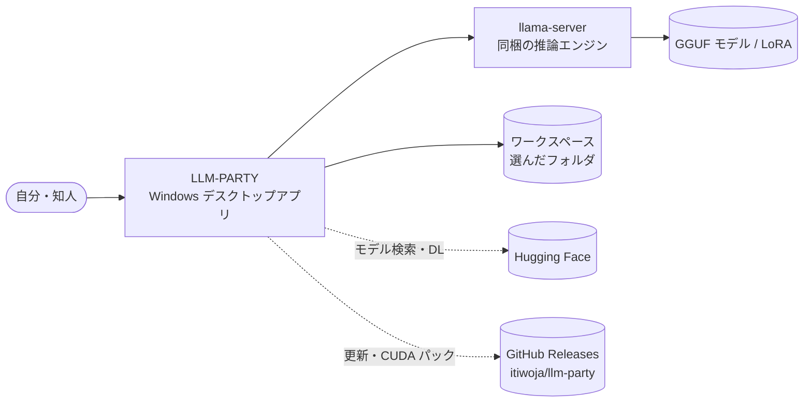

# 00. プロジェクト概要
- プロジェクト：LLM-PARTY（llm-party） ／ 版数：v0.3（2026-11-07） ／ インプット：ヒアリング（2026-11-05）、参考実装 DC-Designer

> **3行で**
> 1. LLM-PARTY は、Qwen3.5 9B などの GGUF モデルを手元の Windows PC で動かし、Codex 風の画面で対話・コーディング・評価ができるデスクトップアプリ。
> 2. 推論は llama.cpp（llama-server）。チューニングしたモデルや LoRA を読み込んで、プリセット単位で評価セットを流して比べるのが主目的。
> 3. アプリ内での学習、Linux / Mac、クラウド API、MCP、Web 検索、画像入力はやらない（[01 §7](01_requirements.md#7-スコープ外wont)）。

**段階**：まず localhost で作って試し、利用者が OK を出してから exe にする（[12](12_localhost_stage.md)）。

## 🧭 判断してほしいこと
なし（全体の論点は [README](README.md) に集約）

## 全体図

見てほしいところ：図は exe 段階の最終形（localhost 段階は [12](12_localhost_stage.md#全体図)）。外への通信は Hugging Face と GitHub の2か所だけ。会話の中身は端末の外へ出ない。

## 要点
- 対象は自分（チューニングして試す人）と、exe を受け取った知人（[01 §4](01_requirements.md#4-利用者ロール)）。
- 用語は下の [用語集](#用語集) で統一する。特に「プリセット」「評価セット」「ラン」。
- 決まったことは [決定事項ログ](#決定事項ログ) に1行ずつ。代替案があったものは [adr/](adr/)。
- 開発は2段階：localhost 段階でブラウザから試し、OK が出たら exe 段階へ進む（D-49）。exe 化・更新の仕組みは DC-Designer に合わせる（D-01〜D-06）。
- ID のたどり方は [トレーサビリティ表](#トレーサビリティ表)。

---

## 詳細

### エレベーターピッチ
手元の GPU でローカル LLM を育てて試したい人のための LLM-PARTY は、「チューニングしたモデルが本当に良くなったのか分からない」という課題を、Codex 風のエージェント画面と評価セットの一括実行で解決するデスクトップアプリである。

### 背景と目的
- Qwen3.5 9B を自分でチューニング（外部の Unsloth や Colab で学習）し、その結果を日常の対話・コーディングで使いながら確かめたい。
- 既存のツールは「対話」と「評価」が別々で、同じ設定のまま比べにくい。プリセット（モデル＋LoRA＋生成設定）を単位に、普段使いと評価を同じアプリで行う。
- 知人にも配り、GitHub に新しい版を出せば各自の PC で更新が通る状態にする。

### 対象ユーザー（ペルソナ概要）
| ペルソナ | 概要 | 詳細 |
|---|---|---|
| P-1 チューナー（開発者本人） | GGUF / LoRA を作って比べる。評価セットを作り込む | [02](02_user_stories.md#ペルソナ) |
| P-2 知人 | exe を入れて対話・コーディング補助に使う。GPU はバラバラ | [02](02_user_stories.md#ペルソナ) |

### スコープ（In / Out）
| In（MVP） | Out（Won't） |
|---|---|
| ローカル対話、ワークスペース内のエージェント、3ペイン GUI | アプリ内での学習（LoRA 学習・変換） |
| HF 検索・DL、ローカル GGUF / LoRA の登録 | Linux / macOS 版（WSL の localhost 段階は検証用で配布しない）、portable / MSI |
| プリセット、評価セット（編集・JSONL 取込/書出・一括実行・3種の採点） | Ollama・クラウド API への接続 |
| Vulkan / CPU 同梱、CUDA 追加パック | MCP、Web 検索ツール、画像入力 |
| NSIS インストーラー、GitHub Releases からの更新 | コード署名（v1 は未署名。SignPath は後で） |

### 用語集
| 用語 | 英語名（コード上の名前） | 定義 |
|---|---|---|
| モデル | model | 推論に使うベースの GGUF ファイル1つ。[TBL-001](08_database.md#tbl-001models) |
| LoRA アダプタ | adapter | llama.cpp が読める GGUF 形式の LoRA。ベースモデルに重ねる。[TBL-002](08_database.md#tbl-002adapters) |
| プリセット | preset | モデル＋LoRA（倍率つき）＋生成設定＋システムプロンプト＋思考モード＋文脈長の組。対話・評価の単位。[TBL-003](08_database.md#tbl-003presets) |
| 推論エンジン | engine | 子プロセスとして動く llama-server。同時に1プリセットだけ読み込む |
| 実行バックエンド | backend | llama-server の種類。`cuda` / `vulkan` / `cpu` |
| ランタイムパック | runtime pack | 追加 DL する llama-server 一式（CUDA 版）。[TBL-015](08_database.md#tbl-015runtime_packs) |
| localhost 段階 | localhost stage | Electron なしで、WSL の worker とブラウザで試す最初の段階。[12](12_localhost_stage.md) |
| exe 段階 | exe stage | localhost 段階で OK が出た後に、Electron に包んで配る段階 |
| ワークスペース | workspace | エージェントが触ってよいフォルダ。[TBL-005](08_database.md#tbl-005workspaces) |
| スレッド | thread | 1つの会話。ワークスペースありなら「エージェント」、なしなら「チャット」 |
| ターン | turn | ユーザーの1回の指示と、それに対するモデルの応答・ツール実行のまとまり |
| ツール呼び出し | tool call | エージェントが行う1回の操作（読む・書く・コマンド実行など） |
| 承認 | approval | 書き込み・コマンド実行の前にユーザーが許可すること |
| 変更記録 | file change | エージェントが書き換えたファイルの前後の中身。差分表示と取り消しに使う |
| 評価セット | eval set | 評価用の問題（ケース）の集まり。[TBL-010](08_database.md#tbl-010eval_sets) |
| ケース | eval case | 評価セットの1問。入力・種類・採点方法を持つ |
| ラン | eval run | 1つの評価セットを1つのプリセットで流した1回。[TBL-012](08_database.md#tbl-012eval_runs) |
| 採点方法 | grader | `match`（文字列一致・正規表現）/ `manual`（人が採点）/ `test`（テストコマンド） |
| 自動要約 | compaction | 文脈が 80% を超えたら古い会話をモデルに要約させて置き換えること |
| worker | worker | Electron の utilityProcess で動く Node のプロセス。API・DB・エージェント・評価を担う |

### 決定事項ログ
| ID | 決定内容 | 決定者 | 理由 | 影響範囲 | ADR |
|---|---|---|---|---|---|
| D-01 | デスクトップの枠組みは Electron＋utilityProcess の worker | ユーザー指定（DC-Designer 準拠） | 既に配布実績のある構成を流用 | 07 全体 | [ADR-001](adr/ADR-001-electron-worker.md) |
| D-02 | インストーラーは NSIS・x64・ユーザーごと・未署名 | ユーザー指定（DC-Designer 準拠） | 管理者権限なしで入る | NFR-020 | — |
| D-03 | 更新は electron-updater＋GitHub Releases（`latest.yml` の sha512、差分 DL なし） | ユーザー指定（DC-Designer 準拠） | public リポジトリならトークン不要 | FR-019 | [ADR-007](adr/ADR-007-update-flow.md) |
| D-04 | 起動ごとに裏で更新確認、DL と適用はそれぞれユーザー操作 | ユーザー指定（DC-Designer 準拠） | 作業中に勝手に再起動しない | FR-019, SCR-009 | [ADR-007](adr/ADR-007-update-flow.md) |
| D-05 | `v*` タグ push → verify → build → 承認つき publish | ユーザー指定（DC-Designer 準拠） | main への push で誤って配布しない | 07 §デプロイ | — |
| D-06 | データは `%LOCALAPPDATA%\llm-party\` 配下、資格情報は safeStorage（DPAPI）で暗号化 | ユーザー指定（DC-Designer 準拠） | 同上 | 08 §方針 | — |
| D-07 | 推論エンジンは llama.cpp（llama-server）を同梱し子プロセスで動かす | ユーザー | 外部インストール不要・LoRA 対応 | FR-003 | [ADR-002](adr/ADR-002-llama-server-child.md) |
| D-08 | チューニングはアプリ外。アプリは読み込み・比較・評価だけ | ユーザー | MVP を小さく | 01 §7 | — |
| D-09 | エージェントはワークスペース内のみ。書き込みとコマンドは既定で承認制 | ユーザー | 9B は誤操作しやすい | FR-010 | [ADR-005](adr/ADR-005-approval-policy.md) |
| D-10 | 知人にも配る（public リポジトリ `itiwoja/llm-party`） | ユーザー | private だと更新にトークンが要る | 07, NFR | — |
| D-11 | Vulkan＋CPU を同梱、CUDA は NVIDIA の人だけ追加 DL（自分の GitHub Releases、sha256 確認） | ユーザー | インストーラーを小さく | FR-001, FR-002 | [ADR-003](adr/ADR-003-gpu-runtime.md) |
| D-12 | モデル入手はアプリ内 DL・ファイル登録・HF 検索の3つ | ユーザー | Qwen 以外も試せる | FR-012, FR-013 | — |
| D-13 | MVP の比較機能は「評価セットの一括実行」。モデル・LoRA・生成設定の切替（プリセット）も Must | ユーザー | — | REQ-005, REQ-006 | — |
| D-14 | 画面は3ペイン（スレッド / 会話 / 差分・端末） | ユーザー | Codex 風 | SCR-001 | — |
| D-15 | 保存は SQLite | ユーザー | 評価の集計・推移が楽 | 08 | [ADR-004](adr/ADR-004-sqlite.md) |
| D-16 | 採点は文字列一致/正規表現・人手・テストコマンドの3種 | ユーザー | — | FR-017 | — |
| D-17 | MCP・Web 検索・画像入力・クラウド API・Linux は Won't | ユーザー | — | 01 §7 | — |
| D-18 | アプリ名は表示「LLM-PARTY」、識別子は `llm-party`、appId `io.github.itiwoja.llmparty` | ユーザー | — | 07 | — |
| D-19 | 対応 OS は Windows 10/11 x64 のみ（Linux は後で検討） | ユーザー | — | NFR-020 | — |
| D-20 | モデル置き場は既定 `%LOCALAPPDATA%\llm-party\models`、設定で変更可。外部 GGUF はコピーせず参照も可 | ユーザー | 容量対策 | FR-013, FR-020 | — |
| D-21 | 評価セットはアプリ内編集と JSONL 取込/書出の両方 | ユーザー | — | FR-015 | — |
| D-22 | 文脈長の既定 32K（設定で変更可） | ユーザー | VRAM 8GB で収まる | NFR-003 | — |
| D-23 | コマンド1回の時間切れ 120 秒 | ユーザー | — | NFR-005 | — |
| D-24 | 1指示あたりのツール呼び出し上限 40 回、超えたら「続ける？」 | ユーザー | ループ対策 | FR-008 | — |
| D-25 | 起動時の更新確認は 10 秒で打ち切り | ユーザー | DC-Designer と同じ | NFR-007 | — |
| D-26 | ツール出力の上限 1回 8,000 トークン（先頭・末尾を残し省略）、2MB 超のファイルは読まない | ユーザー | 文脈を守る | FR-009 | — |
| D-27 | 文脈が 80% を超えたら自動で要約 | ユーザー | — | FR-006 | [ADR-006](adr/ADR-006-auto-compaction.md) |
| D-28 | 生成設定の既定は Qwen 公式推奨値（コーディング用・対話用の2プリセット） | ユーザー | — | FR-014 | — |
| D-29 | 評価1ケースの時間切れ 300 秒（超えたら不合格） | ユーザー | — | FR-016 | — |
| D-30 | ログ保持 14 日 | ユーザー | — | FR-021 | — |
| D-31 | DL 前に「ファイルサイズ＋2GB」の空きを確認、途中再開・自動再試行 3 回 | ユーザー | — | FR-012 | — |
| D-32 | llama-server の起動待ちは 60 秒 | ユーザー | — | FR-003 | — |
| D-33 | 初回のおすすめモデルは `unsloth/Qwen3.5-9B-GGUF` の `Q4_K_M`（5.7GB） | 定石 | DL 数が最も多い素の Qwen3.5 9B の GGUF。Q4_K_M は品質と容量の定番 | FR-012 | — |
| D-34 | ID は ULID、日時は ISO 8601（UTC 保存・表示はローカル） | 定石 | — | 08 | — |
| D-35 | 評価は同時に1ケースずつ順番に実行 | 定石 | GPU は1つ・エンジンは1つ | FR-016 | — |
| D-36 | 1つのワークスペース・1つの評価ランに同時に動くエージェントは1つ | 定石 | 書き込みの衝突を防ぐ | FR-008 | — |
| D-37 | HF の DL は同時に1つ | 定石 | 回線と書き込みを取り合わない | FR-012 | — |
| D-38 | 人手採点 1〜5 点は 4 点以上を合格に数える | ユーザー | — | FR-017 | — |
| D-39 | DB の版上げ前に1世代バックアップ | 定石 | 移行失敗時に戻せる | NFR-023 | — |
| D-40 | worker が落ちたら main が1回だけ起動し直す | ユーザー（D-44 で確認） | — | 07 | — |
| D-41 | 一覧 API は既定 50 件・カーソル方式 | ユーザー（D-44 で確認） | — | 09 | — |
| D-42 | 自動要約で直近 6 メッセージはそのまま残す（システムと最初の指示も残す） | ユーザー | — | FR-006 | [ADR-006](adr/ADR-006-auto-compaction.md) |
| D-43 | 案内する最低動作環境は RAM 16GB・VRAM 8GB | ユーザー | — | NFR-021 | — |
| D-45 | 細部の定石（Claude 判断・見直し可）：ワークスペースにできないフォルダの一覧（FR-007）、スレッドの題名は最初のメッセージの1行目（FR-004）、`list_dir` は `.git`・`node_modules` の中を見せない、`edit_file` は1か所一致のときだけ置換（FR-009）、承認カードの「以後自動承認」（FR-010）、エラーコード 12 種と CORS は `app://llm-party` のみ（09）、評価の agent ケースはケースごとにひな形をコピー（FR-016）、採点の尺度 `pass_fail` / `1to5` とタグ（FR-015）、SSE の再接続で直近のイベントを送り直す（API-099）、開発用の環境変数と `data/`（11 §10）、同梱 llama-server の置き場（07） | Claude 判断（定石） | 業界の定石・DC-Designer の形に合わせた | 各所 | — |
| D-44 | 内部の値：エンジン停止の猶予 5 秒、起動確認の間隔 0.5 秒、失敗時のエラー末尾 20 行、HF 検索 20 件、文脈長の下限 2,048、一覧 50 件、worker の自動再起動 1 回、評価中のエンジン再読込 1 回、DL の記録 30 日 | ユーザー（一覧を確認） | — | FR-003, FR-012, FR-014, FR-016, 07, 08, 09 | — |
| D-46 | 画面の言語は日本語のみ | ユーザー | 利用者は自分と知人。文言の二重管理を避ける | NFR-030, ui/08_copy | — |
| D-47 | スレッドの作成は「新規」1つにまとめ、最初の送信の前にフォルダを選ぶとエージェントになる | ユーザー | 入力欄を主役にする UI 設計に合わせた | FR-004, SCR-001 | — |
| D-48 | 画面の文言の正本は ui/08_copy.md | ユーザー | 文章の声を体言止めでそろえる | 04 の各メッセージ | — |
| D-49 | 先に localhost で試し、OK が出てから exe にする。exe の設計は残す | ユーザー | 試して直す手間を減らす | 12, 07 | [ADR-008](adr/ADR-008-localhost-first.md) |
| D-50 | localhost 段階は WSL で動かし、Windows のブラウザで開く | ユーザー | 今の開発環境のまま進める | 12 | [ADR-008](adr/ADR-008-localhost-first.md) |
| D-51 | localhost 段階のワークスペース・GGUF の指定はパス入力 | ユーザー | 追加の API が要らない。exe で標準ダイアログに差し替える | FR-007, FR-013, FR-015 | — |
| D-52 | localhost 段階の GPU は環境変数で手動指定。自動判定・CUDA パックは exe 段階へ | ユーザー | 知人の PC の違いを吸収する機能なので、本人だけの段階では要らない。手動指定は ADR-011 で改訂 | FR-001, FR-002 | — |
| D-53 | localhost 段階のポートは 8787 に固定（`LLM_PARTY_PORT` で変更可）。使用中なら起動エラー | ユーザー | 毎回同じ URL で開ける | 12, NFR-011 | — |
| D-54 | localhost 段階の細部（Claude 判断・見直し可）：トークンは `data/local-token` に保存して使い回し、起動時の URL で画面に渡す。Host と Origin を確かめる。画面は worker から同一オリジンで配る（開発中は Vite をミドルウェアにする）。HF トークンは API-094 で `data/secrets/` に保存。シェルは bash。データは exe 版へ引き継がない。exe 段階へ進む条件の6項目 | Claude 判断 | 固定 URL とトークン認証を両立し、ポートを1つにする | 12 | — |
| D-55 | SQLite のドライバは better-sqlite3（Q-01 決着） | ユーザー | Electron での実績。Node 24 で FTS5 の動作を確認済み | 07, 08, R-08 | [ADR-004](adr/ADR-004-sqlite.md) |
| D-56 | 生成速度の目安は置かず、評価で毎回測って表示する（Q-09 決着） | ユーザー | GPU で大きく変わり、知人の PC では保証できない | NFR-002, FR-018 | — |
| D-57 | AI の回答は Markdown で表示し、コードブロックは言語ごとに色分けしてコピーボタンを付ける。生成中も順に整形する | ユーザー | コーディング用途で読みやすくする | FR-005, CMP-022 | — |
| D-58 | スレッド検索は3文字以上を FTS5 の `trigram`、2文字以下を `LIKE` で探す | ユーザー | FTS5 の既定では日本語が検索できない。`trigram` は2文字以下を探せない | FR-004, TBL-006 | — |
| D-59 | localhost 段階の開発環境：npm、Node 24 系、llama-server は公式の b12125 `ubuntu-cuda-12.8-x64`、検証モデルは Qwen3.5 9B Q4_K_M、WSL のメモリ上限 8GB は変えない。Q-02 と Q-06 は exe 段階で決める | ユーザー | ビルドと sudo が要らない。9B は VRAM 8GB に収まる | 12, ADR-011 | — |
| D-60 | llama-server は `--parallel 2` で起動し、生成は同時に2本まで（枠は `GENERATION_SLOTS`）。文脈 `-c` は2本で分け合うので、1本あたりは半分になる（文脈の使用量もその値で数える） | ユーザー（改訂） | 同時に2本送れるようにする。改訂前は `--parallel 1`（一度に1つ）。`-c` は変えず、VRAM を増やさない代わりに1本の文脈は半分になる | FR-003, FR-005 | 2026-11-06-parallel-two.md |
| D-61 | 1回の生成の上限は `max_tokens` 8,192。上限に達したら画面に知らせる | ユーザー | 思考 ON の 9B が思考を続けて本文に入らない例があった | FR-005, API-101, CP-207 | — |
| D-62 | 内部の値：SSE の再送用に直近 1,000 件、keep-alive 15 秒、再接続の待ち 1 秒、API の JSON 上限 10MB、文脈と速度の更新 0.5 秒ごと | ユーザー（一覧を確認） | — | API-099, 09 | — |
| D-63 | 生成はアプリ全体で同時に2本まで。同じスレッド・同じワークスペースのターンは1つだけ（D-36）。読み込み（モデル・文脈長・LoRA）が違う生成が動いている間の送信は `BUSY`。画像生成はチャットが動いていない間だけ | Claude 判断・見直し可（改訂） | 読み込みが違うと llama-server を読み直して動いている生成が止まるため、同じ読み込みの生成だけ枠を一緒に持つ | FR-005, API-035 | 2026-11-06-parallel-two.md |
| D-64 | 容量は 10 進で扱う（1GB = 10^9 バイト）。表示も D-31 の余白 2GB も同じ。おすすめモデルは 5.7GB | ユーザー（一覧を確認） | 表示と確認の単位をそろえる | FR-012, FR-013, BR-05 | — |
| D-65 | 内部の値：要約の生成の上限 2,048 トークン、要約に渡すツール結果 1 件 1,000 文字、DL の再試行の待ち 2 秒、DL の進捗 0.5 秒ごと、端末の保持 1 コマンド 20 万文字、コマンド出力のメモリ保持は先頭・末尾 各 1MiB、DL の残り時間は 2 秒後から表示、Qwen 一般の repeat_penalty 1.0 | ユーザー（一覧を確認） | — | FR-006, FR-009, FR-012, FR-014, CMP-011 | — |
| D-66 | エージェントのシステムプロンプトは `server/agent/prompt.ts` の 5 行 | ユーザー | 実物を確認 | FR-005 | — |
| D-67 | 「新しいスレッドで続ける」は `POST /api/threads` の `summaryFromThreadId` で作る。最新の要約を最初のメッセージにし、要約がなければ最初の指示を使う。llama-server が文脈超過で断ったときも CP-050 にする | Claude 判断・見直し可 | `/tokenize` の測定はテンプレートの分を含まず、直近 6 件が大きいと要約できない例が実機で出た | FR-006, API-031 | — |
| D-68 | 実装で足した文言を CP-208 以降に載せた。localhost 段階の HF トークンは平文保存なので CP-171 の代わりに専用の文を出す | Claude 判断・見直し可 | 設計にない文言を実装に残さない | ui/08_copy | — |
| D-69 | 「Qwen3.5 コーディング」の repeat_penalty は 1.05（公式の表に値はなく、D-28 の 1.0 から変更）。対話・一般は 1.0 のまま | ユーザー | 思考 ON で presence も 0 のこのプリセットで、思考が同じ下書きを繰り返した | FR-014, API-101 | — |
| D-70 | 思考の中で 20 文字以上の同じ行が 5 回出たら生成を止め、本文なしでターンを `completed` にして CP-284 を出す。再生成はしない。本文と評価は対象外 | ユーザー | 実ログ 9,579 文字で 5,890 文字目に止まる。本文のコードは同じ行が正当に続き、評価は過去のランと比べる | FR-005, API-101, CP-284 | — |
| D-71 | HF の検索・DL をチャット用の GGUF 以外にも広げる。ジャンルは pipeline_tag、無検閲はタグのスイッチで絞り、形式は問わない。チャットで動かないモデルは保存だけで、モデル一覧に載せない。表示は 50 件。**D-72 で画像モデル、D-78 で ACE-Step 1.5 のレシピを動かせるようにした（この項の「保存だけ」はそれらには当たらない）** | ユーザー | 定番の画像・音声モデルの多くが GGUF でない。一覧に載せるとプリセットで選べてしまい起動に失敗する | FR-012 | D-72 |
| D-72 | 画像モデル（単一の `.safetensors`）をアプリ内で生成に使える。推論は sd-server の子プロセス（ADR-009）。生成は、スレッドの入力欄の「モデル」の選択肢に並ぶ画像モデルを選んで行い（画像モードのボタンは置かない。チャットのプリセットと同じ1か所で切り替える）、結果は履歴に残す（チャットの文脈には入らない）。1 枚 300 秒で打ち切る。画像モデルを読むときはチャットを止め、逆も同じ（同時に1つだけ常駐）。対象は SD 1.x・SDXL など単一ファイル。FLUX・SD3 は v1 では外す | ユーザー | 画像モデルを DL しても使えない不満。VRAM を取り合わないよう常駐は1つ | FR-012, API-095〜096, ADR-009 | — |
| D-73 | MOSS-Image を画像モデルとして動かす。部品（DiT・テキストエンコーダ・VAE・トークナイザ）を「レシピ」として一括で DL し、1 つの画像モデルとして登録する。推論は sd-server に `--diffusion-model` `--llm` `--vae` `--tokenizer` を渡す。既定の部品は unsloth 版の MOSS-Image-SFT の UD-Q4_K_XL（DiT）、Qwen3.5-9B の Q8_0（エンコーダ）、MOSS-Image-SFT-FP8 の VAE・トークナイザ。プロンプトの書き換えは今回入れない。今回の Heretic DHQ GGUF は既定にしない。同梱の sd-server は master-975 以降に上げる。FLUX・SD3 は v1 のまま外す（D-72 の単一ファイル制約は MOSS の分だけ緩める） | ユーザー（対象は MOSS のみ・部品は一括・エンコーダは Qwen3.5-9B 系・書き換えなし）＋ Claude 判断（部品の具体的な版・見直し可） | 検証済みの手順は unsloth の model card の sd-cli 例で、部品を利用者が選ぶと組み合わせの誤りが増える | FR-012, API-097〜098, ADR-010 | Q-14, Q-15, R-17, R-18 |
| D-74 | `LLM_PARTY_LLAMA_BIN` のパスが実在しなければ、読み込みを止めず、警告（CP-313）を出して指定を無視する。あとは未設定と同じで、取得済み → 自動取得の順に進む。警告は帯とターミナルに出し、閉じるボタンは付けない | ユーザー（無視して続ける）＋ Claude 判断（警告の出し方・見直し可） | 仮の値が保存済みの起動コマンドに残り、同じ失敗を繰り返した。手動指定は ADR-011 で必須ではなくなった | FR-003, API-023, API-099, CP-313, ADR-012 | R-19 |
| D-75 | llama-server の取得：初回の読み込みで自動に取る（D1）。取得元は ggml-org の Releases 直接（D2）、NVIDIA があれば CUDA（D3）、置き場は `data/runtime/`（D4）、上限 1GB・再試行 3 回（D5）、sd-server は後回し（D6） | ユーザー（D1）＋ Claude 判断（D2〜D6） | 環境変数だけに頼る設計をやめる。README の Q-16 からここへ移した | FR-002, FR-003, ADR-011 | — |
| D-76 | 入力欄のプリセットの右で、思考を選べる（対応するモデルだけ）。対応はチャットテンプレートの変数で見分ける：`reasoning_effort` があれば低・中・高（既定は中）、`enable_thinking` だけならオン／オフ、両方あればオフ＋3段階。どちらも無いモデルには欄を出さない。選んだ値はプリセットに保存する | ユーザー | 手元の Qwen3.5-9B には ON/OFF しかなく、段階だけだと欄が出ないため。[変更記録](changes/2026-11-07-thinking-effort.md) |
| D-77 | HF の表の目安メモリを容量・VRAM推奨・RAM推奨に分ける。GPU に載せる割合をバーで選べるようにし、表の値と絞り込みに反映する。プリセットにも保存して読み込み時に `-ngl` へ渡す（既定は自動）。RAM推奨には OS とアプリの分 4GB を含む | ユーザー | 目安メモリ1列では何の値か分からなかったため。[変更記録](changes/2026-11-07-gpu-ratio.md) |
| D-78 | 音楽を生成できる。エンジンは acestep.cpp（ADR-013）、モデルは ACE-Step 1.5 の部品（LM 1.7B Q8・DiT turbo Q8・テキストエンコーダ・VAE、約 5.6GB）をレシピで一括 DL する。生成はスレッドの入力欄のモデル選択で音楽モデルを選んで行い、長さ（既定 60 秒・10〜240 秒）・歌なし・歌詞（空なら作詞を任せる）を指定する。時間切れは置かず、止めるボタンで止める。結果は MP3 128kbps で `data/music/` に保存し、履歴に残す（チャットの文脈には入らない）。生成の前にチャットと画像を止める。**モデルは D-79 で XL turbo Q8 に、生成の場所は D-80 で音楽の画面に変えた（長さ・時間切れ・保存形式はこのまま）** | ユーザー（エンジンの入手・モデル・長さ・時間切れ）＋ Claude 判断（入力欄の項目・保存形式。見直し可） | DL した音楽モデルが保存だけで使えなかった。8GB の GPU で動く組み合わせを実機で確かめた。[変更記録](changes/2026-11-07-music-generation.md) | FR-012, API-103〜107, ADR-013 | R-20, R-21 |
| D-79 | 音楽の DiT を XL turbo Q8（5.31GB）に置き換える。レシピの表示名は「ACE-Step 1.5 XL」。登録できたら古い音楽モデルの行と 2B の DiT を消す。共有の部品と曲は残す | ユーザー（置き換え）＋ Claude 判断（Q8・消し方。見直し可） | 8GB の GPU で 240 秒まで完走を実機で確認 | FR-022, API-106, API-107 | [ADR-014](adr/ADR-014-xl-turbo-q8.md) |
| D-80 | 音楽は専用の画面（SCR-010、一覧＋エディタの2列）だけで作る。入力欄の音楽モデルは外し、曲はスレッドから独立させる。過去の曲はスレッドで再生でき、一覧にも出る。利用者は自分だけ | ユーザー | 歌詞の編集には入力欄が狭い。スレッドを消すと曲の記録も消えていた | REQ-014, FR-023〜FR-027, SCR-010, TBL-018 | [ADR-015](adr/ADR-015-music-page.md) |
| D-81 | 歌詞エディタの機能は AI の下書き（`lm_mode: inspire`）・構成タグのボタン・作り直しの3つ。タグは Intro / Verse / Pre-Chorus / Chorus / Bridge / Outro / Instrumental Break の7つ。下書きは歌詞だけを使う。編集中の内容はアプリのメモリに持ち、自動保存はしない | ユーザー（機能）＋ Claude 判断（タグの種類・メモリに持つ点。見直し可） | タグは LM の出力に実際に出たものから選んだ | FR-023, FR-024, FR-026, CMP-023 | R-23 |
| D-82 | 作り直しは毎回新しいシード。曲は確認つきで消せる。長さの上限は 240 秒のまま | ユーザー | 240 秒まで実機で確認済み | FR-025〜FR-027, API-113 | — |
| D-83 | 内部の値：説明 2,000 文字・歌詞 4,000 文字（今のまま）、一覧 50 件（D-41）、`--vae-chunk 384`（ADR-013）、下書きはエンジンを止めない、下書きと生成の時間切れなし、空き VRAM の事前確認なし、音楽の目標値（NFR-051〜NFR-054：下書き 45 秒・60 秒の曲 150 秒・240 秒の曲 6 分・VRAM 7.0GB。実測に余裕を足した値） | Claude 判断（見直し可） | 今の実装と決定に合わせた | FR-023〜FR-027, NFR-051〜NFR-054 | — |

### ID体系
| 接頭辞 | 対象 | ファイル |
|---|---|---|
| REQ-001〜 | 要件 | [01](01_requirements.md) |
| US-001〜 | ユーザーストーリー | [02](02_user_stories.md) |
| UC-001〜 | ユースケース | [03](03_use_cases.md) |
| FR-001〜 | 機能要件 | [04](04_functional_spec/README.md) |
| NFR-001〜 | 非機能要件 | [05](05_non_functional.md) |
| SCR-001〜 | 画面 | [06](06_ux_design.md) |
| TBL-001〜 | テーブル | [08](08_database.md) |
| API-001〜 | IPC・worker API・llama-server | [09](09_api/README.md) |
| ADR-001〜 | 設計判断 | [adr/](adr/) |
| Q-01〜 / R-01〜 | 判断してほしいこと | [README](README.md) |
| D-01〜 | 決定事項 | このファイル |

### トレーサビリティ表
| REQ | US | UC | FR | SCR | API | TBL |
|---|---|---|---|---|---|---|
| REQ-001 ローカル対話 | US-002, US-013 | UC-002 | FR-003, FR-004, FR-005, FR-006 | SCR-001 | API-023〜025, API-030〜036, API-099, API-100〜102 | TBL-006, TBL-007, TBL-017 |
| REQ-002 エージェント | US-003, US-004 | UC-003 | FR-007, FR-008, FR-009, FR-010 | SCR-001 | API-002, API-037〜038, API-041〜042 | TBL-005, TBL-008 |
| REQ-003 3ペイン GUI | US-005 | UC-003 | FR-011 | SCR-001 | API-039 | TBL-009 |
| REQ-004 モデル入手 | US-001, US-006, US-007 | UC-001, UC-004 | FR-012, FR-013 | SCR-002, SCR-003 | API-003, API-007, API-050〜059, API-095〜098, API-105〜107 | TBL-001, TBL-002, TBL-014 |
| REQ-005 プリセット | US-008 | UC-005 | FR-014 | SCR-004 | API-060〜063 | TBL-003, TBL-004 |
| REQ-006 評価 | US-009, US-010 | UC-006, UC-007 | FR-015, FR-016, FR-017, FR-018 | SCR-005, SCR-006, SCR-007 | API-070〜082 | TBL-010〜013 |
| REQ-007 GPU 対応 | US-001, US-012 | UC-001 | FR-001, FR-002 | SCR-002, SCR-008 | API-021〜022 | TBL-015 |
| REQ-008 配布・更新 | US-011 | UC-008 | FR-019 | SCR-009 | API-001, API-004〜006 | — |
| REQ-009 保存と再開 | US-013 | UC-002 | FR-004, FR-020, FR-021 | SCR-001, SCR-008 | API-008〜009, API-033〜034, API-090〜092 | TBL-006, TBL-016 |
| REQ-010 変更の取り消し（Should） | US-014 | UC-003 | FR-011 | SCR-001 | API-040 | TBL-009 |
| REQ-014 音楽の制作（Should） | US-015, US-016, US-017, US-018 | UC-009, UC-010 | FR-022, FR-023, FR-024, FR-025, FR-026, FR-027 | SCR-010 | API-105〜114 | TBL-018 |

### ドキュメント索引
| # | ファイル | 中身 |
|---|---|---|
| — | [README](README.md) | 読む入口・判断してほしいこと |
| 00 | このファイル | 概要・用語・決定事項 |
| 01 | [01_requirements](01_requirements.md) | 要件（REQ） |
| 02 | [02_user_stories](02_user_stories.md) | ユーザーストーリー（US） |
| 03 | [03_use_cases](03_use_cases.md) | ユースケース（UC） |
| 04 | [04_functional_spec/](04_functional_spec/README.md) | 機能仕様（FR） |
| 05 | [05_non_functional](05_non_functional.md) | 非機能要件（NFR） |
| 06 | [06_ux_design](06_ux_design.md) | 画面（SCR） |
| 07 | [07_architecture](07_architecture.md) | アーキテクチャ |
| 08 | [08_database](08_database.md) | DB（TBL） |
| 09 | [09_api/](09_api/README.md) | IPC・worker API・llama-server（API） |
| 10 | [10_diagrams](10_diagrams.md) | ER・シーケンス・状態遷移 |
| 11 | [11_tech_spec](11_tech_spec.md) | 技術仕様書 |

## このドキュメントで決まったこと
- D-01〜D-83（上の決定事項ログ）
