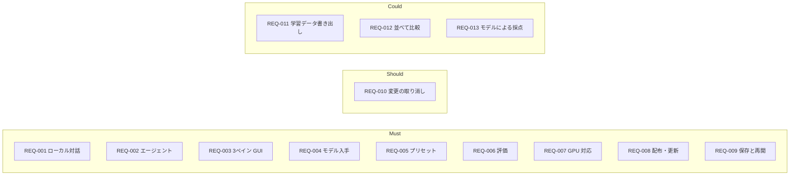

# 01. 要件定義
- プロジェクト：LLM-PARTY ／ 版数：v0.1（2026-11-05） ／ インプット：[00_overview](00_overview.md)

> **3行で**
> 1. 手元の Windows PC で Qwen3.5 9B などの GGUF を動かし、対話・コーディング・評価を1つのアプリで行う（REQ-001〜REQ-009 が Must）。
> 2. 主目的は「チューニングしたモデルをプリセット単位で評価セットにかけて比べる」こと。学習そのものはアプリの外。
> 3. やらないこと：アプリ内学習、Linux / Mac、クラウド API、MCP、Web 検索、画像入力、コード署名（[§7](#7-スコープ外wont)）。

## 🧭 判断してほしいこと
なし

## 全体図

見てほしいところ：比較の中心は REQ-006（評価）。並べて比較（REQ-012）は Could に下げた。

## 要点
- 成功の基準は「新しく作った GGUF / LoRA を登録してから、評価結果を前の版と比べられるまでがアプリだけで済む」こと（[§2](#2-目的成功指標kpi)）。
- 利用者は自分（P-1）と知人（P-2）。権限の区別はない（[§4](#4-利用者ロール)）。
- 制約は Windows 10/11 x64・public リポジトリ・未署名で配る（[§6](#6-制約条件)）。
- Won't は [§7](#7-スコープ外wont)。

---

## 詳細

### 1. 背景・課題
- 外部で Qwen3.5 9B をチューニングしても、普段使いと評価の環境が別々で、改善したのか分かりにくい。
- 既存のローカル LLM アプリは対話が中心で、コーディングエージェントや評価の一括実行がない。
- 知人に配るには、GPU の違いを吸収し、更新も GitHub から自動で届く必要がある。

### 2. 目的・成功指標（KPI）
| 指標 | 目標値 | 計測方法 |
|---|---|---|
| 新モデルの比較までの手数 | GGUF 登録 → プリセット作成 → 評価ラン → 前の版との比較が、アプリの外に出ずに完了する | 手動の受け入れ確認（US-007 → US-008 → US-010） |
| 知人の導入 | 知人がインストーラーと初回セットアップだけで対話を始められる | 知人1名以上での確認 |
| 更新の到達 | `v*` タグの公開後、次の起動で全員に更新の案内が出る | GitHub Releases の公開と起動時確認 |

### 3. ステークホルダー
| 役割 | 関心事 | 関与度 |
|---|---|---|
| 開発者本人（P-1） | チューニングの効果を確かめたい。配布と更新の手間を減らしたい | 高 |
| 知人（P-2） | 入れてすぐ使えること。PC を壊されないこと | 中 |

### 4. 利用者・ロール
| ロール | 説明 | 想定人数 |
|---|---|---|
| 利用者 | 自分の PC で使う人。ログインもロールの区別もない | 本人＋知人数名（10名未満） |

### 5. 要件一覧
| ID | 要件 | 優先度 | 理由 | 段階 |
|---|---|---|---|---|
| REQ-001 | ローカルの GGUF モデルとストリーミングで対話できる（思考モードの表示を含む） | Must | 普段使い | localhost |
| REQ-002 | 選んだフォルダ（ワークスペース）の中で、ファイルの読み書き・検索・コマンド実行をするエージェントに作業を頼める。書き込みとコマンドは承認制 | Must | コーディング用途 | localhost |
| REQ-003 | Codex 風の3ペイン画面（スレッド一覧 / 会話 / 差分・端末出力） | Must | 見た目の要望 | localhost |
| REQ-004 | Hugging Face の GGUF を検索・DL でき、手元の GGUF と LoRA（GGUF 形式）を登録できる | Must | チューニングしたモデルを試す | localhost |
| REQ-005 | モデル・LoRA と倍率・生成設定・システムプロンプト・思考モード・文脈長を「プリセット」として保存し切り替えられる | Must | 比較の単位 | localhost |
| REQ-006 | 評価セットをアプリ内で作り、JSONL で取込・書出できる。プリセットを選んで一括実行し、文字列一致/正規表現・人手・テストコマンドで採点し、ランどうしの比較と推移を見られる | Must | 主目的 | localhost |
| REQ-007 | GPU に合わせて実行バックエンドを選ぶ。Vulkan・CPU は同梱、CUDA は NVIDIA の人だけ追加 DL | Must | 知人の PC がバラバラ | exe（localhost は手動指定） |
| REQ-008 | NSIS インストーラーで配り、GitHub Releases の新版を起動時に知らせて更新できる | Must | 配布 | exe |
| REQ-009 | 会話・評価結果・設定を端末内に保存し、続きから再開できる。ログを残して不具合を追える | Must | 普段使い | localhost |
| REQ-010 | エージェントが書き換えたファイルを1件ずつ元に戻せる | Should | 9B の誤操作対策 | localhost |
| REQ-011 | 会話を学習用 JSONL（SFT 形式）で書き出せる | Could | 次のチューニングの材料 | localhost |
| REQ-012 | 同じ入力を複数プリセットに投げて結果を並べる | Could | 評価で代用できる | localhost |
| REQ-013 | 別のローカルモデルに採点させる（LLM-as-judge） | Could | 3種の採点で足りる | localhost |

### 6. 制約条件
| 種類 | 内容 |
|---|---|
| OS | 配布は Windows 10/11 x64 のみ（D-19）。localhost 段階は開発者の WSL だけで動かす（D-50） |
| 動作環境 | 最低 RAM 16GB・VRAM 8GB の GPU（D-43）。GPU なしでも CPU で動くが案内の対象外 |
| 開発の進め方 | 先に localhost で試し、OK が出てから exe にする（D-49、[12](12_localhost_stage.md)）。「段階」列はその機能を最初に作る段階 |
| 配布 | public リポジトリ `itiwoja/llm-party` の GitHub Releases。v1 は未署名（D-02, D-10） |
| 技術 | exe 段階は DC-Designer と同じ Electron 構成（D-01）。推論は同梱の llama.cpp（D-07） |
| モデル | Qwen3.5 9B は Apache-2.0。LoRA は llama.cpp が読める GGUF 形式に限る（R-03） |
| 体制 | 個人開発。予算はゼロ（GitHub の無料枠） |

### 7. スコープ外（Won't）
| 項目 | 理由 |
|---|---|
| アプリ内での学習・LoRA の変換 | 外部（Unsloth / Colab）で行う（D-08） |
| Linux / macOS 版、portable / MSI | まず Windows だけ（D-19） |
| Ollama・クラウド API への接続 | ローカル同梱エンジンに絞る（D-17） |
| MCP サーバー連携、Web 検索ツール | 同上。外への通信を増やさない |
| 画像入力（mmproj） | 同上 |
| コード署名 | v1 は未署名。SignPath Foundation への申請は後で（R-01） |
| ユーザー登録・同期・複数端末 | 端末ごとに完結 |

## このドキュメントで決まったこと
- D-08, D-13, D-17, D-19（[00 決定事項ログ](00_overview.md#決定事項ログ)）
