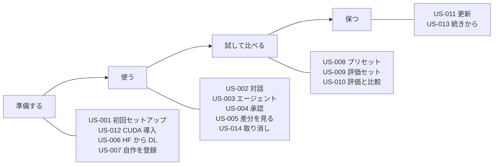

# 02. ユーザーストーリー
- プロジェクト：LLM-PARTY ／ 版数：v0.1（2026-11-05） ／ インプット：[01_requirements](01_requirements.md)

> **3行で**
> 1. ペルソナは2人：チューナー（P-1、開発者本人）と知人（P-2）。ストーリーは US-001〜US-014。
> 2. 中心の流れは「モデルを登録 → プリセットを作る → 評価を流す → 前の版と比べる」（US-007 → US-008 → US-010）。
> 3. Could の要件（REQ-011〜013）のストーリーは書かない。

**段階**：知人向けの US-011・US-012 は exe 段階で作る。US-001 の GPU の受け入れ条件も exe 段階（[12](12_localhost_stage.md)）。

## 🧭 判断してほしいこと
なし

## 全体図

見てほしいところ：P-2（知人）は「準備する」「使う」「保つ」だけで完結し、「試して比べる」は P-1 が主に使う。

## 要点
- ペルソナは [ペルソナ](#ペルソナ)、全体の流れは [ストーリーマップ](#ストーリーマップ)。
- 受け入れ基準はすべて Given/When/Then。数値（40 回・120 秒など）は [00 決定事項ログ](00_overview.md#決定事項ログ) の値と一致させている。

---

## 詳細
以下は詳細層。

## ペルソナ
### P-1：チューナー（開発者本人）
- 属性：WSL で開発する。Unsloth / Colab で LoRA を作り GGUF に変換できる
- 目的：チューニングの効果を、普段使いと評価の両方で確かめたい
- 困りごと：評価の環境と普段使いの環境が別々で、同じ条件で比べにくい
- IT リテラシー：高

### P-2：知人
- 属性：Windows PC を持つ。GPU は NVIDIA / AMD / Intel / なしとバラバラ
- 目的：ローカルで AI と話したり、ちょっとしたコードを書かせたりしたい
- 困りごと：モデルや GPU の設定が分からない。PC を壊されたくない
- IT リテラシー：中

## ストーリーマップ
| アクティビティ | ステップ | ストーリー |
|---|---|---|
| 準備する | 入れる・GPU を合わせる・モデルを用意する | US-001, US-012, US-006, US-007 |
| 使う | 話す・作業を頼む・承認する・結果を見る・戻す | US-002, US-003, US-004, US-005, US-014 |
| 試して比べる | 設定を組む・問題を作る・流して比べる | US-008, US-009, US-010 |
| 保つ | 更新する・続きから使う | US-011, US-013 |

## ストーリー一覧

### US-001：初回セットアップでモデルまで用意する 〔REQ-004, REQ-007〕 Must
**知人として、何も分からなくても使い始めるために、初回起動で GPU の判定とおすすめモデルの DL を済ませたい。**
- Given 初めて起動した When 初回セットアップが開く Then GPU の判定結果と使う実行バックエンドが表示される
- Given 空き容量が「5.7GB＋2GB」以上ある When 「おすすめモデルを DL」を押す Then `Qwen3.5-9B-Q4_K_M.gguf` の DL が進捗つきで始まる
- Given 空き容量が足りない When DL を押す Then DL は始まらず、必要な容量と置き場の変え方が表示される
- Given おすすめモデルの DL が終わった When セットアップを閉じる Then 既定のプリセット2つ（コーディング・対話）が作られ、メイン画面が開く
- Given 手元のファイルを登録した When セットアップを閉じる Then そのモデル名のプリセットが1つ（対話用の推奨値）作られる

### US-002：モデルと対話する 〔REQ-001〕 Must
**利用者として、ちょっとした相談をするために、ワークスペースなしで対話したい。**
- Given プリセットを選んだ When メッセージを送る Then 応答が1文字ずつ表示される
- Given 思考モードが ON When 応答が来る Then 思考部分は折りたたまれて表示され、開けば読める
- Given 応答中 When 「停止」を押す Then 生成が止まり、そこまでの応答が残る
- Given 会話が文脈長の 80% を超えた When 次の送信をする Then 古い会話が自動で要約され、要約したことが会話に表示される

### US-003：エージェントにコーディングを頼む 〔REQ-002〕 Must
**利用者として、手元のコードを直すために、フォルダを選んでエージェントに作業を頼みたい。**
- Given ワークスペースを選んでスレッドを作った When 「〜を直して」と送る Then エージェントがファイルを読み、ツール呼び出しがカードで並ぶ
- Given ツール呼び出しが 1 指示で 40 回に達した When 41 回目に進もうとする Then 止まり「続ける / やめる」を聞かれる
- Given エージェントがワークスペース外のパスを指定した When ツールを実行しようとする Then 実行されず「拒否」と記録され、モデルにも伝わる

### US-004：書き込みとコマンドを承認する 〔REQ-002〕 Must
**利用者として、PC を壊されないために、書き込みとコマンドを実行前に確かめたい。**
- Given エージェントがファイルを書き換えようとした When カードが出る Then 差分のプレビューと「承認 / 却下」が表示される
- Given コマンドの承認を求められた When 承認する Then コマンドが実行され、出力が右パネルの端末に流れる。120 秒を超えたら止まる
- Given スレッドの「自動承認」を ON にした When 書き込み・コマンドが来る Then 承認なしで実行される（ワークスペース外は ON でも拒否）

### US-005：差分と端末出力を見る 〔REQ-003〕 Must
**利用者として、エージェントが何をしたか把握するために、変更と出力を右パネルで見たい。**
- Given エージェントがファイルを書き換えた When 右パネルの「差分」を開く Then スレッドで変わったファイルの一覧と、各ファイルの差分が見られる
- Given コマンドを実行した When 右パネルの「端末」を開く Then コマンドごとの出力と終了コードが見られる

### US-006：Hugging Face からモデルを探して DL する 〔REQ-004〕 Must
**チューナーとして、色々なモデルを試すために、アプリ内でジャンルを絞って検索して DL したい。**
- Given モデル画面で検索した When 結果が出る Then リポジトリ名・ジャンル・ライセンス・DL 数・更新日が並ぶ
- Given リポジトリを開いた When ファイルの一覧が出る Then 量子化の種類とサイズが表示され、選んで DL できる
- Given チャットで動かないモデルを DL した When 完了する Then 置き場に保存され、チャットのモデル一覧には載らない
- Given DL 中に通信が切れた When 再開する Then 途中から続く。自動では 3 回まで再試行する

### US-007：自作の GGUF と LoRA を登録する 〔REQ-004〕 Must
**チューナーとして、チューニング結果を試すために、手元の GGUF と LoRA を登録したい。**
- Given モデル画面で「ファイルを登録」を押した When GGUF を選ぶ Then コピーせずに元の場所を参照して登録される（「モデル置き場へコピー」も選べる）
- Given LoRA の GGUF を登録した When ベースモデルを指定する Then そのモデルのプリセットで LoRA を選べるようになる
- Given 登録した GGUF が後で消された When 一覧を開く Then 「ファイルが見つからない」と表示される

### US-008：プリセットを作って切り替える 〔REQ-005〕 Must
**チューナーとして、条件をそろえて比べるために、モデル・LoRA・生成設定をプリセットに保存したい。**
- Given プリセット画面 When モデル・LoRA と倍率・温度など・システムプロンプト・思考モード・文脈長を入れて保存する Then 一覧に追加される
- Given 会話中 When 入力欄のプリセット選択を変える Then 次の送信から新しいプリセットで応答する（モデルが違えば読み込み直す）

### US-009：評価セットを作る 〔REQ-006〕 Must
**チューナーとして、毎回同じ問題で比べるために、評価セットを作りたい。**
- Given 評価セット画面 When ケースを追加する Then 入力・種類（対話 / エージェント）・採点方法（一致・人手・テスト）を設定できる
- Given JSONL ファイルがある When 取り込む Then 1行1ケースとして登録され、不正な行は行番号つきで報告される
- Given 評価セットがある When 書き出す Then 同じ形式の JSONL が保存される

### US-010：評価を一括実行して比べる 〔REQ-006〕 Must
**チューナーとして、チューニングの効果を確かめるために、評価を流して前の版と比べたい。**
- Given 評価セットとプリセットを選んだ When 実行する Then 1 ケースずつ順に流れ、進捗が見える
- Given 1 ケースが 300 秒を超えた When 時間切れになる Then そのケースは不合格として次へ進む
- Given 人手採点のケースがある When ランが終わる Then 「採点待ち」として残り、結果画面で ○× か 1〜5 点を付けられる
- Given 同じ評価セットのランが2つ以上ある When 比較画面を開く Then ケースごとの合否の違いと、正解率の推移が見える

### US-011：更新を受け取る 〔REQ-008〕 Must（exe 段階）
**知人として、手間なく最新版を使うために、新しい版が出たら知らせてほしい。**
- Given 新しい版が公開された When アプリを起動する Then 10 秒以内に確認され、案内が出る
- Given 案内で「更新する」を押した When DL が終わる Then 「再起動して更新」を押したときだけ入れ替わる
- Given 確認に失敗した When 起動時 Then 何も表示せずに普通に使える

### US-012：NVIDIA GPU で速く動かす 〔REQ-007〕 Must（exe 段階）
**NVIDIA GPU を持つ知人として、速く動かすために、CUDA 版を追加したい。**
- Given NVIDIA GPU が見つかった When 初回セットアップか設定を開く Then 「CUDA パックを追加（約 650MB）」が表示される
- Given CUDA パックを DL した When sha256 が一致する Then 実行バックエンドが CUDA に切り替わる。一致しなければ破棄して Vulkan のまま

### US-013：続きから使う 〔REQ-009〕 Must
**利用者として、昨日の作業を続けるために、過去のスレッドを開いて続きを送りたい。**
- Given スレッド一覧 When スレッドを選ぶ Then 会話・ツール呼び出し・差分がそのまま表示され、続きを送れる（端末の出力は切り詰め後のもの）
- Given スレッドを削除する When 確認で「削除」を押す Then 会話と変更記録が消える（ワークスペースのファイルはそのまま）

### US-014：エージェントの変更を取り消す 〔REQ-010〕 Should
**利用者として、間違った変更を戻すために、ファイルごとに元に戻したい。**
- Given 差分の一覧 When ファイルの「元に戻す」を押す Then エージェントが書き換える前の中身に戻る
- Given その後に人がファイルを編集していた When 「元に戻す」を押す Then 上書きせず「変更後に編集されています」と警告し、続けるか聞く

## このドキュメントで決まったこと
- なし（数値はすべて既存の D-xx に従う）
