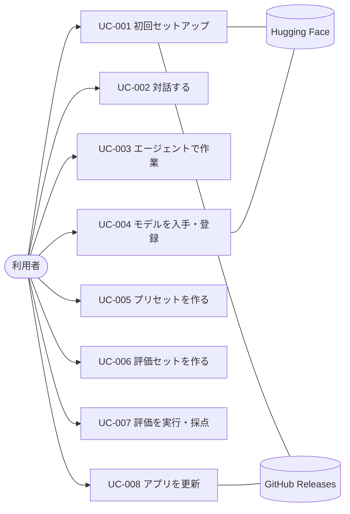

# 03. ユースケース
- プロジェクト：LLM-PARTY ／ 版数：v0.1（2026-11-05） ／ インプット：[02_user_stories](02_user_stories.md)

> **3行で**
> 1. 主要な流れを UC-001〜UC-008 の8本に絞った（小規模のため主フローのみ）。
> 2. いちばん複雑なのは UC-003（エージェント）と UC-007（評価の実行）。どちらも「承認」「時間切れ」「上限」で止まる場所がある。
> 3. ビジネスルール BR-01〜BR-08 は、04 機能仕様の判断の根拠になる。

## 🧭 判断してほしいこと
なし

## 全体図

見てほしいところ：外部システムに触れるのは UC-001・UC-004・UC-008 だけ。対話・エージェント・評価は端末内で閉じる。

## 要点
- アクターは利用者・Hugging Face・GitHub Releases の3つ（[アクター一覧](#アクター一覧)）。
- エージェントの止まる条件：承認待ち・却下・40 回上限・120 秒時間切れ・ワークスペース外（[UC-003](#uc-003エージェントで作業する)）。
- 評価は1ケースずつ順番、300 秒で不合格、人手採点は後から（[UC-007](#uc-007評価を実行採点する)）。
- 判断のルールは [ビジネスルール](#ビジネスルール) にまとめた。

---

## 詳細
以下は詳細層。

## アクター一覧
| アクター | 種別 | 説明 |
|---|---|---|
| 利用者 | 人 | P-1 チューナー / P-2 知人。区別なし |
| Hugging Face | 外部システム | モデル検索 API と GGUF ファイルの配布元 |
| GitHub Releases | 外部システム | アプリ更新（`latest.yml`・exe）と CUDA ランタイムパックの配布元 |

## ユースケース記述

### UC-001：初回セットアップ 〔US-001, US-012〕
- アクター：利用者、Hugging Face、GitHub Releases
- 事前条件：インストール直後。DB にモデルが1件もない
- トリガー：起動時にモデルが0件
- 基本フロー：
  1. アプリが GPU を調べ、使える実行バックエンド（CUDA / Vulkan / CPU）を表示する
  2. NVIDIA GPU があれば CUDA パックの追加を勧める。利用者が選べば UC-001a へ
  3. おすすめモデル（`unsloth/Qwen3.5-9B-GGUF` の Q4_K_M）と置き場を表示する
  4. 利用者が DL を押す。アプリが空き容量を確かめて DL する
  5. 既定プリセット2つ（コーディング・対話）を作り、メイン画面を開く（3a で手元のファイルを使ったときは、そのモデル名のプリセットを1つだけ作る）
- 代替フロー：
  - 2a. 利用者が CUDA を断る → Vulkan のまま進む
  - 3a. 利用者が「手元のファイルを使う」を選ぶ → UC-004 の登録へ
  - 3b. 利用者が置き場を変える → フォルダを選び直して 4 へ
- 例外フロー：
  - E1. 空き容量不足 → DL せず、必要量と置き場の変え方を表示（BR-05）
  - E2. Vulkan も動かない → CPU を選ぶ
  - E3. 通信不可 → 「後で DL」でメイン画面へ。モデル画面からやり直せる
- 事後条件：モデル1件以上・プリセット2件・実行バックエンドが決まっている
- UC-001a（CUDA パック導入）：GitHub Releases から DL → sha256 照合 → 展開 → 起動確認。失敗時は破棄して Vulkan のまま（BR-06）

### UC-002：対話する 〔US-002, US-013〕
- アクター：利用者
- 事前条件：プリセットが1件以上ある
- トリガー：新しいスレッド（ワークスペースなし）か既存スレッドで送信
- 基本フロー：
  1. 利用者がプリセットを選び、メッセージを送る
  2. アプリが必要ならプリセットのモデルを読み込む（BR-01）
  3. 文脈が 80% を超えていれば古い会話を要約する（BR-04）
  4. 応答を1文字ずつ表示する。思考は折りたたむ
  5. 会話を保存する
- 代替フロー：
  - 4a. 利用者が停止 → そこまでの応答を保存して終える
- 例外フロー：
  - E1. モデルの読み込みが 60 秒を超える・失敗 → エラーとログの場所を表示。スレッドは残す
  - E2. 推論エンジンが落ちた → 「再読み込み」を表示。押すと 2 からやり直す
- 事後条件：スレッドに会話が追加されている

### UC-003：エージェントで作業する 〔US-003, US-004, US-005, US-014〕
- アクター：利用者
- 事前条件：ワークスペースを選んだスレッドがある
- トリガー：利用者が指示を送る
- 基本フロー：
  1. アプリがツール一覧つきでモデルに指示を渡す
  2. モデルがツール呼び出しを返す
  3. アプリが承認ポリシー（BR-02）で判定する
     - 読み取り → すぐ実行
     - 書き込み・コマンド → 承認待ちのカードを出す。利用者が承認したら実行
  4. 結果（8,000 トークンまで）をモデルに返し、2 に戻る
  5. モデルがツールを呼ばずに答えたら終える
- 代替フロー：
  - 3a. 利用者が却下 → 「却下された」とモデルに返して 2 へ
  - 3b. 自動承認が ON → 承認を省く（ワークスペース外は拒否のまま）
  - 4a. ツール呼び出しが 40 回に達した → 止めて「続ける / やめる」を聞く（BR-03）
- 例外フロー：
  - E1. ワークスペース外のパス → 拒否してモデルに伝える
  - E2. コマンドが 120 秒を超えた → プロセスごと止め、時間切れとしてモデルに伝える
  - E3. 利用者が停止 → 実行中のコマンドを止め、ターンを「中止」で終える
- 事後条件：ツール呼び出しと変更記録が保存され、右パネルで見られる
- 取り消し（US-014）：変更記録から書き換え前の中身に戻す。その後に別の編集があれば警告（BR-07）

### UC-004：モデルを入手・登録する 〔US-006, US-007〕
- アクター：利用者、Hugging Face
- 事前条件：なし
- トリガー：モデル画面を開く
- 基本フロー（HF）：
  1. 利用者がキーワードで検索する（GGUF のリポジトリに絞る）
  2. リポジトリを選び、GGUF ファイルの一覧（量子化・サイズ）を見る
  3. ファイルを選んで DL。空き容量を確かめて始める（BR-05）
  4. 終わったらモデル一覧に追加する
- 基本フロー（ファイル登録）：
  1. 利用者が GGUF を選ぶ。種類（モデル / LoRA）を選ぶ
  2. アプリが GGUF の先頭を読み、形式と種類が正しいか確かめる
  3. LoRA ならベースモデルを指定する
  4. 「参照」か「置き場へコピー」を選んで登録する
- 例外フロー：
  - E1. 通信が切れた → 途中から自動で 3 回まで再開。それでも失敗なら「失敗」にして手動再開を出す
  - E2. GGUF でない・壊れている → 登録しない
  - E3. ゲート付きリポジトリ → HF トークンの設定を案内する
- 事後条件：モデル / LoRA が一覧にある

### UC-005：プリセットを作る 〔US-008〕
- アクター：利用者
- 基本フロー：モデル → LoRA と倍率 → 生成設定 → システムプロンプト → 思考モード → 文脈長を選び保存する。Qwen 公式推奨値から始められる
- 例外フロー：E1. LoRA のベースモデルが違う → 選べない（BR-08）
- 事後条件：プリセットが一覧にあり、会話と評価で選べる

### UC-006：評価セットを作る 〔US-009〕
- アクター：利用者
- 基本フロー：
  1. 評価セットを作り、ケースを追加する
  2. 各ケースに入力・種類（chat / agent）・採点方法（match / manual / test）を設定する
  3. agent のケースには作業フォルダのひな形（テンプレートフォルダ）を指定する
- 代替フロー：1a. JSONL を取り込む → 不正な行は行番号つきで報告し、正しい行だけ登録する
- 事後条件：評価セットがあり、JSONL に書き出せる

### UC-007：評価を実行・採点する 〔US-010〕
- アクター：利用者
- 事前条件：評価セットとプリセットがある
- 基本フロー：
  1. 評価セットとプリセットを選んで実行する
  2. プリセットのモデルを読み込む
  3. ケースを1つずつ流す（agent のケースは、ひな形をコピーした使い捨てフォルダで自動承認で動かす）
  4. 採点方法ごとに判定する（match：一致・正規表現 / test：テストコマンドの終了コード 0 で合格 / manual：採点待ち）
  5. 全ケースが終わったらランを完了にし、正解率を出す
- 代替フロー：
  - 3a. 1 ケースが 300 秒を超えた → 時間切れで不合格にして次へ
  - 5a. 採点待ちがある → 利用者が結果画面で採点すると正解率が更新される
- 例外フロー：
  - E1. 利用者が中止 → 残りを「未実行」にしてランを中止にする
  - E2. 推論エンジンが落ちた → 1 回だけ読み込み直して続ける。再び落ちたらランを失敗にする
- 事後条件：ランと結果が保存され、比較・推移画面に出る

### UC-008：アプリを更新する 〔US-011〕
- アクター：利用者、GitHub Releases
- 基本フロー：
  1. 起動ごとに裏で `latest.yml` を確かめる（10 秒で打ち切り）
  2. 新しい版があれば案内を出す
  3. 利用者が「更新する」を押すと DL する
  4. 利用者が「再起動して更新」を押すと、実行中の生成・評価を止めて入れ替える
- 代替フロー：2a. 「あとで」→ 次の起動まで案内しない。3a. 手動の「更新を確認」→ 結果を必ず知らせる
- 例外フロー：E1. 確認失敗（起動時）→ 何も出さない。E2. DL 失敗 → エラーを出し、今の版のまま使える
- 事後条件：新しい版で起動する。データはそのまま

## ビジネスルール
| ID | ルール | 使う場所 |
|---|---|---|
| BR-01 | 推論エンジンは同時に1プリセットだけ読み込む。違うモデル・文脈長のプリセットに切り替えるときは読み込み直す。LoRA の倍率と生成設定の違いだけなら読み込み直さない | UC-002, UC-007 |
| BR-02 | 承認ポリシー：読み取りは自動、書き込み・コマンドは承認（自動承認 ON なら省略）、ワークスペース外は常に拒否 | UC-003 |
| BR-03 | 1 指示あたりのツール呼び出しは 40 回まで。超えたら利用者に聞く | UC-003 |
| BR-04 | 文脈が 80% を超えたら自動要約。システムプロンプトと最初の指示は要約しない | UC-002, UC-003 |
| BR-05 | DL の前に「ファイルサイズ＋2GB」の空きを確かめる | UC-001, UC-004 |
| BR-06 | ランタイムパックは sha256 が一致し、起動確認が通ったときだけ使う | UC-001 |
| BR-07 | 取り消しは、変更後にファイルが別に編集されていたら警告して確認する | UC-003 |
| BR-08 | LoRA はベースモデルが一致するプリセットでだけ選べる | UC-005 |

## このドキュメントで決まったこと
- BR-01〜BR-08（数値は D-24, D-27, D-31 など既存の決定に従う）
