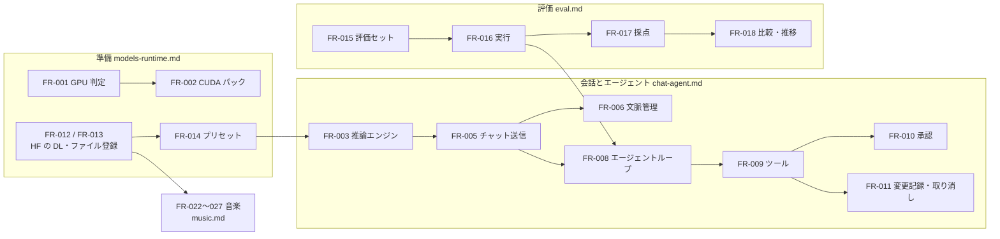

# 04. 機能仕様
- プロジェクト：LLM-PARTY ／ 版数：v0.3（2026-11-07） ／ インプット：[03_use_cases](../03_use_cases.md)

> **3行で**
> 1. 機能は FR-001〜FR-027。分野ごとに5ファイルに分けた（下の表）。
> 2. 振る舞いの中心は「推論エンジン管理（FR-003）」「エージェントループ（FR-008）」「承認ポリシー（FR-010）」「評価の実行（FR-016）」。
> 3. ログインも権限の区別もない。状態を持つものは6つ（ターン・ツール呼び出し・ラン・ケース結果・DL・音楽のジョブ）で、値は [状態の定義](#状態の定義) に集約。

## 🧭 判断してほしいこと
| # | 種類 | 論点 | 選択肢 | おすすめ（理由） | 決まらないと止まるもの |
|---|---|---|---|---|---|
| R-05 | リスク | 9B がツール呼び出しを間違える・同じ操作を繰り返す | — | 形式エラーはモデルに返して直させる。40 回上限（BR-03）で止める | FR-008 |
| R-06 | リスク | 自動要約で大事な指示が落ちる（9B の要約は粗い） | — | システムプロンプトと最初の指示は要約しない（BR-04）。要約前の全文は DB に残し、画面で読める | FR-006 |
| R-10 | リスク | コマンドはワークスペース外にも影響しうる（パスの検査はファイル系ツールだけに効く） | — | コマンドは既定で承認制。自動承認は利用者がスレッドごとに明示して ON。評価では使い捨てフォルダで動かす | FR-009, FR-010 |

## 全体図

見てほしいところ：評価（FR-016）は会話と同じエージェントループ（FR-008）を再利用する。評価専用の推論経路はない。その他（FR-004, FR-007, FR-019〜021）は [app.md](app.md)。

## 要点
- 機能一覧は [機能一覧](#機能一覧)。詳細は分野ごとのファイルへ。
- 承認ポリシーは表と図で定義した（[FR-010](chat-agent.md#fr-010承認ポリシー)）。
- 評価の採点は3種（[FR-017](eval.md#fr-017採点)）。
- 音楽は専用の画面で作る（[music](music.md)）。
- 状態の値は [状態の定義](#状態の定義)。DB・API・状態遷移図と同じ値を使う。

---

## 詳細
以下は詳細層。

## 機能一覧
「段階」列はその機能を最初に作る段階（[12](../12_localhost_stage.md)）。

| ID | 機能名 | 概要 | 関連UC | 優先度 | 詳細 | 段階 |
|---|---|---|---|---|---|---|
| FR-001 | GPU 判定・実行バックエンド選択 | 起動時に使えるバックエンドを調べ、CUDA → Vulkan → CPU の順に選ぶ | UC-001 | Must | [models-runtime](models-runtime.md#fr-001gpu-判定実行バックエンド選択) | exe（localhost は ADR-011 の D3 で自動） |
| FR-002 | ランタイムパック導入 | CUDA 版 llama-server を DL・検証・展開 | UC-001 | Must | [models-runtime](models-runtime.md#fr-002ランタイムパック導入) | exe |
| FR-003 | 推論エンジン管理 | llama-server の起動・停止・切替・死活確認 | UC-002, UC-007 | Must | [chat-agent](chat-agent.md#fr-003推論エンジン管理) | localhost |
| FR-004 | スレッド管理 | 作成・一覧・名前変更・削除・検索 | UC-002 | Must | [app](app.md#fr-004スレッド管理) | localhost |
| FR-005 | チャット送信 | ストリーミング・停止・思考の表示 | UC-002 | Must | [chat-agent](chat-agent.md#fr-005チャット送信) | localhost |
| FR-006 | 文脈管理 | トークン数の計測、80% で自動要約 | UC-002, UC-003 | Must | [chat-agent](chat-agent.md#fr-006文脈管理) | localhost |
| FR-007 | ワークスペース選択 | フォルダを選び、スレッドに結びつける | UC-003 | Must | [app](app.md#fr-007ワークスペース選択) | localhost（パス入力） |
| FR-008 | エージェントループ | ツール呼び出しの繰り返し、40 回上限 | UC-003, UC-007 | Must | [chat-agent](chat-agent.md#fr-008エージェントループ) | localhost |
| FR-009 | ツール群 | 一覧・読む・検索・書く・置換・コマンド | UC-003 | Must | [chat-agent](chat-agent.md#fr-009ツール群) | localhost |
| FR-010 | 承認ポリシー | 自動 / 承認 / 拒否の判定 | UC-003 | Must | [chat-agent](chat-agent.md#fr-010承認ポリシー) | localhost |
| FR-011 | 変更記録・差分・取り消し | 書き換え前後の保存、差分表示、元に戻す | UC-003 | Must（取り消しは Should） | [chat-agent](chat-agent.md#fr-011変更記録差分取り消し) | localhost |
| FR-012 | HF 検索・DL | 検索、ファイル一覧、DL（再開・再試行・容量確認） | UC-001, UC-004 | Must | [models-runtime](models-runtime.md#fr-012hf-検索dl) | localhost |
| FR-013 | ファイル登録 | 手元の GGUF / LoRA を登録（参照 / コピー） | UC-004 | Must | [models-runtime](models-runtime.md#fr-013ファイル登録) | localhost（パス入力） |
| FR-014 | プリセット管理 | 作成・編集・複製・削除、Qwen 推奨値 | UC-005 | Must | [models-runtime](models-runtime.md#fr-014プリセット管理) | localhost |
| FR-015 | 評価セット管理 | ケース編集、JSONL 取込・書出 | UC-006 | Must | [eval](eval.md#fr-015評価セット管理) | localhost（パス入力） |
| FR-016 | 評価の実行 | 1 ケースずつ実行、300 秒で不合格、中止 | UC-007 | Must | [eval](eval.md#fr-016評価の実行) | localhost |
| FR-017 | 採点 | match / manual / test | UC-007 | Must | [eval](eval.md#fr-017採点) | localhost |
| FR-018 | 比較・推移 | ランどうしの比較、正解率の推移 | UC-007 | Must | [eval](eval.md#fr-018比較推移) | localhost |
| FR-019 | 更新 | 起動時確認・DL・適用 | UC-008 | Must | [app](app.md#fr-019更新) | exe |
| FR-020 | 設定 | 置き場・バックエンド・HF トークン・既定値 | UC-001, UC-004 | Must | [app](app.md#fr-020設定) | localhost（一部 exe） |
| FR-021 | ログ・診断 | ログ 14 日、診断情報の書き出し | UC-002 | Must | [app](app.md#fr-021ログ診断) | localhost |
| FR-022 | 音楽モデルの用意 | XL turbo Q8 のレシピ、古いモデルの置き換え | UC-009 | Should | [music](music.md#fr-022音楽モデルの用意) | localhost |
| FR-023 | 歌詞の下書き | LM に歌詞だけを作らせる | UC-009 | Should | [music](music.md#fr-023歌詞の下書き) | localhost |
| FR-024 | 歌詞の編集 | 歌詞の入力、構成タグのボタン | UC-009 | Should | [music](music.md#fr-024歌詞の編集) | localhost |
| FR-025 | 曲の生成 | LM → 合成、保存、止める | UC-009, UC-010 | Should | [music](music.md#fr-025曲の生成) | localhost |
| FR-026 | 作り直し | できた曲の内容をエディタに戻す | UC-010 | Should | [music](music.md#fr-026作り直し) | localhost |
| FR-027 | 曲の一覧と削除 | 新しい順の一覧、再生、確認つきの削除 | UC-009, UC-010 | Should | [music](music.md#fr-027曲の一覧と削除) | localhost |

## 権限マトリクス
ログイン・ロールはない。利用者は全機能を使える。代わりに「エージェントが自分でできること」を [FR-010](chat-agent.md#fr-010承認ポリシー) で制限する。

## 画面の文言
各 FR のメッセージは意味の説明。画面に出す文は [ui/08_copy](../ui/08_copy.md) を正本にする。

## 状態の定義
| 対象 | 値 | 意味 | 遷移可能先 |
|---|---|---|---|
| ターン `turns.status` | `running` | 生成・ツール実行中 | `awaiting_approval`, `step_limit`, `completed`, `cancelled`, `failed` |
| | `awaiting_approval` | 承認待ち | `running`, `cancelled` |
| | `step_limit` | 40 回上限で停止中 | `running`（続ける）, `completed`（やめる） |
| | `completed` / `cancelled` / `failed` | 終了 | — |
| ツール呼び出し `tool_calls.status` | `pending_approval` | 承認待ち | `running`, `rejected` |
| | `running` | 実行中 | `succeeded`, `failed`, `timed_out` |
| | `denied` | ポリシーで拒否（ワークスペース外など） | — |
| | `rejected` / `succeeded` / `failed` / `timed_out` | 終了 | — |
| ラン `eval_runs.status` | `queued` → `running` | 待ち → 実行中 | `completed`, `cancelled`, `failed` |
| ケース結果 `eval_results.status` | `pending` | 未実行 | `running`, `skipped` |
| | `running` | 実行中 | `passed`, `failed`, `needs_review`, `timed_out`, `error` |
| | `needs_review` | 人手採点待ち | `passed`, `failed` |
| | `passed` / `failed` / `timed_out` / `error` / `skipped` | 終了 | — |
| DL `downloads.status` | `queued` → `downloading` | 待ち → 取得中 | `verifying`, `retrying`, `failed`, `cancelled` |
| | `retrying` | 自動再試行（3 回まで） | `downloading`, `failed` |
| | `verifying` | サイズ・形式の確認 | `completed`, `failed` |
| | `failed` | 失敗（手動再開できる） | `downloading`, `cancelled` |
| 音楽のジョブ（DB には持たない） | `idle` | 何も動いていない | `drafting`, `composing` |
| | `drafting` | 歌詞の下書き中 | `idle` |
| | `composing` | 作詞と構成（ace-lm） | `rendering`, `idle` |
| | `rendering` | 音声の生成（ace-synth） | `idle` |
| 推論エンジン（DB には持たない） | `stopped` / `starting` / `ready` / `failed` | [10 状態遷移](../10_diagrams.md#推論エンジン) | — |

## このドキュメントで決まったこと
- D-24, D-26, D-27, D-29, D-31, D-32, D-35, D-36（[00 決定事項ログ](../00_overview.md#決定事項ログ)）
