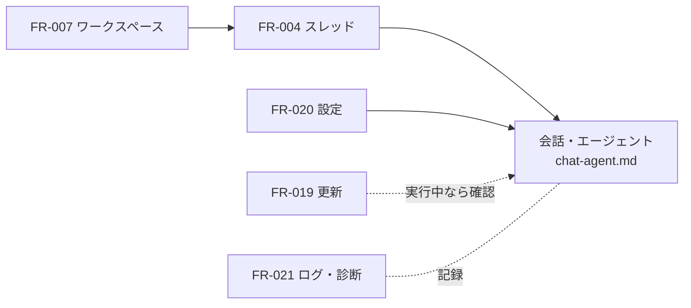

# 04-4. 機能仕様：スレッド・ワークスペース・更新・設定・ログ
- プロジェクト：LLM-PARTY ／ 版数：v0.1（2026-11-05） ／ 親：[04 README](README.md)

> **3行で**
> 1. スレッドは「ワークスペースあり（エージェント）」か「なし（チャット）」。作るときに決め、後から変えない。
> 2. 更新は DC-Designer と同じ流れ（起動時に裏で確認 → 利用者が DL → 利用者が再起動して適用）。
> 3. ログに会話の中身は書かない。14 日で消す。不具合の報告は利用者が「診断情報」を書き出して送る。

## 🧭 判断してほしいこと
なし

## 全体図

見てほしいところ：更新の適用は、生成・評価が動いていれば止めてよいか確認してから行う。

## 要点
- ワークスペースに選べないフォルダ（ドライブ直下・ユーザーフォルダ直下・Windows のシステムフォルダ）がある（[FR-007](#fr-007ワークスペース選択)）。
- 更新の各タイミングは DC-Designer の値に合わせた（[FR-019](#fr-019更新)）。
- 設定の一覧は [FR-020](#fr-020設定)。

---

## 詳細
以下は詳細層。

## FR-004：スレッド管理
〔UC-002〕

- 作成：「新しいチャット」（ワークスペースなし）か「新しいエージェント」（ワークスペースを選ぶ）。プリセットは直前に使ったもの
- 題名：最初のユーザーメッセージの1行目を使う。後から変えられる
- 一覧：更新が新しい順。種類（チャット / エージェント）とワークスペース名を出す
- 検索：題名とメッセージ本文の全文検索（SQLite FTS5）
- 削除：確認のうえ、メッセージ・ツール呼び出し・変更記録を消す。ワークスペースのファイルは消さない。動いているターンがあれば先に止める

## FR-007：ワークスペース選択
〔UC-003〕

- 入力：フォルダ（フォルダ選択ダイアログ。API-002）
- 検証：

  | 条件 | 挙動 |
  |---|---|
  | 存在しない | 選べない |
  | ドライブ直下（`C:\` など）・ユーザーフォルダ直下・`C:\Windows`・`C:\Program Files*`・アプリのデータフォルダ | 「このフォルダはワークスペースにできません」 |
  | それ以外 | 登録（同じパスは使い回す） |
- スレッドに結びつけたワークスペースは後から変えない（別のフォルダは新しいスレッドで）
- 実際のパス（リンクを辿った後）で保存し、FR-010 の判定に使う

## FR-019：更新
〔UC-008〕 DC-Designer の更新設計に合わせる（D-03, D-04、[ADR-007](../adr/ADR-007-update-flow.md)）。

| 場面 | 挙動 |
|---|---|
| 起動時 | 画面の表示を待たずに裏で確認。10 秒で打ち切り（D-25）。新しい版があるときだけ案内を出す。失敗は黙る |
| 手動「更新を確認」 | 結果を必ず知らせる（最新 / 新しい版あり / 失敗）。30 秒以内の押し直しは通信しない |
| 案内で「更新する」 | DL する（進捗を出す）。差分 DL はしない |
| 「あとで」 | 次の起動まで案内しない |
| 「再起動して更新」 | 生成・評価・DL が動いていれば「止めて更新しますか」と確認 → 止めて保存を確かめてから入れ替える。15 秒で入れ替わらなければエラー |
| 失敗 | エラーを出し、今の版のまま使える |

- 開発版（インストールしていない状態）では動かさない
- プレリリースには進まない。古い版には戻さない

## FR-020：設定
〔UC-001, UC-004〕

| 項目 | 既定 | 説明 |
|---|---|---|
| モデルの置き場 | `%LOCALAPPDATA%\llm-party\models` | 変えると、以後の DL・コピーは新しい場所へ。今あるファイルは動かさない（D-20） |
| 実行バックエンド | 自動 | 自動 / CUDA / Vulkan / CPU。「再判定」ボタン（FR-001） |
| CUDA パック | — | 追加 / 削除 / 状態（FR-002） |
| HF トークン | なし | 入れる / 消す。中身は表示しない（D-06） |
| 新しいスレッドの自動承認 | OFF | FR-010 |
| 新しいプリセットの文脈長 | 32768 | D-22 |
| 起動時に更新を確認 | ON | FR-019 |
| テーマ | システムに合わせる | ライト / ダーク / システム |

## FR-021：ログ・診断
〔UC-002〕

- 書くもの：アプリ（main・worker）の動作とエラー、llama-server の出力。会話の本文・ファイルの中身・HF トークンは書かない
- 置き場：`%LOCALAPPDATA%\llm-party\logs\`（日ごとのファイル）。起動時に 14 日より古いものを消す（D-30）
- 診断情報の書き出し：設定画面のボタンで、ログ・アプリと llama.cpp の版・GPU の判定結果・設定（トークンを除く）を1つの zip にして、利用者が選んだ場所に保存する。アプリから外へは送らない
- 「ログフォルダを開く」ボタン（API-009）

## このドキュメントで決まったこと
- D-03, D-04, D-06, D-20, D-22, D-25, D-30（[00 決定事項ログ](../00_overview.md#決定事項ログ)）
- [ADR-007](../adr/ADR-007-update-flow.md)
