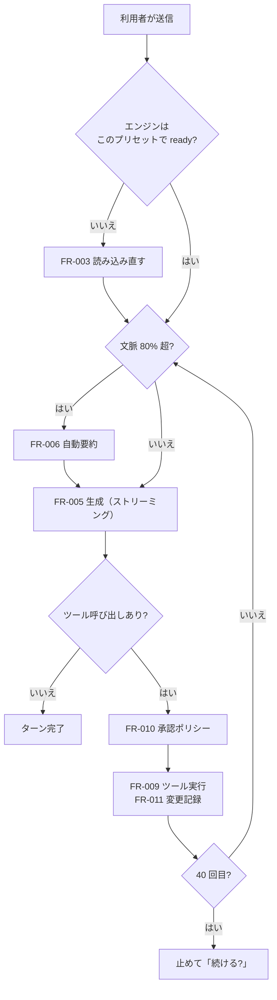
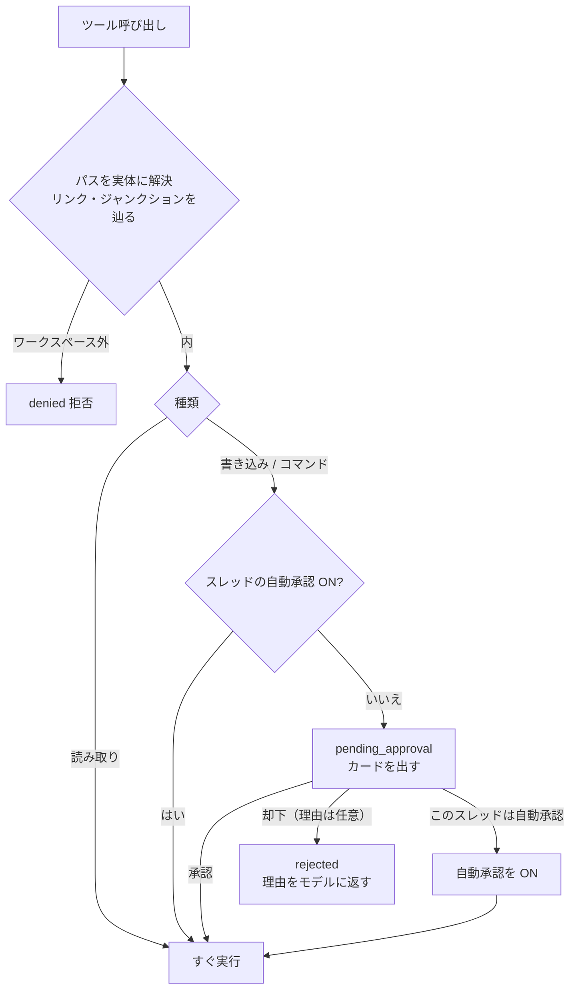

# 04-2. 機能仕様：会話とエージェント
- プロジェクト：LLM-PARTY ／ 版数：v0.2（2026-11-07） ／ 親：[04 README](README.md)

> **3行で**
> 1. 推論エンジン（llama-server）を1つだけ動かし、会話もエージェントも評価もそこへ OpenAI 互換の `/v1/chat/completions` で投げる。
> 2. エージェントは6つのツールを持ち、読み取りは自動・書き込みとコマンドは承認・ワークスペース外は拒否。
> 3. ツール出力は 8,000 トークン、ツール呼び出しは 40 回、コマンドは 120 秒、文脈は 80% で自動要約。

## 🧭 判断してほしいこと
| # | 種類 | 論点 | 選択肢 | おすすめ（理由） | 決まらないと止まるもの |
|---|---|---|---|---|---|
| R-04 | リスク | 9B と b12125 で `chat_template_kwargs.enable_thinking` がリクエストごとに効くことを確認済み。`lora` は `/v1/chat/completions` が受け取ることをソースで確認済みで、倍率が効くことの実機確認だけ残る（手元に LoRA の GGUF がない） | — | 手元の LoRA で確かめる（[exe 段階へ進む条件](../12_localhost_stage.md#exe-段階へ進む条件)の1）。だめなら、倍率・思考モードが違うときもエンジンを読み込み直す（BR-01 を変更） | FR-003, FR-005 |

その他の論点（Q-06, R-05, R-06, R-10）は [04 README](README.md#-判断してほしいこと)。

## 全体図

見てほしいところ：ツールを1回実行するたびに文脈を測り直す。チャット（ワークスペースなし）は「ツール呼び出しあり?」に進まない。

## 要点
- エンジンの起動引数と死活確認は [FR-003](#fr-003推論エンジン管理)。
- 1 回の生成で何を送るかは [FR-005](#fr-005チャット送信)。
- ツールの一覧と上限は [FR-009](#fr-009ツール群)、承認の判定は [FR-010](#fr-010承認ポリシー)。
- 取り消しは書き換え前の中身を DB に持つことで実現する（[FR-011](#fr-011変更記録差分取り消し)）。

---

## 詳細
以下は詳細層。

## FR-003：推論エンジン管理
〔UC-002, UC-007〕 worker が llama-server を子プロセスとして1つだけ動かす。

- 入力：プリセット ID
- 処理：
  1. 読み込み中・読み込み済みのプリセットと「モデル・文脈長・LoRA の組」が同じなら何もしない（BR-01）
  2. 動いている llama-server を止める（終了要求 → 5 秒で応答がなければプロセスツリーごと終了）
  3. 実行バックエンド（FR-001）の `llama-server.exe` を次の引数で起動する

     

     
起動引数

     | 引数 | 値 | 理由 |
     |---|---|---|
     | `-m` | モデルのパス | |
     | `-c` | プリセットの文脈長（既定 32768） | D-22 |
     | `-ngl` | `auto`（CPU バックエンドでは 0） | VRAM に合わせて載せる |
     | `--host` / `--port` | `127.0.0.1` / 空きポート | 外から繋がせない |
     | `--api-key` | 起動ごとの乱数 | 同じ PC の他プロセスからの利用を防ぐ |
     | `--parallel` | `2` | D-60（改訂）。枠の数と同じ。`-c` は2本で分けるので、1本の文脈は半分（`contextSize / 2`）で数える
     | `--jinja` | 有効 | Qwen3.5 のチャットテンプレートとツール呼び出し |
     | `--lora` + `--lora-init-without-apply` | プリセットの LoRA（カンマ区切り） | 倍率はリクエストごとに指定（R-04） |
     | `--no-webui` 相当 | 有効 | 同梱の Web UI は使わない |

     

  4. `GET /health`（API-100）を 500 ミリ秒ごとに確かめ、200 になったら `ready`。60 秒で `failed`（D-32）
  5. 状態を `engine` イベント（API-099）で画面に知らせる
- 出力：エンジンの状態（`stopped` / `starting` / `ready` / `failed` / `installing`）、読み込み中のプリセット ID、使用中のバックエンド、警告（任意）
- エラー・例外：

  | 条件 | 挙動 | メッセージ |
  |---|---|---|
  | 60 秒で ready にならない | プロセスを止めて `failed` | 「モデルを読み込めませんでした（60 秒）。ログを開く」 |
  | 起動直後に終了（VRAM 不足など） | `failed`。標準エラーの末尾 20 行を表示 | 「モデルの読み込みに失敗しました」＋末尾 |
  | 動作中に終了 | `failed`。生成中のターンは `failed` | 「推論エンジンが停止しました。再読み込み」 |
- その他：
  - localhost 段階の本体の決め方は [12](../12_localhost_stage.md#llama-server-の用意)。`LLM_PARTY_LLAMA_BIN` のパスが実在しないときは `failed` にせず、警告（CP-313）を出して続ける（[ADR-012](../adr/ADR-012-invalid-llama-override.md)）
  - 標準出力・標準エラーは `logs/llama-server-YYYYMMDD.log` に書く（FR-021）
  - worker の起動時、前回のプロセスが残っていれば（`runtime/engine.pid`）止める
  - アプリ終了時は必ず止める

## FR-005：チャット送信
〔UC-002〕

- 入力：

  | 項目 | 型 | 必須 | バリデーション |
  |---|---|---|---|
  | threadId | ULID | ○ | 存在するスレッド |
  | presetId | ULID | ○ | 存在するプリセット |
  | content | 文字列 | ○ | 空でない |
- 処理：
  1. ユーザーメッセージを保存し、ターンを `running` で作る
  2. FR-003 でエンジンを用意し、FR-006 で文脈を確かめる
  3. `POST /v1/chat/completions`（API-101）を `stream: true` で呼ぶ。送るもの：システムプロンプト（エージェントならツールの使い方を足す）、会話、生成設定、`lora`（倍率）、`chat_template_kwargs.enable_thinking`（段階に対応するモデルは `reasoning_effort` も。D-76）、エージェントなら `tools`
  4. 受け取った差分を `turn.delta` イベントで画面へ流す。思考（`reasoning_content`）と本文を分けて保存する
  5. 応答の終わりで、ツール呼び出しがあれば FR-008 へ。なければターンを `completed`
- 上限：1回の生成は 8,192 トークンまで（D-61）。上限に達したら本文を保存してターンを `completed` にし、CP-207 を出す
- ループの検知：思考の中で 20 文字以上の同じ行が 5 回出たら接続を切って生成を止め、ターンを `completed` にして CP-284 を出す（D-70）。短い行は数えない。本文と評価には使わない
- 表示：本文は Markdown として表示する（[CMP-022](../ui/04_components.md#cmp-022-markdown-本文)）。生成中も届いた分を順に整形する（D-57）
- 停止：生成中の HTTP を切り、そこまでの本文を保存してターンを `cancelled`
- エラー：エンジンの HTTP エラー → ターンを `failed`、エラー内容を会話に表示

## FR-006：文脈管理
〔UC-002, UC-003〕

- 測り方：直前の応答の `usage`（入力＋出力トークン）に、新しく足すメッセージを `POST /tokenize`（API-102）で数えた分を加える
- 処理：

  | 使用量 | 挙動 |
  |---|---|
  | 80% 以下 | そのまま送る |
  | 80% 超 | 自動要約してから送る |
  | 要約後も 100% を超える | 送らずに「文脈がいっぱいです。新しいスレッドで続ける」を出す（要約を最初のメッセージにした新スレッドを作れる） |
- 自動要約：
  1. 残すもの：システムプロンプト、スレッドの最初のユーザー指示、直近 6 メッセージ（D-42）
  2. それ以外を同じモデル・思考 OFF で「目的・決まったこと・触ったファイル・残りの作業」の見出しで要約させる
  3. 要約を `role = summary` のメッセージとして保存し、要約した元メッセージに `compacted_at` を付ける（消さない。画面では「要約済み」として折りたためる）
- 画面：入力欄の下に使用量（%）と生成速度（トークン/秒）を出す

## FR-008：エージェントループ
〔UC-003, UC-007〕 ワークスペースのあるスレッドだけで動く。

- 処理：
  1. モデルの応答にツール呼び出しがあれば、並んだ順に1つずつ処理する
  2. 名前が不明・引数が JSON として壊れている → 実行せず、エラー内容をツール結果としてモデルに返す（1 回に数える）
  3. FR-010 で判定し、FR-009 で実行する。結果をツール結果として会話に足す
  4. 1 指示のツール呼び出しが 40 回に達したら、ターンを `step_limit` にして「続ける / やめる」を聞く。「続ける」でさらに 40 回（D-24）
  5. モデルがツールを呼ばずに答えたら `completed`
- 同時実行：生成は同時に2本まで（D-63）。同じスレッド・同じワークスペースで動くターンは1つだけ（D-36）。表示中のスレッドのターンが動いている間は送信ボタンを「停止」に変える。別のスレッドのターンは、その画面を開いている間も止めない

## FR-009：ツール群
〔UC-003〕 引数のパスはすべてワークスペースからの相対パス。

| ツール | 種類 | 引数 | 振る舞い |
|---|---|---|---|
| `list_dir` | 読み取り | path, depth（既定 1） | ファイル・フォルダの一覧。`.git` と `node_modules` は中を見せない |
| `read_file` | 読み取り | path, startLine?, endLine? | テキストを行番号つきで返す。2MB 超・バイナリは読まない |
| `search` | 読み取り | pattern（正規表現）, path?, glob? | 一致した行を「パス:行番号: 内容」で返す |
| `write_file` | 書き込み | path, content | 新規作成または全体の上書き。フォルダがなければ作る |
| `edit_file` | 書き込み | path, oldText, newText, replaceAll? | `oldText` が1か所だけ一致するときに置換（`replaceAll` なら全部）。0 か所・複数は失敗としてモデルに返す |
| `run_command` | コマンド | command, cwd? | シェル（Q-06。localhost 段階は bash）で実行。cwd はワークスペース内。120 秒で終了（D-23）。終了コードと出力を返す |

- 出力の上限：1 回 8,000 トークン（D-26）。超えたら先頭と末尾を残し、間に「…N 行省略。startLine / endLine を指定して読めます…」を入れる
- `run_command` の時間切れ・停止はプロセスツリーごと終了する（`taskkill /T /F` 相当）
- 実行中のコマンドの出力は `tool.output` イベントで右パネルの端末に流す。保存するのはモデルに返した出力（切り詰め後）だけなので、スレッドを開き直したときの端末にはその出力を出す

## FR-010：承認ポリシー
〔UC-003〕 BR-02 の実装。

- 書き込みのカードには差分のプレビューを、コマンドのカードにはコマンドと cwd を出す
- 自動承認はスレッドごと。既定は OFF（設定で既定を変えられる。FR-020）
- 評価のラン（FR-016）は使い捨てフォルダの中で自動承認 ON で動く

## FR-011：変更記録・差分・取り消し
〔UC-003〕

- 記録：`write_file` / `edit_file` の実行前の中身（新規なら「なし」）と実行後の中身・ハッシュを `file_changes` に保存する
- 差分：右パネルの「差分」にスレッドで変わったファイルを並べ、選ぶと前後の差分（unified）を出す。同じファイルの複数回の変更はまとめた差分と1回ずつの差分を切り替えられる
- 取り消し（Should）：
  1. 今のファイルのハッシュが記録した「実行後」と同じ → 実行前の中身に戻す（新規だったなら消す）
  2. 違う → 「変更後に編集されています」と警告し、利用者が続けたときだけ戻す（BR-07）
  3. 戻したことも `file_changes` に記録する（`reverted_at`）

## このドキュメントで決まったこと
- D-22〜D-24, D-26, D-27, D-32, D-36, D-42, D-44, D-76（[00 決定事項ログ](../00_overview.md#決定事項ログ)）
- [ADR-002](../adr/ADR-002-llama-server-child.md)、[ADR-005](../adr/ADR-005-approval-policy.md)、[ADR-006](../adr/ADR-006-auto-compaction.md)
