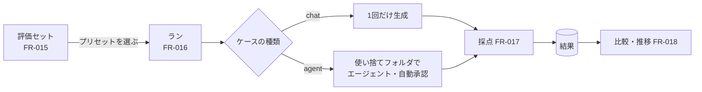

# 04-3. 機能仕様：評価
- プロジェクト：LLM-PARTY ／ 版数：v0.1（2026-11-05） ／ 親：[04 README](README.md)

> **3行で**
> 1. 評価セット＝ケースの集まり。ケースは「対話（chat）」か「エージェント（agent）」で、採点は一致・人手・テストの3種。
> 2. ランは「評価セット × プリセット」の1回。ケースは1つずつ、毎回まっさらな文脈で流し、1ケース 300 秒で打ち切る。
> 3. 結果は比較（2ランのケースごとの差）と推移（正解率の折れ線）で見る。

## 🧭 判断してほしいこと
なし

## 全体図

見てほしいところ：agent のケースはワークスペースのコピーの中でだけ動くので、本物のフォルダには触れない。

## 要点
- JSONL の1行＝1ケース。形式は [JSONL の形式](#jsonl-の形式)。
- 採点の判定は [FR-017](#fr-017採点) の表。人手採点は後から付けられる。
- 実行中は他のプリセットで会話できない（エンジンが1つのため。[FR-016](#fr-016評価の実行)）。

---

## 詳細
以下は詳細層。

## FR-015：評価セット管理
〔UC-006〕

- 評価セットの項目：名前、説明、ひな形フォルダの置き場（`fixturesDir`。agent / test のケースが使う）
- ケースの項目：

  | 項目 | 型 | 必須 | バリデーション |
  |---|---|---|---|
  | name | 文字列 | ○ | セット内で重複不可 |
  | kind | `chat` / `agent` | ○ | |
  | input | 文字列 | ○ | 空でない |
  | fixture | 文字列 | agent のとき ○ | `fixturesDir` からの相対パスで、存在するフォルダ |
  | grader | オブジェクト | ○ | 下の [JSONL の形式](#jsonl-の形式) |
  | tags | 文字列[] | — | 比較・推移の絞り込みに使う |
- 画面でケースを追加・編集・並べ替え・削除できる
- 取り込み：JSONL を1行ずつ検証し、正しい行だけ追加する。不正な行は「行番号：理由」で一覧にする。同名のケースは「上書き / 飛ばす」を選ぶ
- 書き出し：同じ形式の JSONL を保存する（`fixturesDir` の中身は含めない）

### JSONL の形式
<details>
<summary>1行の例（3種の採点）</summary>

```json
{"name":"挨拶","kind":"chat","input":"日本語で自己紹介して","grader":{"type":"match","mode":"regex","expected":"(私|わたし)は","ignoreCase":true},"tags":["日本語"]}
{"name":"丁寧さ","kind":"chat","input":"上司への謝罪メールを書いて","grader":{"type":"manual","scale":"1to5","rubric":"敬語が正しく、言い訳がない"}}
{"name":"fizzbuzz修正","kind":"agent","input":"fizzbuzz.py のバグを直して","fixture":"fizzbuzz","grader":{"type":"test","command":"python -m pytest -q"},"tags":["python"]}
```

| grader.type | 項目 |
|---|---|
| `match` | `mode`（`contains` / `exact` / `regex`）、`expected`、`ignoreCase`（既定 false） |
| `manual` | `scale`（`pass_fail` / `1to5`）、`rubric`（採点の目安。任意） |
| `test` | `command`（作業フォルダで実行し、終了コード 0 で合格） |

</details>

## FR-016：評価の実行
〔UC-007〕

- 入力：評価セット、プリセット（複数選べる。選んだ数だけランを作り、順番に流す）、タグでの絞り込み（任意）
- 処理：
  1. ランを `queued` で作り、プリセットの中身（モデルのパスとハッシュ、LoRA と倍率、生成設定、システムプロンプト、思考、文脈長）を写して保存する
  2. 順番が来たら `running` にし、FR-003 でエンジンを用意する
  3. ケースを1つずつ流す。毎回まっさらな文脈で、前のケースの会話は持ち越さない（D-35）
     - `chat`：1回だけ生成する（ツールなし）
     - `agent`：`fixture` を `eval-workspaces\<runId>\<caseName>\` にコピーし、そこをワークスペースとして FR-008 を自動承認で動かす
  4. 採点（FR-017）。トークン数・生成速度（トークン/秒）・かかった時間も記録する
  5. 1ケースが 300 秒を超えたら止めて `timed_out`（不合格に数える）（D-29）
  6. 全ケースが終わったら `completed` にし、正解率を出す
- 中止：実行中のケースを止め、残りを `skipped`、ランを `cancelled`
- エンジンが落ちた：1 回だけ読み込み直してそのケースからやり直す。2 回目は `failed`（UC-007 E2）
- 実行中の会話：ランと同じプリセットなら送れる（ケースの合間に処理）。違うプリセットは「評価の実行中です」と出して送らない
- 進捗は `eval.progress` イベントで画面へ（何問目か・合格数）
- 使い捨てフォルダはランを削除するときに消す

## FR-017：採点
〔UC-007〕 判定の対象は最終応答の本文（思考は除く）。agent の `test` はフォルダの状態。

| grader | 判定 | 結果 |
|---|---|---|
| `match` / `contains` | 本文に `expected` を含む | `passed` / `failed` |
| `match` / `exact` | 前後の空白を除いて `expected` と一致 | `passed` / `failed` |
| `match` / `regex` | 本文が正規表現に一致（`ignoreCase` なら `i`） | `passed` / `failed`。正規表現が不正なら `error` |
| `manual` / `pass_fail` | 人が ○× を付ける | `needs_review` → `passed` / `failed` |
| `manual` / `1to5` | 人が 1〜5 点を付ける | `needs_review` → 点数（4 点以上を `passed`） |
| `test` | 作業フォルダで `command` を実行（FR-009 と同じシェル・残り時間内）し、終了コード 0 なら合格 | `passed` / `failed`。出力は結果に残す |

- 正解率 = `passed` ÷（`needs_review` と `skipped` を除いたケース数）。`1to5` は平均点も別に出す
- 人手採点は結果画面で付け直せる。付けるたびに正解率を計算し直す

## FR-018：比較・推移
〔UC-007〕

- 比較：同じ評価セットのランを2つ選び、ケースごとに結果を並べる。「良くなった（不合格→合格）」「悪くなった（合格→不合格）」「同じ」で色分けし、悪くなったものを先頭に出す。ケースを開くと両方の応答・ツール呼び出しを横に並べて見られる
- 推移：評価セットごとに、ランの正解率を時系列の折れ線で出す。線はプリセット名ごと。タグで絞り込める
- 一覧には正解率・平均点・平均トークン/秒・合計時間を出す（速度もチューニングの比較材料にする）

## このドキュメントで決まったこと
- D-16, D-21, D-29, D-35（[00 決定事項ログ](../00_overview.md#決定事項ログ)）
- D-38：`1to5` の合格ラインは 4 点以上（ユーザー）
