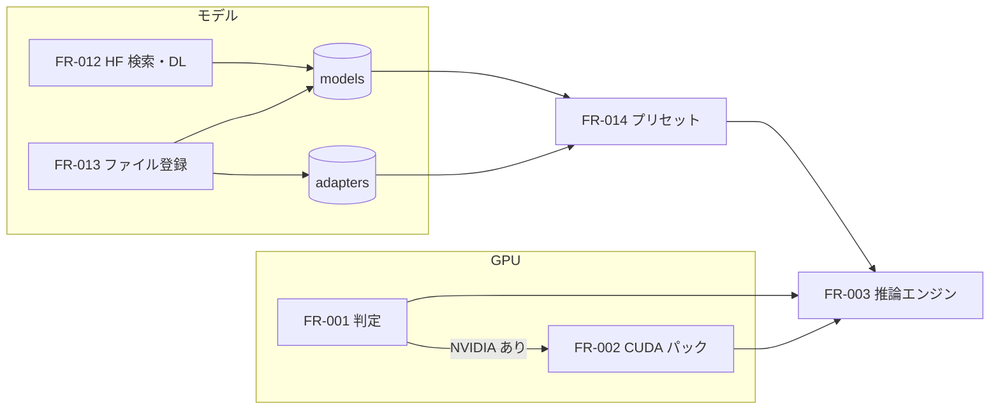

# 04-1. 機能仕様：準備（GPU・モデル・プリセット）
- プロジェクト：LLM-PARTY ／ 版数：v0.1（2026-11-05） ／ 親：[04 README](README.md)

> **3行で**
> 1. 実行バックエンドは CUDA → Vulkan → CPU の順に、使えるものを自動で選ぶ。CUDA は追加のランタイムパックとして DL する。
> 2. モデルは HF から DL するか、手元の GGUF を登録する。LoRA も GGUF 形式で登録し、ベースモデルに結びつける。
> 3. プリセットは「モデル＋LoRA＋生成設定＋システムプロンプト＋思考モード＋文脈長」。既定は Qwen 公式推奨値の2つ。

## 🧭 判断してほしいこと
| # | 種類 | 論点 | 選択肢 | おすすめ（理由） | 決まらないと止まるもの |
|---|---|---|---|---|---|
| Q-02 | 未決 | CUDA パックの CUDA の版 | A: 12.4（llama 275MB＋cudart 373MB ≒ 650MB） / B: 13.4（162MB＋403MB ≒ 565MB） | A（古いドライバの PC でも動く。13.x は新しいドライバが必要） | FR-002, CI |
| R-02 | リスク | アプリ更新で同梱の llama.cpp の版が変わると、DL 済みの CUDA パックと版がずれる | — | パックに llama.cpp のビルド番号を持たせ、ずれたら Vulkan に戻して再 DL を案内する（[FR-002](#fr-002ランタイムパック導入)） | FR-002 |
| R-03 | リスク | Unsloth などで作った LoRA（PEFT 形式）はそのまま読めない | — | 登録時に GGUF の種類を確かめ、違えば「llama.cpp の `convert_lora_to_gguf.py` で変換してください」と案内する | FR-013 |
| R-09 | リスク | CUDA ランタイム（cudart）を自分の Releases で再配布するときの NVIDIA のライセンス条件 | — | 公開前に CUDA の再配布条件を確かめる。だめなら ggml-org/llama.cpp の Releases から直接 DL する方式に切り替える | FR-002 |

## 全体図

見てほしいところ：エンジンに渡るのは「プリセット」と「実行バックエンド」の2つだけ。

## 要点
- バックエンドの選び方と再判定は [FR-001](#fr-001gpu-判定実行バックエンド選択)。
- CUDA パックは自分の GitHub Releases の `runtime-<ビルド番号>` に置き、sha256 で確かめる（[FR-002](#fr-002ランタイムパック導入)）。
- HF の DL は途中再開・自動再試行 3 回・「サイズ＋2GB」の空き確認（[FR-012](#fr-012hf-検索dl)）。
- 外部 GGUF はコピーせず参照もできる（[FR-013](#fr-013ファイル登録)）。
- 評価のランはプリセットの中身を写して残すので、後でプリセットを変えても過去の結果は変わらない（[FR-014](#fr-014プリセット管理)）。

---

## 詳細
以下は詳細層。

## FR-001：GPU 判定・実行バックエンド選択
〔UC-001〕 exe 段階で作る。localhost 段階は環境変数で手動指定する（D-52、[12](../12_localhost_stage.md#wsl-での違い)）。

- 処理：
  1. 入っている各バックエンドの `llama-server.exe --list-devices` を実行し、見つかったデバイス（名前・VRAM）を集める
  2. 次の表で選ぶ

     | 条件 | 選ぶもの |
     |---|---|
     | CUDA パックが入っていて、CUDA のデバイスが1つ以上 | `cuda` |
     | Vulkan のデバイスが1つ以上 | `vulkan` |
     | それ以外 | `cpu` |
  3. 結果を `settings.backend` に保存する。設定画面で手動で固定もできる（固定中は自動で変えない）
- 再判定するとき：初回起動、アプリの版が変わったとき、CUDA パックを入れた・消したとき、設定の「再判定」
- NVIDIA のデバイスが見つかり CUDA パックがない → 初回セットアップと設定で CUDA パックを勧める
- エラー：どのバックエンドも起動しない → `cpu` にして「CPU で動かします（遅くなります）」と表示

## FR-002：ランタイムパック導入
〔UC-001〕 exe 段階で作る。CUDA 版の llama-server 一式を追加する。

- 配置：アプリに `runtime-manifest.json`（同梱の llama.cpp のビルド番号、パックの URL・サイズ・sha256）を同梱する。パックは `https://github.com/itiwoja/llm-party/releases/download/runtime-<ビルド番号>/` に置く（CI が ggml-org/llama.cpp の CUDA 版と cudart を1つの zip にまとめて公開する）
- 処理：
  1. 空き容量を確かめる（BR-05）
  2. DL（途中再開・再試行は FR-012 と同じ）→ sha256 を照合
  3. `runtime\llama\<ビルド番号>-cuda<版>\` に展開し、`--list-devices` で CUDA のデバイスが見えるか確かめる
  4. 通ったら `runtime_packs` に記録し、FR-001 を再判定する
- 版ずれ（R-02）：起動時に、入っているパックのビルド番号が同梱の llama.cpp と違えば、パックを使わず Vulkan で動かし、「CUDA パックの更新があります」を出す。新しいパックが入ったら古いパックのフォルダを消す
- エラー：

  | 条件 | 挙動 |
  |---|---|
  | sha256 不一致 | DL したファイルを消し、Vulkan のまま。「ファイルが壊れていました。再試行」 |
  | 起動確認で CUDA デバイスが見えない | 展開したフォルダを消し、「NVIDIA ドライバを更新してください」 |

## FR-012：HF 検索・DL
〔UC-001, UC-004〕

- 検索：Hugging Face の `GET /api/models?sort=downloads&limit=50` に、語（`search`）・ジャンル（`pipeline_tag`）・無検閲（`filter=uncensored`）を足して使う。`expand[]` で項目を指定する（指定しないと `lastModified` と `gated` が返らない）。表示はリポジトリ名・ジャンル・ライセンス・DL 数・更新日。語がなくても、ジャンルか無検閲を選べば DL 数の順に一覧できる（D-71）。`expand[]` に `gguf` と `safetensors` を足し、パラメータ数（`gguf.total` か `safetensors.total`）を取る
- VRAM・RAM で絞る：欄に GB の上限を入れると、目安メモリ（下の式）がその上限以下のものだけ出す。両方入れたら両方を満たすもの。パラメータ数の分からないものは絞るときに外す。HF はサイズで絞れないので、件数の上限 100 で取ってから絞り、50 件に切る。語もジャンルもなくても、上限だけで一覧できる
- 目安メモリ：Q4_K_M で動かすときの目安（GB）。`パラメータ数 × 0.61 byte × 1.1 + 1GB`。ファイル一覧はファイルのサイズから `サイズ × 1.1 + 1GB` で出す。文脈長（既定 32K、D-22）で増えるので、目安はあくまで粗い見積もり
- ジャンル：

  | ジャンル | `pipeline_tag` | 補足 |
  |---|---|---|
  | すべて | なし | 形式を問わない |
  | チャット | `text-generation`, `image-text-to-text` | GGUF に絞る（`filter=gguf`）。動かせるのは GGUF だけなので |
  | 画像生成 | `text-to-image` | |
  | 映像生成 | `text-to-video` | |
  | 音楽生成 | `text-to-audio` | |
  | 音声生成 | `text-to-speech` | |
  | 文字起こし | `automatic-speech-recognition` | |
  | Embedding | `feature-extraction`, `sentence-similarity` | |

  `pipeline_tag` は1回に1つしか受けないので、2つあるジャンルは別々に検索し、重複を除いて DL 数の順に混ぜて 50 件に切る。無検閲はジャンルではなくタグなので、スイッチにして各ジャンルと組み合わせられる
- ファイル一覧：`GET /api/models/<repo>/tree/main` で全ファイルを並べ、モデル本体（`.gguf` `.safetensors` `.ckpt` `.pt` `.pth` `.bin` `.onnx`）を先に出す。量子化の種類（ファイル名から）とサイズを出す。分割の GGUF / safetensors（`-00001-of-0000N`）は1つにまとめて表示し、全部を DL する
- DL の種類（`kind`）：

  | kind | 対象 | DL の後 |
  |---|---|---|
  | `model` | GGUF | 確認して `models` に登録 |
  | `adapter` | GGUF | 確認して、利用者がベースモデルを選んで登録 |
  | `image` | 単一の `.safetensors` | 画像生成のモデルとして登録（D-72）。分割・GGUF は取れない |
  | `image-set` | レシピの部品一式（MOSS-Image：DiT・エンコーダ・VAE・トークナイザ） | 部品を一括で取り、1 つの画像モデルとして登録（D-73, ADR-010）。部品は固定の一覧で、利用者は選ばない。API-097 から始める |
  | `file` | 形式を問わない | 保存だけ。チャットのモデルには載せない（D-71）。DL の表に保存先を出す |

  チャットのリポジトリ（`pipeline_tag` が上のチャットの2つか、なし）の GGUF だけ `model` / `adapter` を選べる。それ以外のファイル・リポジトリは `file` になる。実行エンジンはチャットが llama-server、画像生成が sd-server（ADR-009）。映像・音楽・音声・文字起こし・Embedding はアプリ内では動かせないため保存だけ（D-72）
- リポジトリ全体の DL：`files` を省くと全ファイルを `file` で取る。複数ファイルが揃って初めて動くモデル向け。保存先に同じサイズのファイルがあれば取り直さない
- DL：
  1. 空き容量が「ファイルサイズ＋2GB」以上か確かめる（BR-05, D-31）。足りなければ始めない
  2. `https://huggingface.co/<repo>/resolve/main/<file>` を `<置き場>\<repo>\<file>.part` に保存する。切れたら `Range` で続きから
  3. 失敗したら自動で 3 回まで再試行（`retrying`）。それでも失敗なら `failed` にして「再開」ボタンを出す
  4. 終わったらサイズと、HF が公開する sha256（LFS の oid）を照合する。LFS でないファイルに sha256 はないのでサイズだけ。`model` / `adapter` は GGUF の先頭（マジック・種類）も確かめる → `.part` を外して、`model` は `models` に登録
- DL は同時に1つ。2つ目からは `queued` で待つ
- HF トークン（任意）：ゲート付きリポジトリ用。設定で入れると main が暗号化して保存し（D-06）、worker には起動時にメモリで渡す
- 初回のおすすめ：`unsloth/Qwen3.5-9B-GGUF` の `Qwen3.5-9B-Q4_K_M.gguf`（5.7GB）（D-33）

## FR-013：ファイル登録
〔UC-004〕

- 入力：

  | 項目 | 型 | 必須 | バリデーション |
  |---|---|---|---|
  | path | 文字列 | ○ | 存在する `.gguf` ファイル |
  | kind | `model` / `adapter` | ○ | GGUF の中身（`general.type`）と一致 |
  | mode | `reference` / `copy` | ○ | copy のときは置き場の空き容量（BR-05） |
  | baseModelId | ULID | adapter のとき ○ | 登録済みのモデル。アーキテクチャが一致 |
  | name | 文字列 | — | 空なら拡張子を除いたファイル名 |
- 処理：GGUF のメタデータ（アーキテクチャ・量子化・学習時の文脈長・種類）を読んで保存する。`reference` は元の場所を記録、`copy` は置き場へコピーしてから記録
- エラー：

  | 条件 | メッセージ |
  |---|---|
  | GGUF でない | 「GGUF ファイルではありません」 |
  | LoRA なのに GGUF の LoRA でない（PEFT など） | 「llama.cpp 形式の LoRA ではありません。`convert_lora_to_gguf.py` で変換してください」（R-03） |
  | ベースモデルとアーキテクチャが違う | 「このモデルには使えない LoRA です」 |
- 見つからないファイル：一覧を開くたびに存在を確かめ、なければ「ファイルが見つかりません」と出して、選び直しか削除を促す
- 削除：プリセットで使われていれば、使っているプリセット名を出して止める。DL・コピーしたファイルは「ファイルも消す」を選べる。参照のファイルは消さない

## FR-014：プリセット管理
〔UC-005〕

- 項目：

  | 項目 | 型 | 必須 | バリデーション |
  |---|---|---|---|
  | name | 文字列 | ○ | 重複不可 |
  | modelId | ULID | ○ | 登録済みモデル |
  | adapters | {adapterId, scale}[] | — | ベースモデルが一致（BR-08）。scale は 0 以上 |
  | temperature / topP / topK / minP / presencePenalty / repeatPenalty | 数値 | ○ | llama.cpp が受け付ける範囲 |
  | systemPrompt | 文字列 | — | |
  | thinking | 真偽 | ○ | |
  | contextSize | 整数 | ○ | 2048 以上、モデルの学習時の文脈長以下 |
- 既定プリセット（初回セットアップでおすすめモデルを DL したときに作る。Qwen3.5 公式の推奨値。D-28）。手元のファイルで始めたときは、そのモデル名で「対話」の値のプリセットを1つだけ作る：

  | 名前 | 思考 | temperature | top_p | top_k | min_p | presence | repeat |
  |---|---|---|---|---|---|---|---|
  | Qwen3.5 コーディング | ON | 0.6 | 0.95 | 20 | 0.0 | 0.0 | 1.05 |
  | Qwen3.5 対話 | OFF | 0.7 | 0.8 | 20 | 0.0 | 1.5 | 1.0 |
- 編集画面の「Qwen 推奨値を入れる」で、上の2つと「思考 ON・一般（1.0 / 0.95 / 20 / 0.0 / 1.5）」を選んで入れられる
- 複製できる。削除しても、そのプリセットで流したランの結果は残る（ランはプリセットの中身を写して持つ。TBL-012）

## このドキュメントで決まったこと
- D-11, D-12, D-20, D-28, D-31, D-33（[00 決定事項ログ](../00_overview.md#決定事項ログ)）
- D-37, D-44, D-69（[00 決定事項ログ](../00_overview.md#決定事項ログ)）
- [ADR-003](../adr/ADR-003-gpu-runtime.md)
