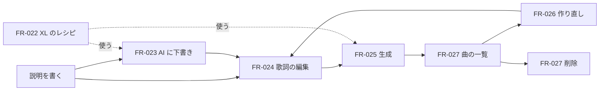

# 04-5. 機能仕様：音楽
- プロジェクト：LLM-PARTY ／ 版数：v0.1（2026-11-07） ／ インプット：[03_use_cases](../03_use_cases.md)、[ADR-013](../adr/ADR-013-acestep-cli.md)〜[015](../adr/ADR-015-music-page.md)

> **3行で**
> 1. 音楽は左端の「音楽」画面（[SCR-010](../06_ux_design.md#scr-010音楽)）だけで作る。スレッドの入力欄からは外す。
> 2. 流れは「説明を書く → AI に下書き → 構成タグと歌詞を手直し → 生成 → 聴く → 作り直す」。モデルは ACE-Step 1.5 XL turbo Q8 に置き換える。
> 3. やらないこと：下書きの自動保存、BPM・キーの指定、カバー・部分作り直し・LoRA（[01 §7](../01_requirements.md#7-スコープ外wont)）。

## 🧭 判断してほしいこと
| # | 種類 | 論点 | 選択肢 | おすすめ（理由） | 決まらないと止まるもの |
|---|---|---|---|---|---|
| R-22 | リスク | XL の VRAM の山は 6.8GB で、8GB の GPU の余裕は約 1.4GB。他のアプリが GPU を使うと失敗しうる | — | 失敗しても編集中の内容を残し、CP-353 で案内する。空き VRAM の事前確認はしない（Vulkan では正確に測れない） | — |
| R-23 | リスク | AI の下書きは説明と内容がずれることがあり、長さの指定も守らない（60 秒の指定に 138 秒ぶんの歌詞）。長い歌詞を短い曲に渡すと完走はするが、どこまで歌われるかは未確認 | — | 下書きは「手直しの土台」と位置づける。長さは画面の指定を優先する。実装時に耳で確かめる | FR-023 |

## 全体図

見てほしいところ：下書きは飛ばせる。歌詞が空のまま生成すると、今までどおり LM が作詞する。

## 要点
- エンジンは acestep.cpp の CLI のまま（[ADR-013](../adr/ADR-013-acestep-cli.md)）。常駐はさせない。
- 下書きは `lm_mode: "inspire"`。音声コードを作らないので 60 秒の指定でも約 27 秒で終わる（[FR-023](#fr-023歌詞の下書き)）。
- 曲はスレッドから独立させる。過去の曲もスレッドで再生でき、一覧にも出る（[ADR-015](../adr/ADR-015-music-page.md)）。
- 同時に動くのは下書きか生成の1つだけ（BR-09）。
- 編集中の内容はアプリのメモリに持つ。再読み込みで消える（D-81）。

---

## 詳細
以下は詳細層。

## FR-022：音楽モデルの用意
〔UC-009〕優先度 Should

- レシピ `ace-step` の DiT を `acestep-v15-xl-turbo-Q8_0.gguf`（5.31GB）に替え、表示名を「ACE-Step 1.5 XL」にする。LM 1.7B Q8・Qwen3-Embedding 0.6B Q8・VAE BF16 はそのまま（[ADR-014](../adr/ADR-014-xl-turbo-q8.md)）
- 手元に同じサイズの部品があれば DL を飛ばす（今の DL の動き）。2B を入れている環境で増える DL は XL の 5.31GB だけ
- 登録の処理：
  1. XL の部品がそろったら音楽モデルを登録する（API-106、kind `music-set`）
  2. 登録できたら、`architecture = ace-step` の古い音楽モデルの行を消し、そのモデルの DiT ファイルを消す。共有の部品は消さない
  3. 曲（TBL-018）は `model_name` を文字で持つので、古い曲はそのまま残る
- 音楽モデルは常に1つなので、音楽の画面にモデルの選択肢は置かない。API には今までどおり `modelId` を渡す

## FR-023：歌詞の下書き
〔UC-009〕優先度 Should

- 入力：

  | 項目 | 型 | 必須 | バリデーション |
  |---|---|---|---|
  | prompt | 文字列 | ○ | 1〜2,000 文字（前後の空白を除く） |
  | modelId | 文字列 | ○ | `use = music` のモデル |

- 処理：
  1. `{ caption, lyrics: "", lm_mode: "inspire", vocal_language, lm_model }` の JSON を作り、`ace-lm --device CPU` で動かす。`vocal_language` の決め方は今の生成と同じ
  2. 出力の `request0.json` から `lyrics` だけを使う。LM が返す `bpm`・`keyscale`・`duration`・`caption` は捨てる
- 出力：`music` イベントの `{ job: "draft", status: "completed", lyrics }`
- エラー・例外：

  | 条件 | 挙動 | 文言 |
  |---|---|---|
  | 歌詞欄に文字がある | 先に確認する（BR-10） | CP-351 |
  | 別の生成が動いている | 409 BUSY | CP-357 |
  | 出力がない・歌詞が空 | `failed`。歌詞欄は変えない | CP-354 |
  | 止めるボタン | 子プロセスを止める。歌詞欄は変えない | — |

- VRAM を使わないので、チャットや画像のエンジンは止めない。CPU とメモリは使うので、順番は `GenerationSlot` を通す

## FR-024：歌詞の編集
〔UC-009〕優先度 Should

- 歌詞エディタ（[CMP-023](../ui/04_components.md#cmp-023-歌詞エディタ)）は複数行の入力欄と、構成タグのボタン7つ（D-81）からなる
- タグのボタンはカーソル位置に `[Chorus]` などを1行で挿入する。行の途中なら前で改行し、挿入後のカーソルはタグの次の行に置く
- 上限は 4,000 文字。「歌なし」を ON にすると歌詞エディタと下書きのボタンを隠す。隠した歌詞は OFF に戻すと元に戻る

## FR-025：曲の生成
〔UC-009, UC-010〕優先度 Should

- 入力：

  | 項目 | 型 | 必須 | バリデーション |
  |---|---|---|---|
  | modelId | 文字列 | ○ | `use = music` のモデル |
  | prompt | 文字列 | ○ | 1〜2,000 文字 |
  | lyrics | 文字列 | | 0〜4,000 文字。空なら LM が作詞、`[Instrumental]` なら歌なし |
  | duration | 整数 | | 10〜240 秒、既定 60（D-82） |

- 処理：
  1. チャットのエンジンと sd-server を止める（D-78 のまま）
  2. シードは常に `-1`（毎回新しいシード。D-82）。`ace-lm`（CPU）→ `ace-synth`（`--vae-chunk 384`）の順に動かす
  3. MP3 を `dataDir/music/<ULID>.mp3` に保存し、TBL-018 に `thread_id = NULL` で入れる。`bpm`・`keyscale`・`reasoning` も入れる
- 出力：`music` イベントの `{ job: "track", status: "completed", trackId }`。一覧の先頭に足して選ぶ
- 完了したら編集中の内容は空に戻す。内容は曲に保存済みで、「作り直す」で戻せる。別の曲や別の画面を見ているときは画面を移らない
- 時間切れは置かない（D-78）。止めるボタンで止める
- 進捗：`composing`（作詞と構成）→ `rendering`（生成）。割合は出ない。LM の思考は折りたたみで見せる
- エラー・例外：

  | 条件 | 挙動 | 文言 |
  |---|---|---|
  | 別の生成が動いている | 409 BUSY | CP-357 |
  | 評価の実行中 | 409 BUSY | 既存の文言 |
  | 音声ファイルができない（VRAM 不足は終了コード 0 のことがある） | `failed`。編集中の内容は残す | CP-353 |

## FR-026：作り直し
〔UC-010〕優先度 Should

1. 曲を選んで「作り直す」を押すと、`prompt`・`lyrics`・`duration` を編集中の内容にコピーして、新しい曲の状態にする
2. `lyrics` が `[Instrumental]` なら「歌なし」を ON にする
3. 編集中の内容があるときは先に確認する（BR-10、CP-351）
4. 生成すると別の曲として増える。元の曲は残る

## FR-027：曲の一覧と削除
〔UC-009, UC-010〕優先度 Should

- 一覧は新しい順に 50 件ずつ（D-41）。行に説明の1行目・長さ・作成日時を出す。古い曲も出す
- 曲を選ぶと、説明・歌詞・長さ・BPM・キー・モデル名・プレーヤーを読み取り専用で出す
- 削除は確認つき（CP-349, CP-350）。TBL-018 の行と MP3 を消す。スレッドに残った曲のメッセージは CP-356 を出す
- スレッドを消しても曲は消えない（`ON DELETE SET NULL`）

## 状態
下書きと生成の状態は DB に持たない。値は [04 状態の定義](README.md#状態の定義) に、遷移は [10](../10_diagrams.md#音楽のジョブ) にある。

## このドキュメントで決まったこと
- [ADR-014](../adr/ADR-014-xl-turbo-q8.md)：XL turbo Q8 に置き換える
- [ADR-015](../adr/ADR-015-music-page.md)：音楽専用の画面に一本化する
- D-79〜D-83（[00 決定事項ログ](../00_overview.md#決定事項ログ)）
