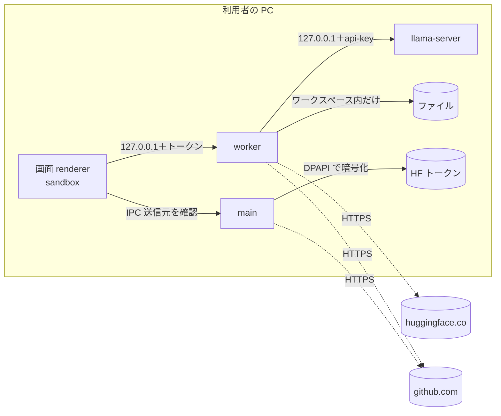

# 05. 非機能要件
- プロジェクト：LLM-PARTY ／ 版数：v0.1（2026-11-05） ／ インプット：[01_requirements](01_requirements.md)、[04_functional_spec](04_functional_spec/README.md)

> **3行で**
> 1. 数値はすべてヒアリングで決めたもの（D-22〜D-32）か、DC-Designer に合わせたもの。生成速度の目安だけ未決（Q-09）。
> 2. セキュリティの柱は「全部 127.0.0.1 ＋起動ごとの乱数トークン」「エージェントはワークスペースの中だけ」「外への通信は Hugging Face と GitHub だけ」。
> 3. 稼働率・同時接続などサーバー向けの項目は、端末で完結するため対象外。

**段階**：下の表は exe 段階の最終形。localhost 段階の違いは [段階ごとの違い](#段階ごとの違い)。

## 🧭 判断してほしいこと
| # | 種類 | 論点 | 選択肢 | おすすめ（理由） | 決まらないと止まるもの |
|---|---|---|---|---|---|
| Q-09 | 未決 | 生成速度の目安（受け入れ確認に使う） | A: 目安なし（評価で毎回測って表示するだけ） / B: 「VRAM 8GB の GPU・Q4_K_M で 20 トークン/秒以上」を目安にする | A（GPU で大きく変わり、知人の PC では保証できない。速度は FR-018 で比べられる） | NFR-002 |
| R-01 | リスク | 未署名の exe は SmartScreen で「WindowsによってPCが保護されました」と出る | — | 知人には「詳細情報 → 実行」の手順を README とリリースノートで案内。SignPath Foundation への申請は後で（DC-Designer と同じ） | NFR-041 |
| R-07 | リスク | 「ローカル」と言いつつ外への通信がある（HF・GitHub） | — | 通信先を [NFR-015](#セキュリティ) に列挙し、設定・初回セットアップでも明示。会話の中身は送らない | NFR-015 |

## 全体図

見てほしいところ：外向きの矢印は3本だけ。どれも会話の中身を運ばない。

## 要点
- 性能の数値は [性能](#性能)、セキュリティは [セキュリティ](#セキュリティ)。
- データはアンインストールしても消えない（DC-Designer と同じ）。
- 費用はゼロ（public リポジトリの GitHub Actions・Releases）。

---

## 詳細
以下は詳細層。

## 性能
| ID | 要件 | 目標値 | 根拠 |
|---|---|---|---|
| NFR-001 | モデルの読み込み（llama-server が ready になるまで） | 60 秒以内。超えたら失敗として表示 | D-32 |
| NFR-002 | 生成速度 | Q-09 で決める | — |
| NFR-003 | 文脈長 | 既定 32,768 トークン。使用量 80% 超で自動要約 | D-22, D-27 |
| NFR-004 | ツール出力・ファイル読み取り | 1 回 8,000 トークンまで。2MB 超のファイルは読まない | D-26 |
| NFR-005 | コマンド1回の時間切れ | 120 秒 | D-23 |
| NFR-006 | 評価1ケースの時間切れ | 300 秒 | D-29 |
| NFR-007 | 起動時の更新確認 | 10 秒で打ち切り。起動を待たせない | D-25 |
| NFR-008 | 1 指示のツール呼び出し | 40 回まで | D-24 |

## セキュリティ
| ID | 要件 | 実現方法 |
|---|---|---|
| NFR-010 | 画面（renderer）から OS を直接触らせない | `contextIsolation` ON・`sandbox` ON・`nodeIntegration` OFF・CSP。preload は決めた関数だけ公開。IPC は送信元が自アプリのメインフレームか確かめる（DC-Designer と同じ） |
| NFR-011 | worker の API を他のプロセスから使わせない | `127.0.0.1` の空きポートで待ち受け、起動ごとの乱数トークン（`Authorization: Bearer`）がないと 401 |
| NFR-012 | llama-server を他のプロセスから使わせない | `127.0.0.1` の空きポート＋起動ごとの `--api-key` |
| NFR-013 | エージェントの操作範囲 | ワークスペース外は拒否、書き込み・コマンドは既定で承認（FR-010） |
| NFR-014 | HF トークンの保護 | main が `safeStorage`（Windows では DPAPI）で暗号化して保存。画面に中身を返さない。ログに書かない |
| NFR-015 | 外への通信先 | `huggingface.co`（検索・DL とその配信先）、`github.com`（更新・CUDA パックとその配信先）だけ。利用状況の送信（テレメトリ）はしない |
| NFR-016 | DL したものが正しいか | アプリ更新：`latest.yml` の sha512。CUDA パック：同梱マニフェストの sha256。モデル：HF の sha256（LFS）とサイズ |

## 段階ごとの違い
localhost 段階（[12](12_localhost_stage.md)）では次の要件の実現方法が変わる。他の要件は同じ。

| ID | localhost 段階 |
|---|---|
| NFR-007 | 対象外（更新がない） |
| NFR-010 | Electron の設定はない。画面は OS を直接触れず、worker の API だけを使う。`npm start` で CSP をかける |
| NFR-011 | `127.0.0.1:8787` 固定。トークンは `data/local-token` に保存して使い回す。Host と Origin も確かめる |
| NFR-014 | `data/secrets/hf-token`（権限 600）に平文で保存。画面に返さず、ログに書かない |
| NFR-015 | `huggingface.co` だけ |
| NFR-020, 024, 025, 040, 041 | 対象外（配布しない） |

## 運用・保守
| ID | 要件 | 目標値・方法 |
|---|---|---|
| NFR-020 | 対応環境 | Windows 10 / 11 x64。NSIS、ユーザーごと、管理者権限なし（D-02, D-19） |
| NFR-021 | 最低動作環境の案内 | RAM 16GB・VRAM 8GB の GPU・空き容量はモデルサイズ＋2GB 以上（D-43, BR-05）。GPU なしの CPU 動作は案内の対象外 |
| NFR-022 | ログの保持 | 14 日（D-30） |
| NFR-023 | DB の版上げ | 起動時に版を確かめ、上げる前に DB ファイルを `db\backup\` に1世代コピーしてから移行する |
| NFR-024 | アンインストール | データフォルダ（`%LOCALAPPDATA%\llm-party`）は消さない |
| NFR-025 | リリース | `v*` タグの push だけで配布。タグ・`package.json` の版の一致、所有者による承認を CI で必須にする（D-05） |

## ユーザビリティ・アクセシビリティ
| ID | 要件 | 方法 |
|---|---|---|
| NFR-030 | 画面の言語 | 日本語のみ（D-46） |
| NFR-031 | キーボード操作 | Enter で送信・Shift+Enter で改行。承認カードの「承認 / 却下」はキーボードで押せる |
| NFR-032 | 見やすさ | ライト / ダーク。文字と背景のコントラストは WCAG 2.2 AA |

## 法令・ライセンス
| ID | 要件 | 方法 |
|---|---|---|
| NFR-040 | 同梱物のライセンス表示 | llama.cpp（MIT）・Electron ほか依存の通知を「このアプリについて」に載せる。モデルは DL 前に HF のライセンス表示を出す |
| NFR-041 | コード署名 | v1 は未署名（R-01） |

## コスト
| ID | 要件 | 目標値 |
|---|---|---|
| NFR-050 | 運用費 | 月 0 円（public リポジトリの GitHub Actions・Releases の無料枠） |

## このドキュメントで決まったこと
- D-02, D-05, D-19, D-22〜D-32（[00 決定事項ログ](00_overview.md#決定事項ログ)）
- D-39：DB の版上げ前に1世代バックアップ（定石）
- D-53, D-54（localhost 段階）
