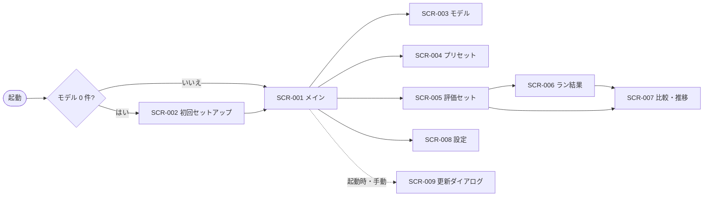

# 06. 画面・UX設計
- プロジェクト：LLM-PARTY ／ 版数：v0.1（2026-11-05） ／ インプット：[04_functional_spec](04_functional_spec/README.md)

> **3行で**
> 1. 画面は9つ。中心は Codex 風3ペインのメイン（SCR-001）で、他はそこから開く。
> 2. 会話の中でツール呼び出しはカードとして並び、承認は会話の中のカードで行う。差分と端末出力は右パネル。
> 3. 色やフォントなど見た目の細部はこの設計の範囲外（必要なら fe-designer で別に決める）。

## 🧭 判断してほしいこと
なし（言語は Q-05）

## 全体図

見てほしいところ：左端の縦のアイコン列（スレッド / モデル / プリセット / 評価 / 設定）から全画面に1クリックで行ける。

## 要点
- メインは「左：スレッド一覧 / 中央：会話 / 右：差分・端末（開閉）」（[SCR-001](#scr-001メイン)）。
- 承認カードは会話の中に出る。差分のプレビューつき（[SCR-001 操作](#scr-001メイン)）。
- 評価は「セットを編集 → 実行 → 結果で人手採点 → 比較・推移」（SCR-005 → 006 → 007）。

---

## 詳細
以下は詳細層。

## デザイン方針
- Codex 風：暗めの落ち着いた配色、余白多め、会話は中央の1列。ツール呼び出しは小さな折りたたみカード
- 大事な操作（承認・却下・停止）だけ目立たせ、他は控えめにする
- 状態（エンジンの読み込み中・承認待ち・評価の実行中）は、画面上部の帯で常に見えるようにする

## 画面一覧
| ID | 画面名 | ルート | 関連FR |
|---|---|---|---|
| SCR-001 | メイン | `#/threads/:id?` | FR-003〜FR-011 |
| SCR-002 | 初回セットアップ | `#/setup` | FR-001, FR-002, FR-012, FR-014 |
| SCR-003 | モデル | `#/models` | FR-012, FR-013 |
| SCR-004 | プリセット | `#/presets/:id?` | FR-014 |
| SCR-005 | 評価セット | `#/evals/:id?` | FR-015, FR-016 |
| SCR-006 | ラン結果 | `#/runs/:id` | FR-016, FR-017 |
| SCR-007 | 比較・推移 | `#/evals/:id/compare` | FR-018 |
| SCR-008 | 設定 | `#/settings` | FR-001, FR-002, FR-019〜FR-021 |
| SCR-009 | 更新ダイアログ | （ダイアログ） | FR-019 |

## SCR-001：メイン
- 目的：対話とエージェント作業
- ワイヤーフレーム：
  ```
  +--+-----------+-------------------------------+-------------------+
  |☰ | + チャット | [Qwen3.5 コーディング ▼] ● ready |  差分 | 端末  [×] |
  |💬| + エージェント+-------------------------------+-------------------+
  |📦| 🔍検索      | user: ログイン処理のバグを直して  | src/auth.ts  +3-1 |
  |🎛| ▸ バグ修正   | ▸ 思考（折りたたみ）             | ----------------- |
  |🧪|   my-app    | [read_file] src/auth.ts  ✓     | - if (a = b)      |
  |⚙ | ▸ 雑談       | [edit_file] src/auth.ts        | + if (a === b)    |
  |  |             |   - if (a = b) / + if (a===b)  |                   |
  |  |             |   [承認] [却下] [以後自動承認]  |  [元に戻す]        |
  |  |             +-------------------------------+                   |
  |  |             | > 入力欄            文脈 42%  [送信]|                   |
  +--+-----------+-------------------------------+-------------------+
  ```
- 表示項目：

  | 項目 | データ元 | 備考 |
  |---|---|---|
  | スレッド一覧 | API-030 | 種類アイコン・ワークスペース名・更新日時 |
  | 会話 | API-034、`turn.*` イベント | 思考は折りたたみ。要約済みは「要約済み（N 件）」で折りたたみ |
  | ツール呼び出しカード | `tool.*` イベント | 状態アイコン（承認待ち・実行中・成功・失敗・拒否・却下・時間切れ） |
  | エンジン状態 | API-023、`engine` イベント | ● ready / ◌ 読み込み中 / ✕ 失敗 |
  | 文脈の使用量 | `turn.usage` イベント | % 表示 |
  | 差分 | API-039 | ファイル一覧＋unified diff |
  | 端末 | `tool.output` イベント | コマンドごとに区切り、終了コード |
- 操作・イベント：

  | 操作 | 挙動 | 呼び出すAPI | 遷移先 |
  |---|---|---|---|
  | 送信（Enter） | ターン開始 | API-035 | — |
  | 停止 | ターン中止 | API-036 | — |
  | プリセット選択 | 次の送信から使う。モデルが違えば読み込み | API-024 | — |
  | 承認 / 却下 / 以後自動承認 | ツールの判定 | API-038 | — |
  | 続ける / やめる（40 回上限） | 再開 / 完了 | API-037 | — |
  | 元に戻す | 取り消し（警告あり） | API-040 | — |
  | + エージェント | フォルダ選択 → スレッド作成 | API-002, API-042, API-031 | — |
  | スレッドの名前変更・削除 | 右クリックメニュー | API-032, API-033 | — |
- 状態：初期（スレッドなし：「新しいチャット / エージェントを始める」）/ 読み込み中（帯に進捗）/ エラー（帯に赤で原因と「ログを開く」）/ 評価の実行中（帯に「評価中 3/20」）

## SCR-002：初回セットアップ
- 目的：GPU 判定とおすすめモデルの用意
- ワイヤーフレーム：
  ```
  +----------------------------------------------+
  | LLM-PARTY へようこそ                    1/3 |
  | GPU：NVIDIA RTX 4070 (12GB) → Vulkan で動作 |
  | [CUDA パックを追加（約650MB）] [あとで]      |
  |----------------------------------------------|
  | おすすめ：Qwen3.5-9B Q4_K_M（5.4GB）          |
  | 置き場：C:\Users\..\llm-party\models [変更]  |
  | 空き：120GB ✓                                |
  | [DL する]  [手元のファイルを使う]  [あとで]    |
  +----------------------------------------------+
  ```
- 操作：CUDA 追加（API-022）/ DL（API-055）/ 手元のファイル（API-003 → API-051）/ 置き場変更（API-002 → API-091）
- 状態：判定中 / DL 中（進捗・残り時間）/ 容量不足（DL ボタン無効と必要量）/ 通信不可（「あとで」だけ）

## SCR-003：モデル
- 目的：モデル・LoRA の一覧と入手
- タブ：「手元のモデル」「LoRA」「Hugging Face を探す」「DL」
- 表示項目：名前・量子化・サイズ・場所（参照 / 置き場）・状態（見つからない など）/ 検索結果（API-053）/ ファイル一覧（API-054）/ DL の進捗（API-056、`download.*` イベント）
- 操作：ファイル登録（API-003 → API-051 / API-058）、削除（API-052 / API-059）、DL（API-055）、DL 取消（API-057）
- 状態：検索結果 0 件 / ゲート付き（「HF トークンを設定」へ誘導）/ 容量不足

## SCR-004：プリセット
- 目的：プリセットの作成・編集
- レイアウト：左にプリセット一覧、右に編集フォーム（モデル・LoRA と倍率・生成設定・システムプロンプト・思考・文脈長）
- 操作：保存（API-061 / API-062）、複製、削除（API-063）、「Qwen 推奨値を入れる」
- バリデーション：入力欄ごとにその場で表示（範囲外・ベースモデル違いの LoRA）

## SCR-005：評価セット
- 目的：評価セットの編集と実行
- ワイヤーフレーム：
  ```
  +------------+------------------------------------------+
  | 評価セット   | コーディング基本 (20問)  [取込][書出][実行▶]|
  | ▸ コーディング| # 名前          種類   採点     タグ      |
  |   日本語     | 1 fizzbuzz修正  agent  test     python   |
  | + 新規       | 2 挨拶          chat   regex    日本語    |
  |             | [+ ケース追加]                             |
  |             | 最近のラン：v3-lora 85% / base 70%  [比較]  |
  +------------+------------------------------------------+
  ```
- 操作：ケース編集（API-072）、取込（API-003 → API-075）、書出（API-076）、実行（プリセットを複数選ぶダイアログ → API-077）
- 状態：取込エラー（行番号つき一覧）

## SCR-006：ラン結果
- 目的：ランの進捗・結果・人手採点
- 表示項目：正解率・平均点・平均トークン/秒・合計時間、ケースごとの結果（状態・時間）。ケースを開くと入力・応答・ツール呼び出し・テストの出力
- 操作：人手採点（○× / 1〜5。API-081）、中止（API-080）、「採点待ちだけ表示」
- 状態：実行中（進捗バー。`eval.progress` イベント）/ 完了 / 中止 / 失敗

## SCR-007：比較・推移
- 目的：ランどうしの比較と推移
- 表示項目：ラン A・B の選択、ケースごとの「良くなった / 悪くなった / 同じ」（悪くなったものが先頭）、正解率の折れ線（プリセットごと。API-082）
- 操作：ケースを開くと A・B の応答を横に並べる、タグで絞る

## SCR-008：設定
- 目的：FR-020 の項目。GPU 判定の結果、CUDA パック、HF トークン、更新の確認（API-004）、診断情報の書き出し（API-092）、ログフォルダを開く（API-009）、このアプリについて（版・ライセンス）

## SCR-009：更新ダイアログ
- 目的：更新の案内（FR-019）
- 表示：新しい版の番号とリリースノートの要約、[更新する] [あとで] → DL 中は進捗 → [再起動して更新]（実行中の処理があれば止める確認）

## 共通UIコンポーネント
| 部品 | 使う画面 |
|---|---|
| ツール呼び出しカード（折りたたみ・状態アイコン・承認ボタン） | SCR-001, SCR-006 |
| 差分ビュー（unified） | SCR-001, SCR-006 |
| 進捗バー（DL・評価・読み込み） | SCR-001〜003, SCR-006, SCR-009 |
| 状態の帯（エンジン・評価・エラー） | 全画面の上部 |
| プリセット選択 | SCR-001, SCR-005 |

## レスポンシブ・アクセシビリティ方針
- ウィンドウ幅が狭いとき（右パネルを開くと会話が窮屈なとき）は右パネルを会話の上に重ねて表示する
- キーボード操作とコントラストは [NFR-031, NFR-032](05_non_functional.md#ユーザビリティアクセシビリティ)

## このドキュメントで決まったこと
- D-14（[00 決定事項ログ](00_overview.md#決定事項ログ)）
