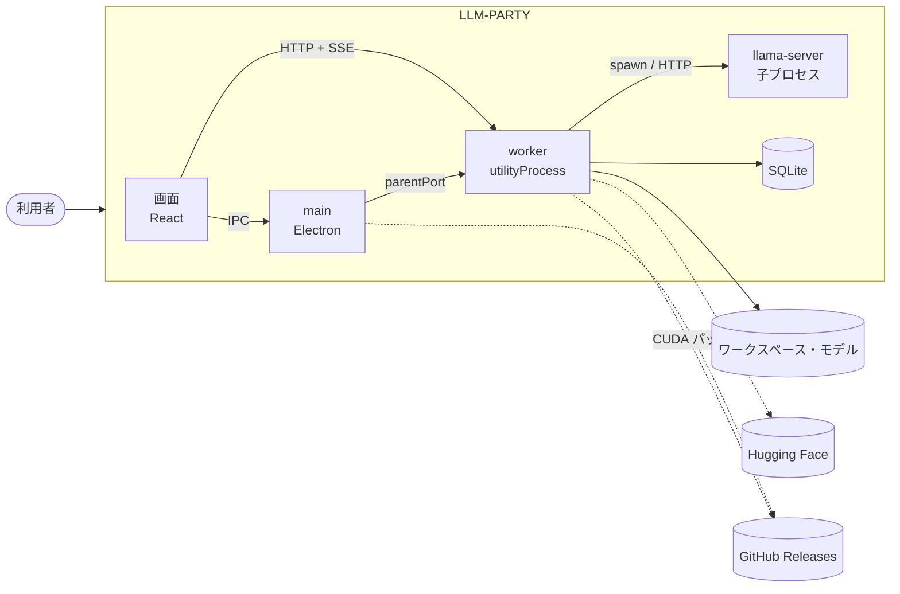
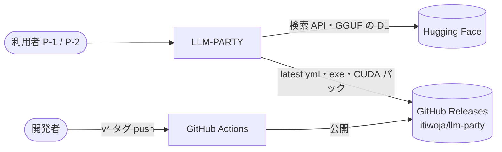
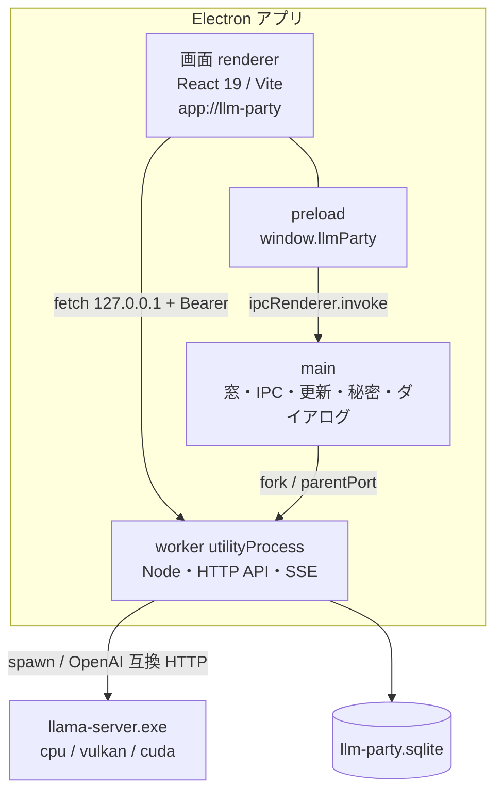
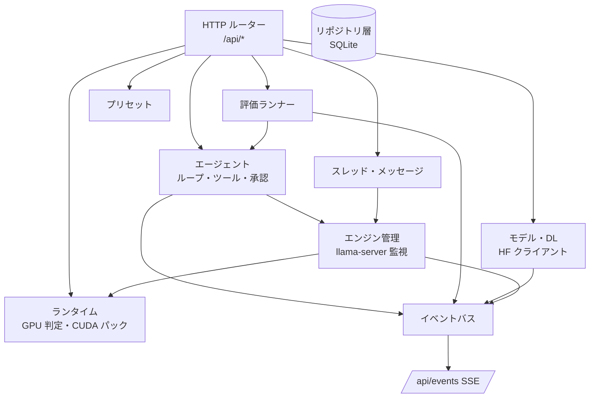
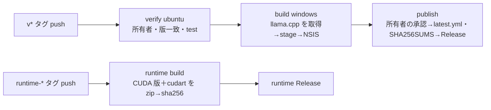

# 07. システムアーキテクチャ
- プロジェクト：LLM-PARTY ／ 版数：v0.1（2026-11-05） ／ インプット：[04](04_functional_spec/README.md)、[05](05_non_functional.md)、参考：DC-Designer（`desktop/`・`server/`・`electron-builder.yml`・`.github/workflows/release-windows.yml`）

> **3行で**
> 1. DC-Designer と同じ Electron の3プロセス構成（main・画面・utilityProcess の worker）に、4つ目として llama-server の子プロセスを足す。
> 2. worker が API・SQLite・エージェント・評価・DL・エンジンの管理を全部持つ。画面は worker の HTTP API と SSE で話し、OS に触る操作だけ main の IPC を使う。
> 3. 配布は `v*` タグ → GitHub Actions → NSIS → GitHub Releases。CUDA パックは同じリポジトリの `runtime-<ビルド番号>` リリースに置く。

## 🧭 判断してほしいこと
| # | 種類 | 論点 | 選択肢 | おすすめ（理由） | 決まらないと止まるもの |
|---|---|---|---|---|---|
| Q-01 | 未決 | SQLite のドライバ | A: better-sqlite3 / B: Node 組み込みの `node:sqlite` | A（Electron での実績が多く FTS5 も使える。asar の外に出し、Electron 用にビルドし直す手間はある）。B は Electron 45 の同梱 Node で安定して使えるか未確認 | 08 全体、ビルド設定 |
| R-08 | リスク | ネイティブモジュール（better-sqlite3）は asar の外に置き、Electron の版に合わせてビルドする必要がある | — | DC-Designer の許可リスト方式のステージに `asarUnpack` を足し、`inspect-desktop` で `.node` の有無を検査する | ビルド |

## 全体図

見てほしいところ：重い処理（推論・DL・エージェント・評価）はすべて worker 以下にあり、main は窓・更新・秘密・ダイアログだけ。

## 要点
- 技術スタックは [技術スタック](#技術スタック)。DC-Designer からの流用と新規を分けた。
- プロセスごとの責務は [レベル2](#レベル2コンテナ図) と [レベル3](#レベル3コンポーネント図worker)。
- データの置き場は [データの置き場](#データの置き場)。
- ビルド・リリースは [デプロイ構成](#デプロイ構成リリース)。
- 主要な判断は [ADR](#主要な設計判断adr)。

---

## 詳細
以下は詳細層。

## レベル1：コンテキスト図

## レベル2：コンテナ図

| コンテナ | 責務 | 主な技術 |
|---|---|---|
| 画面 renderer | 全画面の表示。worker の API と SSE を使う。OS 操作は preload 経由で main に頼む | React 19、Vite、TypeScript |
| preload | `window.llmParty` に決めた関数だけ公開（API-001〜010） | contextBridge |
| main | 窓、`app://` プロトコル、IPC、electron-updater、safeStorage、ダイアログ、worker の起動と監視 | Electron 45 |
| worker | API・SSE、SQLite、エンジン管理、エージェント、評価、HF / CUDA パックの DL | Node（Electron 同梱）、Express 5、better-sqlite3（Q-01） |
| llama-server | 推論（OpenAI 互換 API）。同時に1つ | llama.cpp ビルド b12125 時点（R-02） |

## レベル3：コンポーネント図（worker）

見てほしいところ：評価ランナーはエージェントをそのまま使う。画面への通知は全部イベントバス → SSE の1本。

| コンポーネント | 責務 | 関連FR |
|---|---|---|
| エンジン管理 | llama-server の起動・停止・死活・ログ。同時に1つ | FR-003 |
| ランタイム | `--list-devices` での判定、CUDA パックの DL・検証・展開 | FR-001, FR-002 |
| スレッド・メッセージ | 会話の保存、文脈の計測と自動要約 | FR-004〜FR-006 |
| エージェント | ループ、6つのツール、パス検査、承認待ち、変更記録 | FR-008〜FR-011 |
| モデル・DL | HF 検索・DL（再開・再試行）、GGUF メタデータ読み取り、登録 | FR-012, FR-013 |
| 評価ランナー | ランの待ち行列、使い捨てフォルダ、採点、集計 | FR-015〜FR-018 |
| イベントバス | 進捗・差分・状態を SSE で画面へ | 全般 |

## 技術スタック
| レイヤー | 採用技術 | 理由 | 代替案 |
|---|---|---|---|
| デスクトップ | Electron 45、electron-builder（NSIS） | DC-Designer と同じ（D-01） | Tauri（[ADR-001](adr/ADR-001-electron-worker.md)） |
| 画面 | React 19、Vite、TypeScript | 同上 | — |
| worker | Node（utilityProcess）、Express 5 | 同上。推論と DL を main から切り離す | main で直接動かす |
| 推論 | llama.cpp の llama-server（同梱・子プロセス） | GGUF・LoRA・ツール呼び出し・OpenAI 互換（D-07） | node-llama-cpp で同じプロセスに読み込む、Ollama（[ADR-002](adr/ADR-002-llama-server-child.md)） |
| GPU | Vulkan＋CPU 同梱、CUDA は追加パック | インストーラーを小さく（D-11） | 全部同梱（[ADR-003](adr/ADR-003-gpu-runtime.md)） |
| DB | SQLite（better-sqlite3。Q-01）、WAL、FTS5 | 評価の集計（D-15） | JSON ファイル（[ADR-004](adr/ADR-004-sqlite.md)） |
| 更新 | electron-updater（GitHub provider） | DC-Designer と同じ（D-03） | — |
| テスト | Vitest | DC-Designer と同じ | — |
| CI | GitHub Actions（windows-latest） | 同上 | — |

## データの置き場
`%LOCALAPPDATA%\llm-party\`（D-06）

| フォルダ | 中身 |
|---|---|
| `db\` | `llm-party.sqlite`（＋WAL）、`backup\`（版上げ前の1世代。NFR-023） |
| `models\` | DL・コピーしたモデルと LoRA（既定。設定で変更可） |
| `runtime\llama\<ビルド番号>-cuda<版>\` | CUDA パック |
| `runtime\engine.pid` | 動いている llama-server の PID（取り残し対策） |
| `eval-workspaces\<runId>\` | 評価の使い捨てフォルダ |
| `cache\` | DL 途中のパック |
| `logs\` | アプリと llama-server のログ（14 日） |
| `secrets\` | 暗号化した HF トークン（main だけが読む） |
| `browser\` | Electron の userData |

同梱の llama-server（cpu・vulkan）はインストール先の `resources\llama\<ビルド番号>-<cpu|vulkan>\` に置く。

## 認証・認可方式
- ログインはない。プロセス間の取り決めだけ（NFR-010〜012）
- main → worker：起動時に乱数トークンとポートを決め、`parentPort` で渡す。画面は `window.llmParty.getConnection()`（API-008）で受け取る
- worker → llama-server：起動ごとの `--api-key`

## 外部連携
| 相手 | 使うもの | 使う場所 |
|---|---|---|
| Hugging Face | `GET /api/models`、`GET /api/models/<repo>/tree/main`、`/resolve/main/<file>`（Range） | FR-012 |
| GitHub Releases | `latest.yml`・exe（electron-updater）、`runtime-<ビルド番号>` の zip | FR-019, FR-002 |
| llama-server | `/health`、`/v1/chat/completions`、`/tokenize`（[09 engine](09_api/engine.md)） | FR-003, FR-005, FR-006 |

## デプロイ構成・リリース

- アプリのリリースは DC-Designer の `release-windows.yml` と同じ3段（D-05）。build で、`runtime-manifest.json` に書いたビルド番号の llama.cpp（`llama-<ビルド番号>-bin-win-cpu-x64.zip`・`-win-vulkan-x64.zip`）を ggml-org/llama.cpp の Releases から取り、sha256 を確かめてステージに入れる
- CUDA パックは別のワークフロー。`runtime-<ビルド番号>` タグで `llama-<ビルド番号>-bin-win-cuda-<版>-x64.zip` と `cudart-llama-bin-win-cuda-<版>-x64.zip` を1つにまとめ、sha256 をマニフェストに書く（R-09 の確認が先）
- llama.cpp の版を上げるときは、先に runtime リリースを出し、マニフェストを更新してからアプリのタグを打つ
- 環境：開発（WSL。`npm run dev` で worker を tsx・画面を Vite で動かす。開発中に限り、worker は WSL 用の llama-server を起動してよい）/ 本番（インストール版）

## ログ・監視・エラー通知
- 外への送信はしない（NFR-015）。ログはローカルだけ（FR-021）
- worker が落ちたら main が1回だけ起動し直し、2回目は「アプリを再起動してください」を出す

## 主要な設計判断（ADR）
| ADR | 決定 | 状態 |
|---|---|---|
| [ADR-001](adr/ADR-001-electron-worker.md) | Electron＋utilityProcess の worker（DC-Designer 準拠） | 承認 |
| [ADR-002](adr/ADR-002-llama-server-child.md) | 推論は llama-server を子プロセスで動かす | 承認 |
| [ADR-003](adr/ADR-003-gpu-runtime.md) | Vulkan＋CPU 同梱、CUDA は追加パック | 承認 |
| [ADR-004](adr/ADR-004-sqlite.md) | 保存は SQLite | 承認（ドライバは Q-01） |
| [ADR-005](adr/ADR-005-approval-policy.md) | 読み取り自動・書き込みとコマンドは承認・外は拒否 | 承認 |
| [ADR-006](adr/ADR-006-auto-compaction.md) | 文脈あふれは自動要約 | 承認 |
| [ADR-007](adr/ADR-007-update-flow.md) | 更新は起動時確認・手動 DL・手動適用 | 承認 |

## このドキュメントで決まったこと
- D-01〜D-07, D-11, D-15, D-18（[00 決定事項ログ](00_overview.md#決定事項ログ)）
- D-40：worker が落ちたら main が1回だけ起動し直す（ユーザー確認済み。D-44 の⑦）
