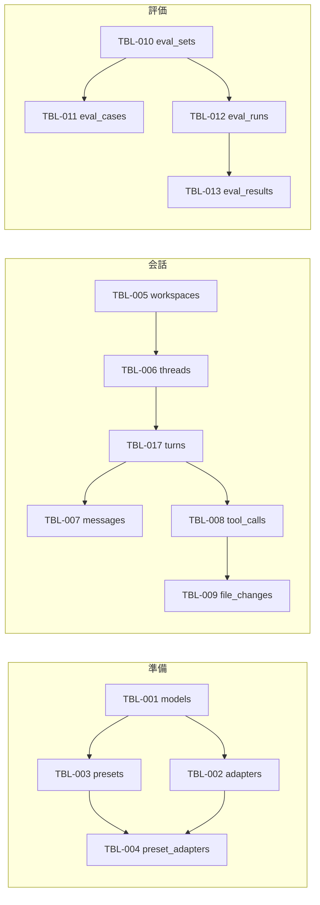

# 08. DB設計
- プロジェクト：LLM-PARTY ／ 版数：v0.3（2026-11-07） ／ インプット：[04_functional_spec](04_functional_spec/README.md)

> **3行で**
> 1. 端末内の SQLite 1ファイル（`db\llm-party.sqlite`）に 18 テーブル。worker だけが読み書きする。
> 2. 中心は「スレッド → ターン → メッセージ / ツール呼び出し → 変更記録」と「評価セット → ケース」「ラン → 結果」の2系統。
> 3. ランはプリセットの中身を写して持つので、プリセットを消しても過去の評価は残る。

## 🧭 判断してほしいこと
なし（ドライバは better-sqlite3。D-55）

## 全体図

見てほしいところ：単独の TBL-014 downloads・TBL-015 runtime_packs・TBL-016 settings は図から省いた。評価のラン（TBL-012）は presets を外部キーで縛らない（`preset_id` は参考、中身は `preset_snapshot`）。ER 図は [10](10_diagrams.md#er図)。

## 要点
- 方針（ID・日時・削除）は [方針](#方針)。
- ステータスの値は [04 状態の定義](04_functional_spec/README.md#状態の定義) と同じ。
- 消し方は [データ保持・削除ポリシー](#データ保持削除ポリシー)。

---

## 詳細
以下は詳細層。

## 方針
| 項目 | 決めたこと |
|---|---|
| DB | SQLite、WAL モード、外部キー ON、FTS5（スレッド検索） |
| ID | ULID（文字列 26 桁）（D-34） |
| 日時 | ISO 8601 の UTC 文字列（`2026-11-05T07:29:28.000Z`）。表示はローカル時刻（D-34） |
| 命名 | テーブル・カラムは snake_case。API は camelCase に変換 |
| 削除 | 物理削除。親を消すと子も消える（`ON DELETE CASCADE`）。例外は eval_runs → presets と tracks → threads（`SET NULL`） |
| JSON | 構造を持つ値（生成設定・採点方法・写し）は JSON 文字列のカラム |
| 版上げ | `PRAGMA user_version` で版を持ち、起動時に移行（前に1世代バックアップ。NFR-023） |

## テーブル一覧
| ID | テーブル名 | 論理名 | 関連FR |
|---|---|---|---|
| TBL-001 | models | モデル | FR-012, FR-013 |
| TBL-002 | adapters | LoRA アダプタ | FR-013 |
| TBL-003 | presets | プリセット | FR-014 |
| TBL-004 | preset_adapters | プリセットの LoRA と倍率 | FR-014 |
| TBL-005 | workspaces | ワークスペース | FR-007 |
| TBL-006 | threads | スレッド | FR-004 |
| TBL-007 | messages | メッセージ | FR-005, FR-006 |
| TBL-008 | tool_calls | ツール呼び出し | FR-008〜FR-010 |
| TBL-009 | file_changes | 変更記録 | FR-011 |
| TBL-010 | eval_sets | 評価セット | FR-015 |
| TBL-011 | eval_cases | ケース | FR-015 |
| TBL-012 | eval_runs | ラン | FR-016, FR-018 |
| TBL-013 | eval_results | ケース結果 | FR-016, FR-017 |
| TBL-014 | downloads | DL | FR-012 |
| TBL-015 | runtime_packs | ランタイムパック | FR-002 |
| TBL-016 | settings | 設定 | FR-020 |
| TBL-017 | turns | ターン | FR-005, FR-008 |

## テーブル定義

### TBL-001：models
ベースモデルの GGUF。主なカラム：`id`, `name`, `path`, `source`

<details>
<summary>カラム定義（16列）</summary>

| カラム | 型 | NULL | デフォルト | キー | 説明 |
|---|---|---|---|---|---|
| id | TEXT | NO | | PK | ULID |
| name | TEXT | NO | | | 表示名 |
| path | TEXT | NO | | UNIQUE | GGUF の絶対パス（分割なら1つ目） |
| source | TEXT | NO | | | `hf` / `local_ref` / `local_copy` |
| hf_repo | TEXT | YES | | | `unsloth/Qwen3.5-9B-GGUF` など |
| architecture | TEXT | NO | | | GGUF の `general.architecture` |
| quantization | TEXT | YES | | | `Q4_K_M` など |
| size_bytes | INTEGER | NO | | | |
| train_context | INTEGER | YES | | | 学習時の文脈長 |
| sha256 | TEXT | YES | | | 分かっていれば |
| kind | TEXT | NO | chat | | `chat` / `image`（D-72）/ `music`（D-78） |
| parts | TEXT(JSON) | YES | | | 部品でできた画像モデルの `{diffusion, llm, vae, tokenizer}`（D-73）、音楽モデルの `{lm, textEncoder, dit, vae}`（D-78） |
| supports_thinking | INTEGER | YES | | | チャットテンプレートに `enable_thinking` があれば 1（D-76）。NULL はまだ読んでいない（起動時に読む） |
| supports_effort | INTEGER | YES | | | チャットテンプレートに `reasoning_effort` があれば 1（D-76） |
| created_at | TEXT | NO | | | |
| updated_at | TEXT | NO | | | |

</details>

### TBL-002：adapters
LoRA の GGUF。主なカラム：`id`, `base_model_id`, `path`

<details>
<summary>カラム定義（8列）</summary>

| カラム | 型 | NULL | デフォルト | キー | 説明 |
|---|---|---|---|---|---|
| id | TEXT | NO | | PK | |
| base_model_id | TEXT | NO | | FK → models（CASCADE しない・RESTRICT） | |
| name | TEXT | NO | | | |
| path | TEXT | NO | | UNIQUE | |
| source | TEXT | NO | | | `local_ref` / `local_copy` / `hf` |
| architecture | TEXT | NO | | | ベースと一致を検査 |
| created_at | TEXT | NO | | | |
| updated_at | TEXT | NO | | | |

</details>

### TBL-003：presets
主なカラム：`id`, `name`, `model_id`, `sampling`

<details>
<summary>カラム定義（10列）</summary>

| カラム | 型 | NULL | デフォルト | キー | 説明 |
|---|---|---|---|---|---|
| id | TEXT | NO | | PK | |
| name | TEXT | NO | | UNIQUE | |
| model_id | TEXT | NO | | FK → models（RESTRICT） | |
| sampling | TEXT(JSON) | NO | | | `{temperature, topP, topK, minP, presencePenalty, repeatPenalty}` |
| system_prompt | TEXT | YES | | | |
| thinking | INTEGER | NO | 0 | | 0 / 1 |
| effort | TEXT | NO | medium | | `low` / `medium` / `high`（D-76） |
| context_size | INTEGER | NO | 32768 | | |
| gpu_ratio | INTEGER | YES | | | GPU に載せる割合（0〜100）。NULL は自動（D-77） |
| created_at | TEXT | NO | | | |
| updated_at | TEXT | NO | | | |

</details>

### TBL-004：preset_adapters
主なカラム：`preset_id`, `adapter_id`, `scale`。PK は（preset_id, adapter_id）。preset は CASCADE、adapter は RESTRICT（使用中の LoRA は消せない）。`sort_order` で並び順。

### TBL-005：workspaces
主なカラム：`id`, `path`（実体パス・UNIQUE）, `name`（表示名。初期値はフォルダ名）, `created_at`, `last_used_at`, `hidden_at`（一覧から外した日時）, `instructions`（プロジェクトの指示）, `default_preset_id`（FK → presets、SET NULL）, `auto_approve`（0/1、NULL は設定 `defaultAutoApprove` に従う）。後ろの4つは v2 で追加

### TBL-006：threads
主なカラム：`id`, `title`, `workspace_id`（NULL ならチャット。FK → workspaces、SET NULL はしない・RESTRICT）, `last_preset_id`（FK → presets、SET NULL）, `auto_approve`（0/1、既定はプロジェクトの値、なければ設定値）, `created_at`, `updated_at`。全文検索用に `threads_fts`（title とメッセージ本文、`tokenize='trigram'`）を持つ。2文字以下の語は `threads_fts` を使わず `LIKE` で探す（D-58）

### TBL-017：turns
主なカラム：`id`, `thread_id`（CASCADE）, `preset_id`（SET NULL）, `status`（04 の値）, `step_count`, `step_limit`（既定 40）, `prompt_tokens`, `completion_tokens`, `started_at`, `finished_at`, `error`

### TBL-007：messages
<details>
<summary>カラム定義（11列）</summary>

| カラム | 型 | NULL | デフォルト | キー | 説明 |
|---|---|---|---|---|---|
| id | TEXT | NO | | PK | |
| thread_id | TEXT | NO | | FK → threads（CASCADE） | |
| turn_id | TEXT | YES | | FK → turns（CASCADE） | system / summary は NULL のことがある |
| seq | INTEGER | NO | | UNIQUE（thread_id, seq） | 並び順 |
| role | TEXT | NO | | | `system` / `user` / `assistant` / `tool` / `summary` |
| content | TEXT | NO | '' | | 本文 |
| reasoning | TEXT | YES | | | 思考（assistant のみ） |
| tool_call_id | TEXT | YES | | FK → tool_calls | role = tool のとき |
| pinned | INTEGER | NO | 0 | | 要約しない（システム・最初の指示）|
| compacted_at | TEXT | YES | | | 要約済みになった日時 |
| created_at | TEXT | NO | | | |

</details>

### TBL-008：tool_calls
<details>
<summary>カラム定義（12列）</summary>

| カラム | 型 | NULL | デフォルト | キー | 説明 |
|---|---|---|---|---|---|
| id | TEXT | NO | | PK | |
| turn_id | TEXT | NO | | FK → turns（CASCADE） | |
| call_ref | TEXT | NO | | | モデルが付けた呼び出し ID |
| tool | TEXT | NO | | | `list_dir` など6種 |
| args | TEXT(JSON) | NO | | | |
| kind | TEXT | NO | | | `read` / `write` / `command` |
| status | TEXT | NO | | | 04 の値 |
| decision_note | TEXT | YES | | | 却下の理由・拒否の理由 |
| output | TEXT | YES | | | モデルに返した結果（省略後） |
| exit_code | INTEGER | YES | | | `run_command` のとき |
| started_at | TEXT | YES | | | |
| finished_at | TEXT | YES | | | |

</details>

### TBL-009：file_changes
主なカラム：`id`, `tool_call_id`（CASCADE）, `thread_id`（CASCADE）, `path`（ワークスペースからの相対）, `before_content`（新規なら NULL）, `after_content`, `after_sha256`, `reverted_at`, `created_at`

### TBL-010：eval_sets
主なカラム：`id`, `name`（UNIQUE）, `description`, `fixtures_dir`, `created_at`, `updated_at`

### TBL-011：eval_cases
主なカラム：`id`, `eval_set_id`（CASCADE）, `name`（UNIQUE（eval_set_id, name））, `sort_order`, `kind`（`chat` / `agent`）, `input`, `fixture`, `grader`（JSON。[04 eval の形式](04_functional_spec/eval.md#jsonl-の形式)）, `tags`（JSON 配列）, `created_at`, `updated_at`

### TBL-012：eval_runs
<details>
<summary>カラム定義（13列）</summary>

| カラム | 型 | NULL | デフォルト | キー | 説明 |
|---|---|---|---|---|---|
| id | TEXT | NO | | PK | |
| eval_set_id | TEXT | NO | | FK → eval_sets（CASCADE） | |
| preset_id | TEXT | YES | | FK → presets（SET NULL） | 参考 |
| preset_name | TEXT | NO | | | 推移の線の名前 |
| preset_snapshot | TEXT(JSON) | NO | | | モデルのパス・sha256・LoRA と倍率・生成設定・システム・思考・段階（`effort`）・文脈長・GPU の割合（`gpuRatio`） |
| backend | TEXT | NO | | | `cuda` / `vulkan` / `cpu` |
| tag_filter | TEXT(JSON) | YES | | | 絞り込んだタグ |
| status | TEXT | NO | `queued` | | 04 の値 |
| pass_rate | REAL | YES | | | 0〜1 |
| avg_score | REAL | YES | | | `1to5` の平均 |
| avg_tokens_per_sec | REAL | YES | | | |
| started_at / finished_at | TEXT | YES | | | |
| created_at | TEXT | NO | | | |

</details>

### TBL-013：eval_results
主なカラム：`id`, `eval_run_id`（CASCADE）, `eval_case_id`（SET NULL。ケースを消しても結果は残す）, `case_name`, `status`（04 の値）, `answer`（最終応答）, `transcript`（JSON：メッセージとツール呼び出し）, `test_output`, `score`（1〜5）, `reviewed_at`, `prompt_tokens`, `completion_tokens`, `tokens_per_sec`, `duration_ms`

### TBL-014：downloads
主なカラム：`id`, `kind`（`model` / `adapter` / `file`。`file` は保存だけで `result_id` は空）, `hf_repo`, `files`（JSON：ファイル名・サイズ・sha256）, `dest_dir`, `status`（04 の値）, `received_bytes`, `total_bytes`, `retry_count`, `error`, `result_id`（できた models.id）, `created_at`, `updated_at`

### TBL-015：runtime_packs
主なカラム：`id`, `backend`（`cuda`）, `cuda_version`, `llama_build`, `path`, `sha256`, `installed_at`

### TBL-016：settings
キーと値（JSON）の表。主なキー：`modelsDir`, `backend`（`auto` / 固定値）, `defaultAutoApprove`, `defaultContextSize`, `checkUpdatesOnStart`, `theme`, `setupCompletedAt`。HF トークンはここに置かない（`secrets\`）


### TBL-018：tracks
音楽生成の結果（D-78、D-80）。スレッドから独立し、チャットの文脈には入らない。音声は `dataDir/music/<id>.mp3`。v7 までの曲は `thread_id` を持ち、スレッドでも再生できる。

| 列 | 型 | NULL | 既定 | キー | 説明 |
|---|---|---|---|---|---|
| id | TEXT | NO | | PK | ULID |
| thread_id | TEXT | YES | | FK | threads.id（ON DELETE SET NULL）。音楽の画面で作った曲は NULL |
| model_name | TEXT | NO | | | 生成時のモデル名 |
| prompt | TEXT | NO | | | 曲の説明 |
| lyrics | TEXT | NO | | | 使った歌詞（LM が作ったものを含む） |
| duration | INTEGER | NO | | | 指定した長さ（秒） |
| seed | INTEGER | NO | | | 使ったシード |
| path | TEXT | NO | | | MP3 の絶対パス |
| bpm | INTEGER | YES | | | LM が決めた BPM |
| keyscale | TEXT | YES | | | LM が決めたキー |
| reasoning | TEXT | NO | '' | | LM の思考 |
| created_at | TEXT | NO | | | 作成日時 |

- インデックス：`idx_tracks_created (created_at DESC, id DESC)`

<details>
<summary>v8 の移行（SQLite は列の制約を変えられないので作り直す）</summary>

```sql
CREATE TABLE tracks_v8 (
  id TEXT PRIMARY KEY,
  thread_id TEXT REFERENCES threads(id) ON DELETE SET NULL,
  model_name TEXT NOT NULL,
  prompt TEXT NOT NULL,
  lyrics TEXT NOT NULL,
  duration INTEGER NOT NULL,
  seed INTEGER NOT NULL,
  path TEXT NOT NULL,
  bpm INTEGER,
  keyscale TEXT,
  reasoning TEXT NOT NULL DEFAULT '',
  created_at TEXT NOT NULL
);
INSERT INTO tracks_v8
SELECT t.id, t.thread_id, t.model_name, t.prompt, t.lyrics, t.duration, t.seed, t.path,
       json_extract(m.content, '$.bpm'), json_extract(m.content, '$.keyscale'),
       COALESCE(json_extract(m.content, '$.reasoning'), ''), t.created_at
FROM tracks t
LEFT JOIN messages m ON m.role = 'music' AND json_extract(m.content, '$.trackId') = t.id;
DROP TABLE tracks;
ALTER TABLE tracks_v8 RENAME TO tracks;
CREATE INDEX idx_tracks_created ON tracks(created_at DESC, id DESC);
```

</details>

## データ保持・削除ポリシー
| データ | 保持 | 消すとき |
|---|---|---|
| スレッド・メッセージ・変更記録 | 利用者が消すまで | スレッド削除で全部（ワークスペースのファイルはそのまま） |
| ラン・結果 | 利用者が消すまで | ラン削除で結果と使い捨てフォルダも |
| DL の記録 | 完了から 30 日、失敗・取消は再開しなければ同じ | 起動時（D-44 の⑨） |
| 曲（TBL-018 と MP3） | 利用者が消すまで | 音楽の画面で1曲ずつ。スレッドを消しても残る |
| ログ | 14 日 | 起動時（D-30） |

## このドキュメントで決まったこと
- D-15, D-34, D-39（[00 決定事項ログ](00_overview.md#決定事項ログ)）
