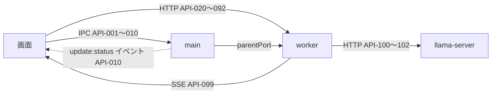

# 09. API設計
- プロジェクト：LLM-PARTY ／ 版数：v0.1（2026-11-05） ／ インプット：[04](../04_functional_spec/README.md)、[06](../06_ux_design.md)、[07](../07_architecture.md)

> **3行で**
> 1. インターフェースは3種類：画面 ↔ main の IPC（API-001〜010）、画面 ↔ worker の HTTP＋SSE（API-020〜099）、worker ↔ llama-server（API-100〜102）。
> 2. worker の API は `127.0.0.1` の空きポートに Bearer トークンつきで呼ぶ。JSON は camelCase、エラーは共通の形。
> 3. 画面への通知（生成の差分・承認待ち・進捗）は全部 `GET /api/events`（SSE）1本に流す。

## 🧭 判断してほしいこと
なし（llama-server 側の未確認点は R-04）

## 全体図

見てほしいところ：画面が main に頼むのは「OS のダイアログ・更新・秘密・接続先」だけ。

## 要点
- IPC の一覧は [ipc.md](ipc.md)、worker の一覧は [worker.md](worker.md)、llama-server は [engine.md](engine.md)。
- 共通仕様（認証・形式・エラー）は [共通仕様](#共通仕様)。
- SSE のイベント種類は [worker.md#API-099](worker.md#api-099get-apievents)。

---

## 詳細
以下は詳細層。

## 共通仕様
| 項目 | 内容 |
|---|---|
| ベース URL | `http://127.0.0.1:<port>/api`（port と token は API-008 で受け取る。localhost 段階は port 8787） |
| 認証 | `Authorization: Bearer <起動ごとのトークン>`。ない・違う → 401（NFR-011） |
| 形式 | JSON、UTF-8、camelCase。日時は ISO 8601（UTC） |
| 一覧 | `?limit=`（既定 50）と `?cursor=`（前の応答の `nextCursor`） |
| CORS | exe 段階は `app://llm-party` からのみ許可。localhost 段階は同一オリジンなので CORS を返さず、Host と Origin を確かめる（[12](../12_localhost_stage.md#接続と認証)） |
| 長い処理 | 受け付けて 202 を返し、進捗と結果は SSE で知らせる（ターン・DL・ラン・CUDA パック・エンジン読み込み） |

共通エラーの形：
```json
{ "error": { "code": "VALIDATION_ERROR", "message": "文脈長の範囲外。2048〜65536 で指定", "details": [{ "field": "contextSize" }] } }
```

<details>
<summary>エラーコード一覧（12件）</summary>

| code | HTTP | 意味 |
|---|---|---|
| UNAUTHORIZED | 401 | トークンがない・違う |
| VALIDATION_ERROR | 400 | 入力が不正 |
| NOT_FOUND | 404 | 対象がない |
| CONFLICT | 409 | 重複・使用中で消せない（プリセットで使っているモデルなど） |
| BUSY | 409 | 別のターンが動いている（D-63）、評価中に別プリセットで送信 |
| INSUFFICIENT_STORAGE | 507 | 空き容量不足（BR-05） |
| PATH_NOT_ALLOWED | 400 | ワークスペースにできないフォルダ |
| INVALID_GGUF | 400 | GGUF でない・種類違い・LoRA の形式違い |
| ENGINE_FAILED | 503 | llama-server の起動・応答の失敗 |
| UPSTREAM_ERROR | 502 | Hugging Face・GitHub の失敗 |
| AUTH_REQUIRED_UPSTREAM | 401 | ゲート付きリポジトリで HF トークンが必要 |
| INTERNAL | 500 | その他 |

</details>

## エンドポイント一覧（要約）
| 範囲 | ID | 内容 | 詳細 |
|---|---|---|---|
| IPC | API-001〜010 | アプリ情報・ダイアログ・更新・HF トークン・接続先・ログフォルダ（exe 段階） | [ipc.md](ipc.md) |
| localhost 用 | API-093〜094 | IPC の代わり（localhost 段階だけ） | [12](../12_localhost_stage.md#ipc-の代わり) |
| システム・エンジン | API-020〜025 | 死活、GPU 判定、CUDA パック、エンジンの読み込み | [worker.md](worker.md#システムエンジン) |
| スレッド・ターン | API-030〜044 | スレッド、送信、停止、承認、変更、ワークスペース | [worker.md](worker.md#スレッドターン) |
| モデル | API-050〜059 | モデル・LoRA・HF 検索・DL | [worker.md](worker.md#モデル) |
| プリセット | API-060〜063 | CRUD | [worker.md](worker.md#プリセット) |
| 評価 | API-070〜082 | 評価セット・取込・書出・ラン・採点・推移 | [worker.md](worker.md#評価) |
| 設定・診断 | API-090〜092 | 設定、診断情報 | [worker.md](worker.md#設定診断) |
| イベント | API-099 | SSE | [worker.md](worker.md#api-099get-apievents) |
| llama-server | API-100〜102 | `/health`・`/v1/chat/completions`・`/tokenize` | [engine.md](engine.md) |

## このドキュメントで決まったこと
- D-41：一覧の既定件数 50・カーソル方式（ユーザー確認済み。D-44 の⑥）
