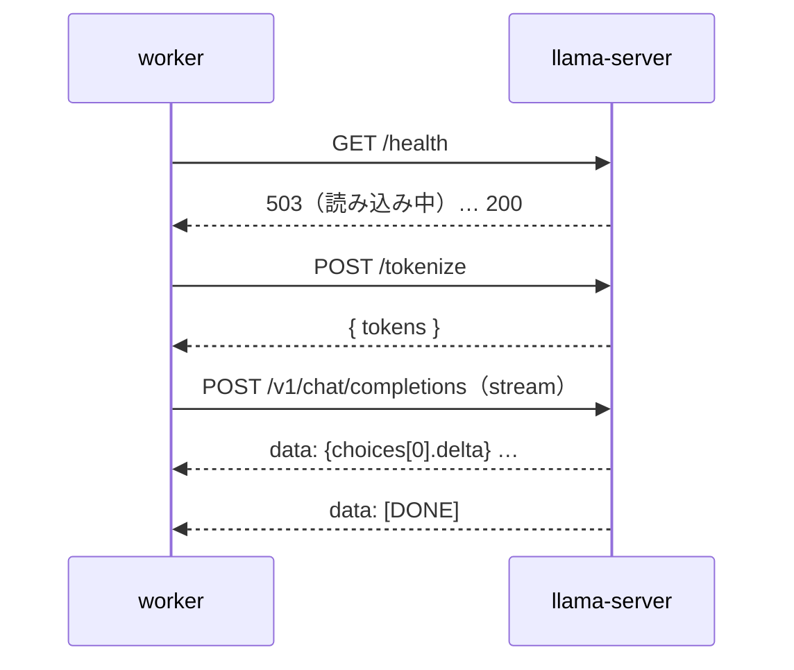

# 09-3. API設計：llama-server（worker → 推論エンジン）
- プロジェクト：LLM-PARTY ／ 版数：v0.1（2026-11-05） ／ 親：[09 README](README.md)

> **3行で**
> 1. worker が使う llama-server のエンドポイントは3つだけ：`/health`・`/v1/chat/completions`・`/tokenize`。
> 2. 根拠は llama.cpp の `tools/server/README.md`（2026-11-05 時点、ビルド b12125 前後）。
> 3. リクエストごとの `chat_template_kwargs` は `/v1/chat/completions` で効く。`lora` の倍率は実機確認が残る（R-04）。

## 🧭 判断してほしいこと
なし（R-04 は [chat-agent](../04_functional_spec/chat-agent.md#-判断してほしいこと)）

## 全体図


## 要点
- 認証は `Authorization: Bearer <--api-key の値>`（`/health` は不要と README にある）。
- ツール呼び出しは OpenAI 形式の `tools` / `tool_calls`。テンプレートは GGUF に入っている Qwen3.5 のもの（`--jinja`）。

---

## 詳細
以下は詳細層。

## API-100：GET /health
- 読み込み中は 503、使えるようになったら 200。FR-003 の起動待ちに使う

## API-101：POST /v1/chat/completions
<details>
<summary>リクエストの例</summary>

```json
{
  "messages": [
    { "role": "system", "content": "あなたはワークスペース C:\\dev\\my-app の中で作業するコーディングエージェントです…" },
    { "role": "user", "content": "ログイン処理のバグを直して" }
  ],
  "tools": [
    { "type": "function", "function": { "name": "read_file", "description": "…", "parameters": { "type": "object", "properties": { "path": { "type": "string" }, "startLine": { "type": "integer" }, "endLine": { "type": "integer" } }, "required": ["path"] } } }
  ],
  "stream": true,
  "stream_options": { "include_usage": true },
  "temperature": 0.6, "top_p": 0.95, "top_k": 20, "min_p": 0.0,
  "presence_penalty": 0.0, "repeat_penalty": 1.0,
  "lora": [{ "id": 0, "scale": 0.8 }],
  "chat_template_kwargs": { "enable_thinking": true }
}
```

</details>

- 応答（SSE）：`choices[0].delta` の `content`（本文）、`reasoning_content`（思考。`--reasoning-format` の既定で分かれる）、`tool_calls`（引数は分割されて届くのでつなげる）。最後に `usage`
- `lora` の `id` は起動時の `--lora` の並び順。省いたアダプタは倍率 0（R-04）。`lora` を空配列にすると起動時の倍率に戻る。登録していない `id` はエラーにならず無視される
- 思考 OFF のプリセットは `chat_template_kwargs.enable_thinking = false`（Qwen3.5 のモデルカードの指定。`/think` `/nothink` は使えない）

## API-102：POST /tokenize
- `{ "content": "…" }` → `{ "tokens": [ … ] }`。FR-006 の計測と FR-009 の出力の切り詰めに使う

## 起動引数で使うもの（エンドポイント以外）
- `--list-devices`（FR-001 の判定。llama.cpp `common/arg.cpp` で確認）、`-m`・`-c`・`-ngl`・`--host`・`--port`・`--api-key`・`--jinja`・`--lora`・`--lora-init-without-apply`（FR-003）

## 使わないもの
- 同梱の Web UI、`--tools` の組み込みツール・MCP（エージェントのツールは worker が持つ）、ルーターモード（複数モデル）、`/metrics`

## このドキュメントで決まったこと
- なし
