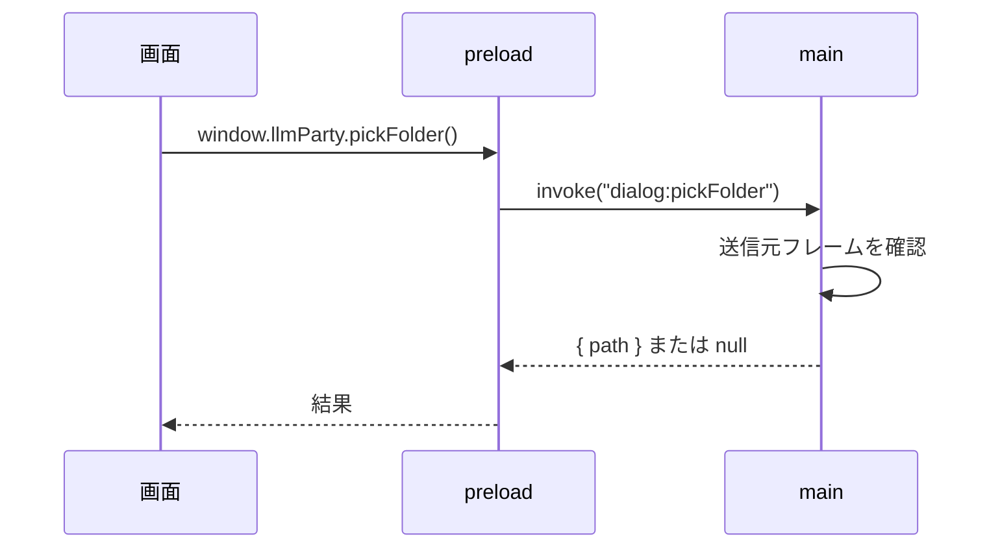

# 09-1. API設計：IPC（画面 ↔ main）
- プロジェクト：LLM-PARTY ／ 版数：v0.1（2026-11-05） ／ 親：[09 README](README.md)

> **3行で**
> 1. preload が `window.llmParty` に 10 個だけ公開する。中身は `ipcRenderer.invoke`。
> 2. main はすべての呼び出しで、送信元が自アプリのメインフレーム（`app://llm-party`）か確かめる（DC-Designer と同じ）。
> 3. HF トークンは書き込みと有無の確認だけで、中身を画面に返す関数はない。

## 🧭 判断してほしいこと
なし

## 全体図

見てほしいところ：送信元の確認に失敗した呼び出しは何もせずエラーにする。

## 要点
- 一覧は下の表。引数と戻り値の型も表に書いた。
- 更新の状態は `update:status` イベント（API-010）で main から画面へ押し出す。

---

## 詳細
以下は詳細層。

## IPC 一覧
| ID | チャンネル | `window.llmParty` の関数 | 引数 | 戻り値 | 関連 |
|---|---|---|---|---|---|
| API-001 | `app:getInfo` | `getInfo()` | — | `{ version, llamaBuild, isPackaged, dataDir }` | SCR-008 |
| API-002 | `dialog:pickFolder` | `pickFolder(purpose)` | `purpose: "workspace" \| "modelsDir" \| "fixturesDir" \| "export"` | `{ path } \| null` | FR-007, FR-020 |
| API-003 | `dialog:pickFile` | `pickFile(purpose)` | `purpose: "gguf" \| "jsonl"` | `{ path } \| null` | FR-013, FR-015 |
| API-004 | `update:check` | `checkForUpdates()` | — | `{ status: "latest" \| "available" \| "error", version? }` | FR-019 |
| API-005 | `update:download` | `downloadUpdate()` | — | `{ ok }`（進捗は API-010） | FR-019 |
| API-006 | `update:install` | `installUpdate()` | — | `{ ok }`（worker に停止を頼んでから入れ替え） | FR-019 |
| API-007 | `secrets:hfToken` | `setHfToken(token \| null)` / `hasHfToken()` | 文字列または null | `{ ok }` / `{ has: boolean }` | FR-012, FR-020 |
| API-008 | `worker:getConnection` | `getConnection()` | — | `{ baseUrl, token }` | 全画面 |
| API-009 | `shell:openLogs` | `openLogsFolder()` | — | `{ ok }` | FR-021 |
| API-010 | `update:status`（main → 画面） | `onUpdateStatus(cb)` | — | `{ phase: "available" \| "downloading" \| "ready" \| "error", percent?, version?, message? }` | SCR-009 |

## main ↔ worker（parentPort）
| メッセージ | 向き | 中身 | 使う場面 |
|---|---|---|---|
| `init` | main → worker | `{ port: 0, token, dataDir, resourcesDir, hfToken? }` | 起動時 |
| `ready` | worker → main | `{ port }` | 待ち受け開始後。main はこれで API-008 に答える |
| `hfToken` | main → worker | `{ token \| null }` | API-007 で変わったとき |
| `prepareShutdown` | main → worker | — | 終了・更新の前。生成・評価・DL を止めて DB を閉じる |
| `shutdownReady` | worker → main | — | 上の完了 |
| `busy` | main → worker / 返答 | `{ generating, evaluating, downloading }` | 更新の前の確認（FR-019） |

## このドキュメントで決まったこと
- なし（DC-Designer の IPC の方式に合わせた。D-01）
