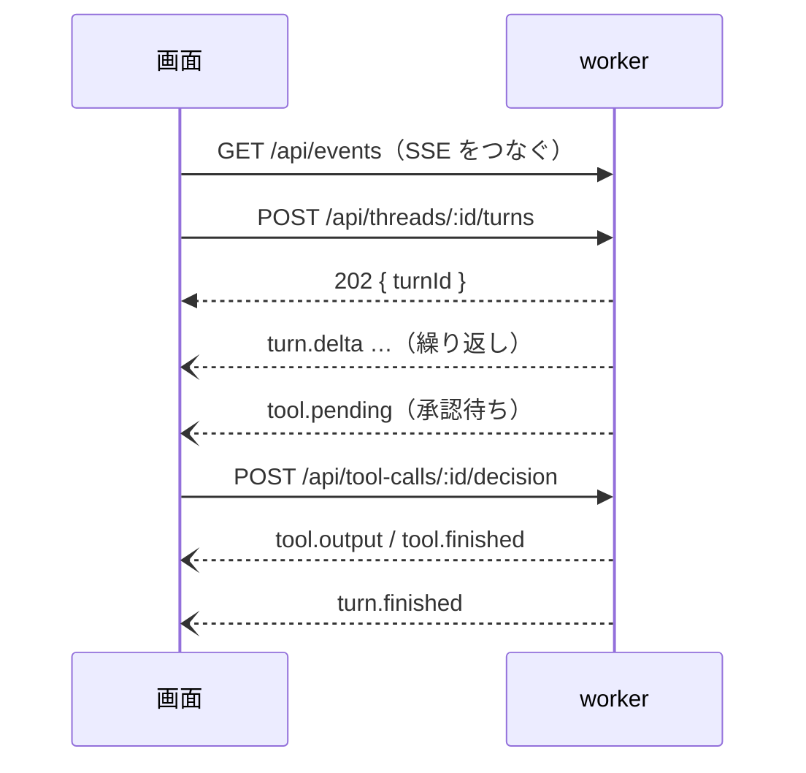

# 09-2. API設計：worker（画面 ↔ worker の HTTP＋SSE）
- プロジェクト：LLM-PARTY ／ 版数：v0.3（2026-11-07） ／ 親：[09 README](README.md)

> **3行で**
> 1. REST 風の `/api/*` が API-020〜094、通知は SSE の `/api/events`（API-099）。
> 2. 時間のかかる処理（送信・DL・ラン・CUDA パック・エンジン読み込み）は 202 で受け付け、結果はイベントで届く。
> 3. 全エンドポイントに Bearer トークンが必要（`/api/health` も含む）。

## 🧭 判断してほしいこと
なし

## 全体図

見てほしいところ：画面は「投げて、イベントを待つ」だけ。応答本文を HTTP の戻り値で待たない。

## 要点
- 一覧は分野ごとの表。代表的なものだけ詳細を書いた（API-035, API-038, API-077, API-099）。
- 関連する FR / SCR は各表の右端。

---

## 詳細
以下は詳細層。

## システム・エンジン
| ID | メソッド | パス | 概要 | 関連 |
|---|---|---|---|---|
| API-020 | GET | `/api/health` | worker の死活 | 全般 |
| API-021 | GET | `/api/system` | GPU 判定の結果、使用中のバックエンド、CUDA パックの状態、空き容量 | FR-001, SCR-002, SCR-008 |
| API-022 | POST | `/api/runtime-packs/install` | CUDA パックの導入を始める（202。`runtime.*` イベント）。`DELETE` で削除。exe 段階だけ | FR-002 |
| API-023 | GET | `/api/engine` | エンジンの状態・読み込み中のプリセット・警告（`warning?`） | FR-003, SCR-001 |
| API-024 | POST | `/api/engine/load` | `{ presetId }` を読み込む（202。`engine` イベント） | FR-003 |
| API-025 | POST | `/api/engine/unload` | 止める | FR-003 |

## スレッド・ターン
| ID | メソッド | パス | 概要 | 関連 |
|---|---|---|---|---|
| API-030 | GET | `/api/threads?q=&cursor=&limit=` | 一覧・全文検索。ページングは共通仕様（D-41） | FR-004 |
| API-031 | POST | `/api/threads` | `{ workspaceId?, presetId, summaryFromThreadId? }` で作る。`summaryFromThreadId` は「新しいスレッドで続ける」（D-67） | FR-004, FR-006 |
| API-032 | PATCH | `/api/threads/:id` | `{ title?, autoApprove? }` | FR-004, FR-010 |
| API-033 | DELETE | `/api/threads/:id` | 削除（動いているターンは止める） | FR-004 |
| API-034 | GET | `/api/threads/:id/messages` | メッセージ・ターン・ツール呼び出し | FR-004, SCR-001 |
| API-035 | POST | `/api/threads/:id/turns` | 送信（下に詳細） | FR-005, FR-008 |
| API-036 | POST | `/api/turns/:id/cancel` | 停止 | FR-005 |
| API-037 | POST | `/api/turns/:id/continue` | 40 回上限の後に `{ action: "continue" \| "stop" }` | FR-008 |
| API-038 | POST | `/api/tool-calls/:id/decision` | 承認・却下（下に詳細） | FR-010 |
| API-039 | GET | `/api/threads/:id/changes` | 変更記録の一覧と前後の中身 | FR-011 |
| API-040 | POST | `/api/file-changes/:id/revert` | `{ force?: boolean }` で取り消し。編集済みで force なし → 409 `CONFLICT` | FR-011 |
| API-041 | GET | `/api/workspaces` | 一覧から外していないワークスペース（画面の「プロジェクト」） | FR-007 |
| API-042 | POST | `/api/workspaces` | `{ path }` を検証して登録。だめなら `PATH_NOT_ALLOWED`。外したものは一覧へ戻す | FR-007 |
| API-043 | PATCH | `/api/workspaces/:id` | `{ name?, instructions?, defaultPresetId?, autoApprove? }`。後ろの3つは `null` で未指定に戻す | FR-007 |
| API-044 | DELETE | `/api/workspaces/:id` | 一覧から外す（行は消さない。スレッドもファイルも残す）。204 | FR-007 |

### API-035：POST /api/threads/:id/turns
- リクエスト：

  | フィールド | 型 | 必須 | 説明 |
  |---|---|---|---|
  | presetId | string | ○ | |
  | content | string | ○ | 空でない |
- レスポンス（202）：`{ "turnId": "01JC…", "status": "running" }`
- エラー：404（スレッド・プリセットがない）、409 `BUSY`（別のターンが動いている（D-63）／評価中で別プリセット）、503 `ENGINE_FAILED`
- 副作用：messages・turns を作る。必要ならエンジンを読み込み直し、自動要約する。イベント `turn.*`・`tool.*`・`engine`

### API-038：POST /api/tool-calls/:id/decision
- リクエスト：`{ "decision": "approve" | "reject" | "approve_and_auto", "note"?: string }`
- レスポンス（200）：`{ "status": "running" | "rejected" }`
- エラー：409 `CONFLICT`（もう承認待ちでない）
- 副作用：`approve_and_auto` はスレッドの `autoApprove` を ON にする。`reject` は `note` を理由としてモデルに返す

## モデル
| ID | メソッド | パス | 概要 | 関連 |
|---|---|---|---|---|
| API-050 | GET | `/api/models` | モデル一覧（ファイルの有無を確かめて `missing` を付ける。思考の対応を `supportsThinking`・`supportsEffort` で返す。D-76）。LoRA の一覧も `adapters` で返す | FR-013, SCR-003 |
| API-051 | POST | `/api/models` | `{ path, mode: "reference" \| "copy", name? }` で登録 | FR-013 |
| API-052 | DELETE | `/api/models/:id?deleteFile=` | 削除。プリセットで使用中 → 409 `CONFLICT`（`details` にプリセット名） | FR-013 |
| API-053 | GET | `/api/hf/search?q=&genre=&uncensored=&vram=&ram=&gpu=` | HF のリポジトリ検索。`genre` は `all` / `chat` / `image` / `video` / `music` / `speech` / `transcribe` / `embedding`。`q` が空でも `genre`・`uncensored=true`・`vram`・`ram` のどれかがあれば一覧する（どれもなければ 400）。`vram`・`ram` は GB の上限（1〜1024、省略か空は指定なし）。`gpu` は絞り込みで使う GPU に載せる割合（0〜100、既定 100）。`pipelineTag`・`license`・`params` も返す（推奨の値は画面が `params` とバーの値から計算する） | FR-012 |
| API-054 | GET | `/api/hf/files?repo=` | 全ファイルの一覧（量子化・サイズ・分割）。モデル本体が先 | FR-012 |
| API-055 | POST | `/api/downloads` | `{ repo, files[]?, kind }` で DL を始める（202。容量不足 → 507）。`kind` は `model` / `adapter` / `file`。`model` / `adapter` は `.gguf` だけ。`files` を省くとリポジトリ全体（`file` だけ） | FR-012 |
| API-056 | GET | `/api/downloads` | DL の一覧と進捗。完了した LoRA は `filePath` を返し、画面がベースモデルを選ばせて API-058 で登録する。完了した `file` は `savedDir` を返す | FR-012 |
| API-057 | POST | `/api/downloads/:id/cancel` | 取消（`.part` を消す）。`/resume` で手動再開 | FR-012 |
| API-058 | POST | `/api/adapters` | `{ path, baseModelId, mode, name? }` で LoRA を登録 | FR-013 |
| API-059 | DELETE | `/api/adapters/:id?deleteFile=` | 削除。使用中 → 409 | FR-013 |

## プリセット
| ID | メソッド | パス | 概要 | 関連 |
|---|---|---|---|---|
| API-060 | GET | `/api/presets` | 一覧 | FR-014 |
| API-061 | POST | `/api/presets` | 作成（`{ name, modelId, adapters[], sampling, systemPrompt, thinking, effort?, contextSize, gpuRatio? }`。`gpuRatio` は GPU に載せる割合（0〜100）で、省略か null は自動） | FR-014 |
| API-062 | PATCH | `/api/presets/:id` | 編集 | FR-014 |
| API-063 | DELETE | `/api/presets/:id` | 削除（ランは残る） | FR-014 |

## 画像生成（D-72）

| ID | メソッド | パス | 内容 | 対応 |
|---|---|---|---|---|
| API-095 | POST | `/api/threads/:id/images` | `{ modelId, prompt, width?, height?, steps?, seed? }` を受けて 202 `{ status: "running" }`。結果は SSE の `image` イベント（`{ threadId, status: "completed", imageId }` または `{ threadId, status: "failed", error }`）で届く。画像モデル（`use: image`）だけを受ける | FR-012, D-72 |
| API-096 | GET | `/api/images/:id` | 生成した PNG を返す（`dataDir/images` の中だけ） | FR-012, D-72 |
| API-097 | POST | `/api/image-recipes` | `{ recipe: "moss-image" }` を受けて、レシピの部品を DL の待ち行列に入れる（kind `image-set`）。202 で DL の行を返す。空き容量が部品の合計＋2GB に足りなければ断る（INSUFFICIENT_STORAGE）。DL が終わると画像モデル（`use: image`）が1つ登録される | FR-012, D-73, ADR-010 |
| API-098 | GET | `/api/image-recipes` | レシピの一覧。各レシピの部品（ファイル名・取得元・サイズ）、合計サイズ、登録済みかどうか | FR-012, D-73 |

- 生成したものは `messages` に `role = image` で入る。内容は JSON（`imageId`・`prompt`・`modelName`・`width`・`height`）。履歴の文脈には入らない
- 同時に1枚。チャットの生成中・評価中は断る（BUSY）

## 音楽生成（D-78, D-80）

| ID | メソッド | パス | 内容 | 対応 |
|---|---|---|---|---|
| API-103 | POST | `/api/threads/:id/music` | **廃止**（D-80）→ API-109 | — |
| API-104 | POST | `/api/threads/:id/music/cancel` | **廃止**（D-80）→ API-110 | — |
| API-105 | GET | `/api/music/:id` | 生成した MP3 を返す（`dataDir/music` の中だけ）。消した曲は 404 | FR-025, FR-027, D-78 |
| API-106 | POST | `/api/music-recipes` | `{ recipe: "ace-step" }` を受けて、部品を DL の待ち行列に入れる（kind `music-set`）。形は API-097 と同じ | FR-012, D-78 |
| API-107 | GET | `/api/music-recipes` | レシピの一覧。形は API-098 と同じ。`installed` は部品がそろい、モデルとして登録済みのときだけ true（API-098 も同じ） | FR-012, FR-022, D-78 |
| API-108 | POST | `/api/music/draft` | `{ modelId, prompt }` を受けて 202 `{ status: "running" }`。歌詞だけを作る | FR-023 |
| API-109 | POST | `/api/music/generate` | `{ modelId, prompt, lyrics?, duration? }` を受けて 202 `{ status: "running" }`。`duration` は 10〜240 秒（既定 60）。`lyrics` は空なら作詞を任せ、`[Instrumental]` なら歌なし。シードは毎回新しい。音楽モデル（`use: music`）だけを受ける | FR-025 |
| API-110 | POST | `/api/music/cancel` | 実行中の下書き・生成を止める。`{ status: "cancelling" }`、動いていなければ `{ status: "idle" }` | FR-023, FR-025 |
| API-111 | GET | `/api/tracks` | 曲の一覧。`{ items: [{ id, prompt, duration, createdAt }], nextCursor }`。新しい順、既定 50 件 | FR-027 |
| API-112 | GET | `/api/tracks/:id` | 曲の中身。`{ id, prompt, lyrics, reasoning, duration, bpm, keyscale, modelName, seed, createdAt }` | FR-026, FR-027 |
| API-113 | DELETE | `/api/tracks/:id` | 曲の行と MP3 を消す。204、なければ 404 | FR-027 |
| API-114 | GET | `/api/music/status` | 今の状態。`{ status: "idle" \| "drafting" \| "composing" \| "rendering", reasoning? }` | FR-023, FR-025 |

- `music` イベント：`{ job: "draft" | "track", status: "progress", phase: "drafting" | "composing" | "rendering", reasoning? }`（`reasoning` は LM の思考のそれまでの全文）、`{ job: "draft", status: "completed", lyrics }`、`{ job: "track", status: "completed", trackId }`、`{ job, status: "failed", error }`、`{ job, status: "cancelled" }`
- 別の生成が動いているときの API-108・API-109 は 409 BUSY
- 新しい曲は `messages` に入らない。v7 までの `role = music` のメッセージは残し、スレッドで再生する。履歴の文脈には入らない

## 評価
| ID | メソッド | パス | 概要 | 関連 |
|---|---|---|---|---|
| API-070 | GET | `/api/eval-sets` | 一覧（ケース数・最新ランの正解率） | FR-015 |
| API-071 | POST | `/api/eval-sets` | 作成 | FR-015 |
| API-072 | PUT | `/api/eval-sets/:id` | セットとケースをまとめて保存 | FR-015 |
| API-073 | DELETE | `/api/eval-sets/:id` | 削除（ランも消える） | FR-015 |
| API-074 | GET | `/api/eval-sets/:id` | セットとケース | FR-015 |
| API-075 | POST | `/api/eval-sets/:id/import` | `{ path, onDuplicate: "overwrite" \| "skip" }` で JSONL 取込。戻り値に `{ added, skipped, errors: [{ line, reason }] }` | FR-015 |
| API-076 | POST | `/api/eval-sets/:id/export` | `{ path }` に JSONL を書く | FR-015 |
| API-077 | POST | `/api/eval-runs` | 実行（下に詳細） | FR-016 |
| API-078 | GET | `/api/eval-runs?evalSetId=` | ラン一覧 | FR-016, SCR-005 |
| API-079 | GET | `/api/eval-runs/:id` | ランと全結果 | FR-016, SCR-006 |
| API-080 | POST | `/api/eval-runs/:id/cancel` | 中止。`DELETE /api/eval-runs/:id` で削除 | FR-016 |
| API-081 | PATCH | `/api/eval-results/:id` | 人手採点 `{ verdict: "passed" \| "failed" }` または `{ score: 1〜5 }` | FR-017 |
| API-082 | GET | `/api/eval-sets/:id/trend?tags=` | 正解率の推移と、`?compare=runA,runB` でケースごとの比較 | FR-018, SCR-007 |

### API-077：POST /api/eval-runs
- リクエスト：`{ "evalSetId": "…", "presetIds": ["…", "…"], "tags"?: ["python"] }`
- レスポンス（202）：`{ "runIds": ["…", "…"] }`（プリセットの数だけ。順番に流れる）
- エラー：404、400（ケース 0 件・agent ケースの `fixture` がない）
- 副作用：eval_runs（`queued`）と eval_results（`pending`）を作る。イベント `eval.progress`・`eval.finished`

## 設定・診断
| ID | メソッド | パス | 概要 | 関連 |
|---|---|---|---|---|
| API-090 | GET | `/api/settings` | 設定（FR-020 の表） | FR-020 |
| API-091 | PATCH | `/api/settings` | 一部を更新 | FR-020 |
| API-092 | POST | `/api/diagnostics/export` | `{ path }` に診断 zip を書く | FR-021 |
| API-093〜094 | — | `/api/local/*` | localhost 段階だけ有効（[12](../12_localhost_stage.md#ipc-の代わり)） | FR-020, FR-021 |

## API-099：GET /api/events
SSE。1本の接続で全種類を流す。切れたら画面がつなぎ直し、`Last-Event-ID` 以降を受け取る（直近のイベントを worker がメモリに持つ）。`EventSource` はヘッダーを付けられないので、画面は `fetch` のストリームで読み、`Authorization` と `Last-Event-ID` を自分で付ける。

イベントの種類（14件）

| event | data の主な中身 | 使う画面 |
|---|---|---|
| `engine` | `{ state, presetId, backend, error?, warning?, installPercent? }`（`warning` は読み込みを止めない注意。ADR-012） | SCR-001 |
| `turn.delta` | `{ turnId, messageId, content?, reasoning? }`（差分） | SCR-001 |
| `turn.usage` | `{ turnId, usedTokens, contextSize, tokensPerSecond? }`（生成中は速度も送る） | SCR-001 |
| `turn.compacted` | `{ threadId, summaryMessageId, count }` | SCR-001 |
| `turn.finished` | `{ turnId, status, error?, truncated?, looped? }`（`truncated` は生成の上限に達したとき。D-61。`looped` は思考のループを検知して止めたとき。D-70） | SCR-001 |
| `tool.pending` | `{ toolCallId, tool, args, preview? }`（書き込みは差分のプレビュー） | SCR-001 |
| `tool.started` | `{ toolCallId }` | SCR-001 |
| `tool.output` | `{ toolCallId, chunk }`（コマンドの出力） | SCR-001 右パネル |
| `tool.finished` | `{ toolCallId, status, exitCode? }` | SCR-001 |
| `turn.stepLimit` | `{ turnId, stepCount }` | SCR-001 |
| `download.progress` | `{ downloadId, status, receivedBytes, totalBytes }` | SCR-002, SCR-003 |
| `runtime.progress` | `{ status, percent?, error? }` | SCR-002, SCR-008 |
| `eval.progress` | `{ runId, done, total, passed, currentCase }` | SCR-001, SCR-006 |
| `eval.finished` | `{ runId, status, passRate }` | SCR-006 |

## このドキュメントで決まったこと
- なし
