# 10. ER図 / シーケンス図 / 状態遷移図
- プロジェクト：LLM-PARTY ／ 版数：v0.1（2026-11-05） ／ インプット：[08](08_database.md)、[09](09_api/README.md)、[04 状態の定義](04_functional_spec/README.md#状態の定義)

> **3行で**
> 1. ER 図は 08 の 17 テーブル。シーケンスは主要4本（初回・エージェント・評価・更新）とエラー1本（エンジン停止）。
> 2. 状態遷移はターン・ツール呼び出し・ラン・ケース結果・DL・推論エンジンの6つ。
> 3. 値は 04 の「状態の定義」と一致させている。

## 🧭 判断してほしいこと
なし

## 全体図
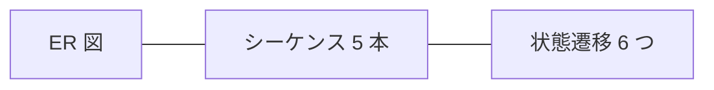

## 要点
- [ER図](#er図) → [シーケンス図](#シーケンス図) → [状態遷移図](#状態遷移図) の順。

---

## 詳細
以下は詳細層。

## ER図
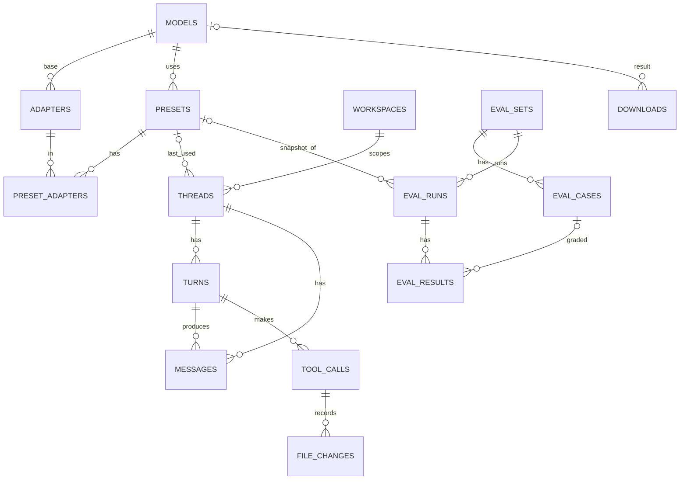
DOWNLOADS・RUNTIME_PACKS・SETTINGS は単独のテーブル。

## シーケンス図

### UC-001：初回セットアップ（CUDA あり）
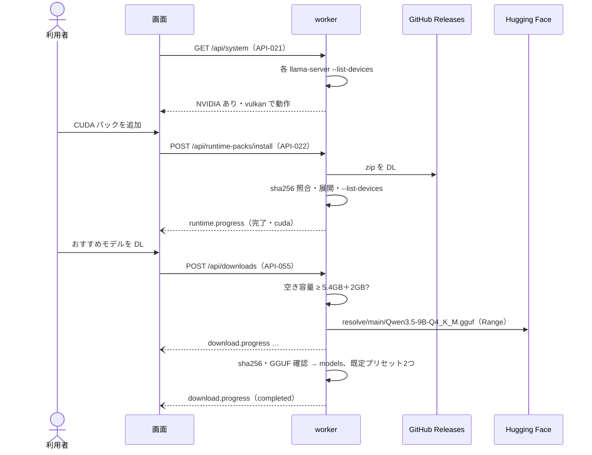

### UC-003：エージェントの作業（承認あり）
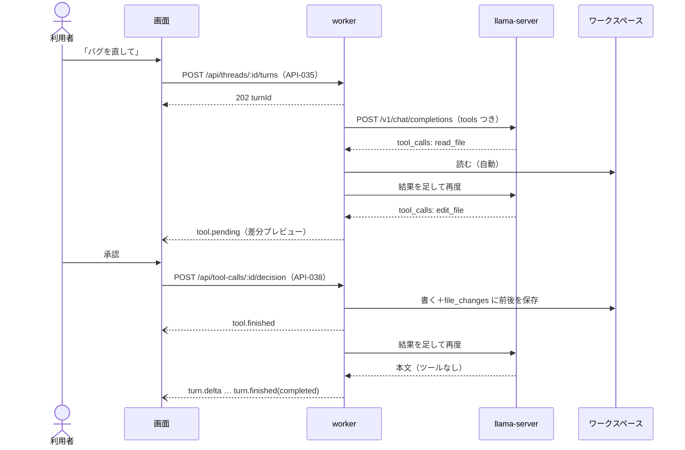

### UC-007：評価の実行
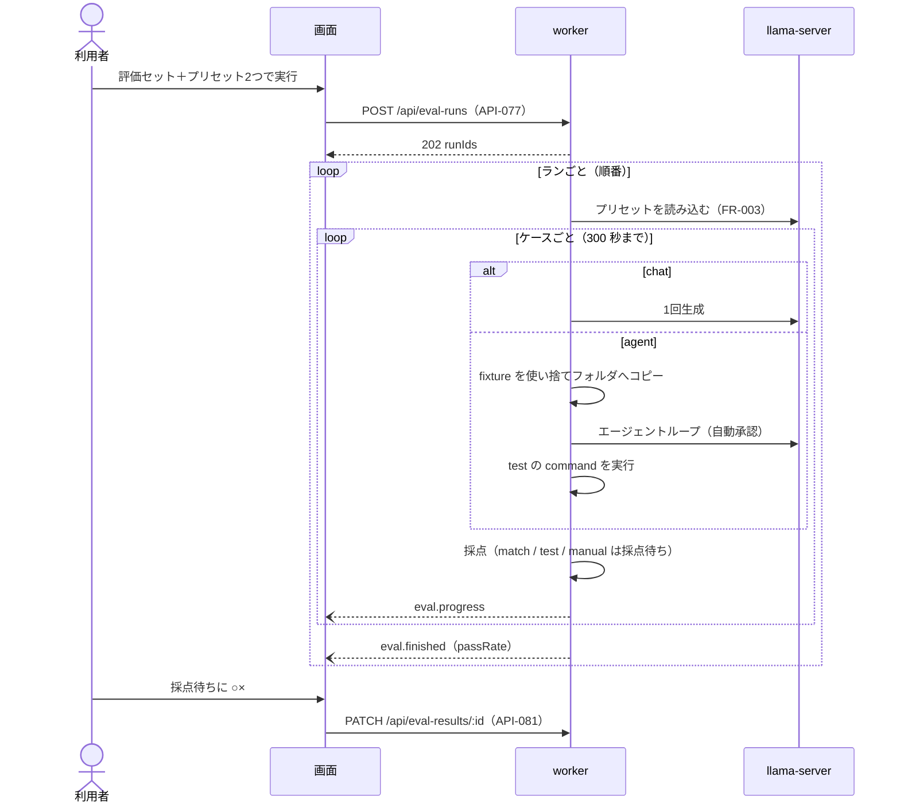

### UC-008：更新
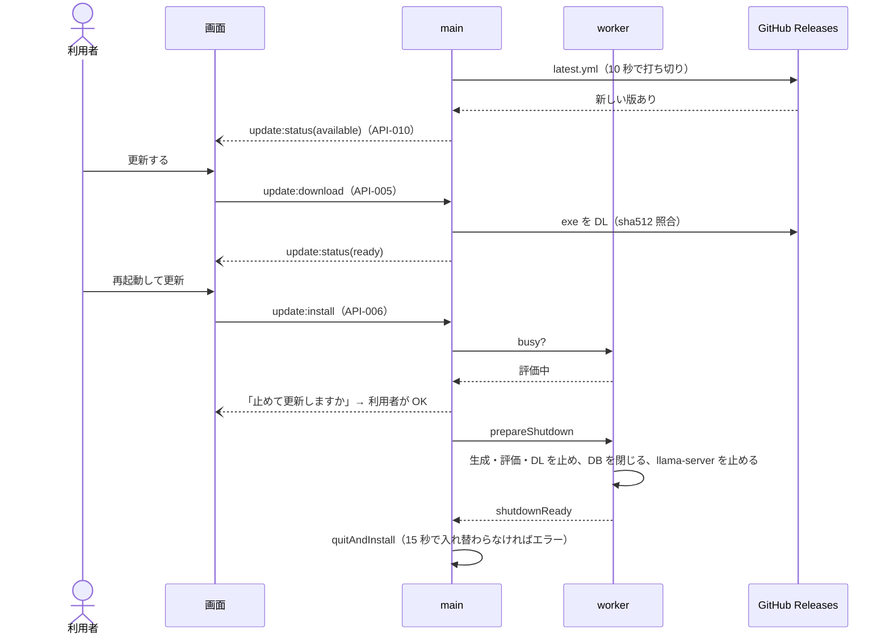

### エラー：生成中に推論エンジンが落ちた
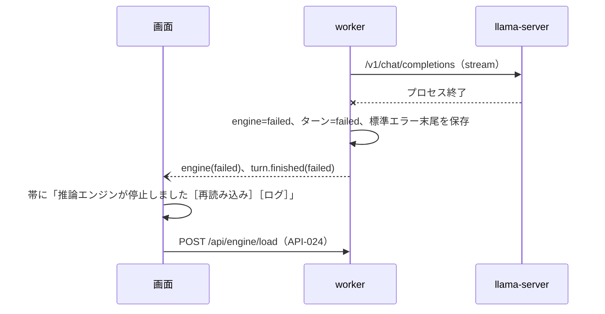

## 状態遷移図

### ターン
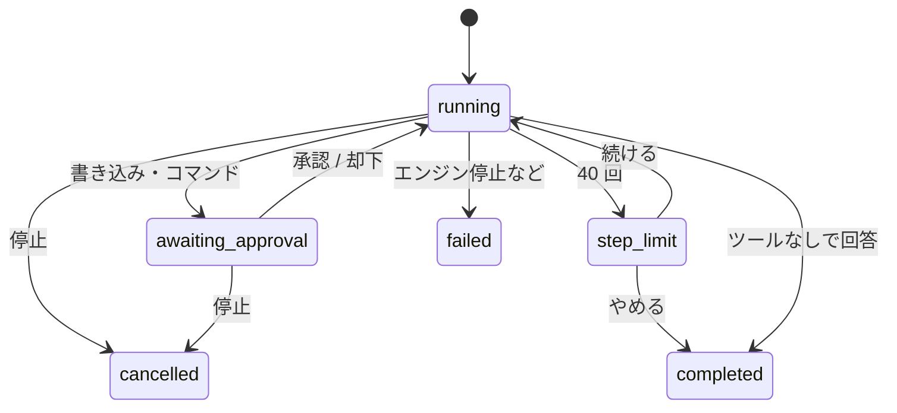

### ツール呼び出し
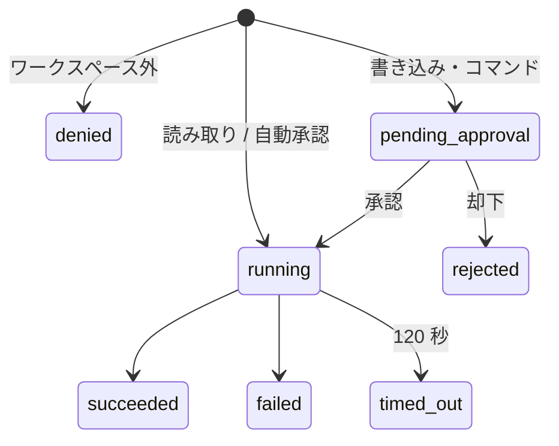

### ラン と ケース結果
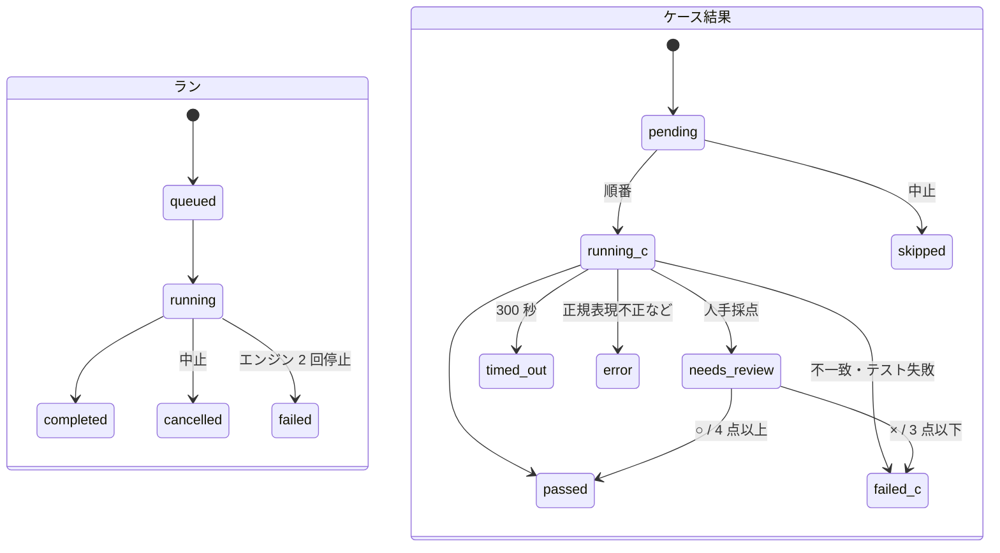
`running_c` / `failed_c` は図の都合の名前で、値は `running` / `failed`。

### DL
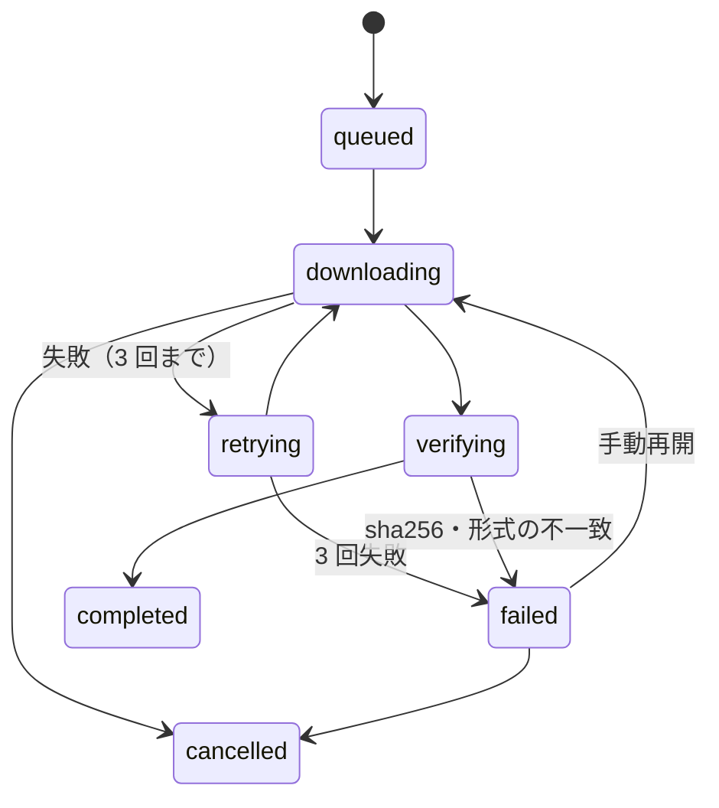

### 推論エンジン
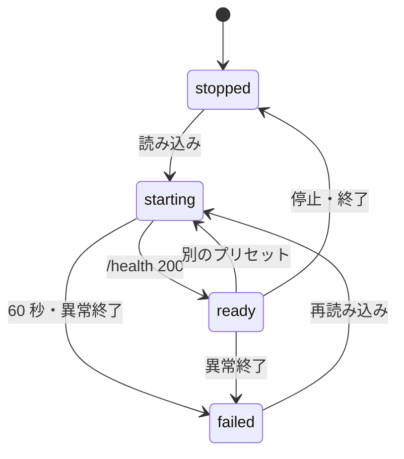

## このドキュメントで決まったこと
- なし
