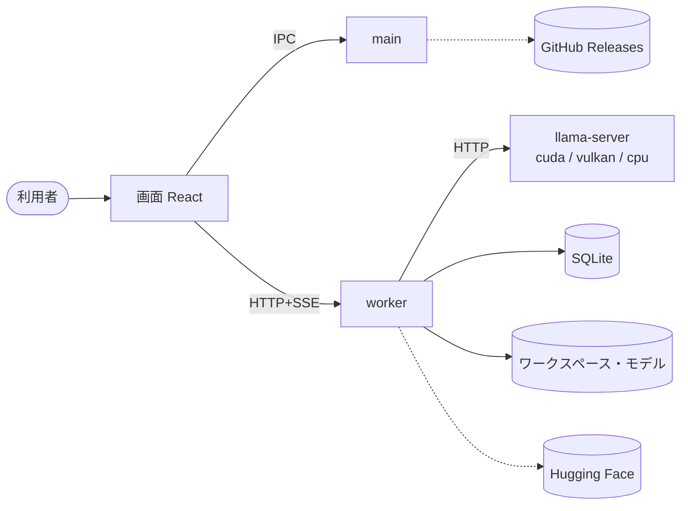

# 11. 技術仕様書
- プロジェクト：LLM-PARTY ／ 版数：v0.3（2026-11-07） ／ インプット：00〜10 すべて

> **3行で**
> 1. LLM-PARTY は Electron（main・画面・worker）＋同梱の llama-server で、GGUF モデルとの対話・ワークスペース内のエージェント・評価セットの一括実行を行う Windows アプリ。
> 2. 比較の単位は「プリセット」、評価の単位は「ラン」。ランはプリセットの中身を写して持つ。
> 3. 配布と更新は DC-Designer と同じ（`v*` タグ → NSIS → GitHub Releases → electron-updater）。CUDA は追加パック。

**段階**：先に localhost 段階（WSL＋ブラウザ）で作って試し、OK が出てから exe にする（[12](12_localhost_stage.md)）。

## 🧭 判断してほしいこと
なし（全体の論点は [README](README.md#-判断してほしいこと) に集約）

## 全体図

見てほしいところ：図は exe 段階の最終形。会話の中身が通るのは画面・worker・llama-server の間（すべて 127.0.0.1）だけ。

## 要点
- 各節は「要点＋リンク」。表の全文は各ドキュメントにある。
- 実装の順番・タスクはこの文書に書かない。

---

## 詳細
以下は詳細層。

## 1. 概要
- 目的：チューニングしたモデルを普段使いと評価の両方で確かめる（[01 §2](01_requirements.md#2-目的成功指標kpi)）
- スコープ：REQ-001〜009 が Must、REQ-010 が Should、REQ-011〜013 が Could。Won't は [01 §7](01_requirements.md#7-スコープ外wont)
- 読者：実装する開発者（本人）

## 2. システム全体像
- 3プロセス＋子プロセス1つ。詳細は [07 レベル2](07_architecture.md#レベル2コンテナ図)・[レベル3](07_architecture.md#レベル3コンポーネント図worker)
- スタック：Electron 45 / React 19 / Vite / TypeScript / Express 5 / SQLite（better-sqlite3）/ llama.cpp llama-server / electron-builder（NSIS）/ electron-updater / Vitest / GitHub Actions

## 3. 機能概要
| 分野 | FR | 詳細 |
|---|---|---|
| 準備 | FR-001 GPU 判定、FR-002 CUDA パック、FR-012 HF、FR-013 登録、FR-014 プリセット | [models-runtime](04_functional_spec/models-runtime.md) |
| 会話・エージェント | FR-003 エンジン、FR-005 送信、FR-006 文脈、FR-008 ループ、FR-009 ツール、FR-010 承認、FR-011 変更 | [chat-agent](04_functional_spec/chat-agent.md) |
| 評価 | FR-015 セット、FR-016 実行、FR-017 採点、FR-018 比較 | [eval](04_functional_spec/eval.md) |
| アプリ | FR-004 スレッド、FR-007 ワークスペース、FR-019 更新、FR-020 設定、FR-021 ログ | [app](04_functional_spec/app.md) |
| 音楽 | FR-022 XL のレシピ、FR-023 下書き、FR-024 編集、FR-025 生成、FR-026 作り直し、FR-027 一覧と削除 | [music](04_functional_spec/music.md) |

## 4. データモデル
- 18 テーブル。2系統（会話：threads → turns → messages / tool_calls → file_changes、評価：eval_sets → eval_cases、eval_runs → eval_results）
- ER 図は [10](10_diagrams.md#er図)、定義は [08](08_database.md)
- ULID・UTC の ISO 8601・物理削除・`PRAGMA user_version` で版上げ

## 5. インターフェース
- IPC 10 本（[ipc](09_api/ipc.md)）、worker の HTTP 約 50 本＋SSE（[worker](09_api/worker.md)）、llama-server 3 本（[engine](09_api/engine.md)）
- 外部：Hugging Face の検索・tree・resolve、GitHub Releases の `latest.yml`・exe・runtime zip

## 6. 画面構成
- 10 画面。メインは3ペイン（[06 SCR-001](06_ux_design.md#scr-001メイン)）。遷移図は [06 全体図](06_ux_design.md#全体図)

## 7. 非機能要件への対応方針
| NFR | 実現手段 |
|---|---|
| NFR-001 読み込み 60 秒 | `/health` を 0.5 秒ごとに確認、60 秒で失敗（FR-003） |
| NFR-003 文脈 32K・80% | `usage`＋`/tokenize` で計測、自動要約（FR-006） |
| NFR-004 出力 8,000 トークン | `/tokenize` で数え、先頭・末尾を残して省略（FR-009） |
| NFR-005 / 006 時間切れ | プロセスツリーごと終了（FR-009, FR-016） |
| NFR-007 更新確認 10 秒 | electron-updater の確認に期限をかけ、起動を待たせない（FR-019） |
| NFR-023 DB 版上げ | 1世代バックアップしてから移行 |

## 8. セキュリティ設計
- 画面：sandbox・contextIsolation・CSP・IPC 送信元確認（NFR-010）
- プロセス間：127.0.0.1＋起動ごとのトークン / `--api-key`（NFR-011, 012）
- エージェント：パスを実体に解決してワークスペース外を拒否、書き込み・コマンドは承認（[ADR-005](adr/ADR-005-approval-policy.md)）。ワークスペースにできないフォルダあり（FR-007）
- 秘密：HF トークンは main が DPAPI で暗号化、画面に返さない、ログに書かない（NFR-014）
- 外部通信：HF と GitHub だけ、テレメトリなし（NFR-015）。DL は sha512 / sha256 で検証（NFR-016）
- 個人情報：会話・ファイルは端末内だけ。ログに本文を書かない（FR-021）

## 9. エラーハンドリング・ログ・監視
- API のエラーは共通形式とコード 12 種（[09 README](09_api/README.md#共通仕様)）
- エンジン停止：ターンを失敗にし「再読み込み」を出す。評価中は1回だけ読み込み直す（[10 エラー](10_diagrams.md#エラー生成中に推論エンジンが落ちた)）
- worker 停止：main が1回だけ起動し直す（D-40）
- ログ：ローカルに日ごと、14 日、診断 zip は利用者が書き出す（FR-021）

## 10. 環境・設定
| 項目 | localhost 段階（Windows） | 本番（インストール版） |
|---|---|---|
| 画面 | worker が `127.0.0.1:8787` で配る（開発中は Vite をミドルウェアに） | `app://llm-party` |
| worker | tsx または Node で起動 | utilityProcess（asar の外） |
| llama-server | `data/runtime/llama/` に自動で取得（ADR-011）。`LLM_PARTY_LLAMA_BIN` は上書き用で、パスが実在しなければ警告して無視する（ADR-012） | `resources\llama\<ビルド番号>-<cpu\|vulkan>\`、CUDA は `runtime\` |
| データ | `%LOCALAPPDATA%\llm-party\`（D-86） | `%LOCALAPPDATA%\llm-party\` |
| 更新 | 動かさない | GitHub `itiwoja/llm-party` |

- 同梱する設定：`runtime-manifest.json`（llama.cpp のビルド番号・各パックの URL・サイズ・sha256）、`app-update.yml`（electron-builder が生成）
- 環境変数（localhost 段階のみ）：`LLM_PARTY_DATA_DIR`、`LLM_PARTY_LLAMA_BIN`、`LLM_PARTY_SD_BIN`、`LLM_PARTY_ACE_DIR`（ADR-009）、`LLM_PARTY_BACKEND`、`LLM_PARTY_PORT`（[12](12_localhost_stage.md#起動のしかた)）

## 11. テスト方針
| レベル | 観点 |
|---|---|
| 単体（Vitest） | 承認ポリシーの判定（パス解決・リンク・ジャンクション）、出力の切り詰め、採点（match / test / manual・正解率）、JSONL の検証、文脈の閾値、状態遷移 |
| 結合 | 小さな GGUF で llama-server を実際に起動し、ストリーミング・ツール呼び出し・LoRA 倍率・思考 OFF（R-04）を確かめる |
| E2E（手動） | localhost 段階：[exe 段階へ進む条件](12_localhost_stage.md#exe-段階へ進む条件)。exe 段階：初回セットアップ（CUDA あり / なし）、エージェントの承認・却下・取り消し、評価ラン→比較、更新の適用 |
| リリース検査 | DC-Designer と同じく、ステージとインストーラーの中身を許可リストで検査（`.node`・llama-server の有無を含む） |

## 12. リスクと対策
| # | リスク | 対策 | 詳細 |
|---|---|---|---|
| R-01 | 未署名で SmartScreen 警告 | 手順の案内、SignPath は後で | [05](05_non_functional.md) |
| R-02 | CUDA パックと同梱版のずれ | ビルド番号で照合、ずれたら Vulkan＋再 DL 案内 | [models-runtime](04_functional_spec/models-runtime.md) |
| R-03 | PEFT 形式の LoRA が読めない | 登録時に判定して変換を案内 | 同上 |
| R-04 | リクエストごとの LoRA 倍率の実機確認が残る | 手元の LoRA で確かめ、だめなら読み込み直し方式 | [chat-agent](04_functional_spec/chat-agent.md) |
| R-05 | 9B のツール誤用・繰り返し | エラーを返して直させる、40 回上限 | [04 README](04_functional_spec/README.md) |
| R-06 | 自動要約で指示が落ちる | 最初の指示とシステムは残す、元は DB に残す | 同上 |
| R-07 | 外部通信がある | 通信先を明示、本文は送らない | [05](05_non_functional.md) |
| R-08 | ネイティブモジュールのビルド | asarUnpack と検査 | [07](07_architecture.md) |
| R-09 | cudart の再配布条件 | 公開前に確認、だめなら公式から直接 DL | [models-runtime](04_functional_spec/models-runtime.md) |
| R-10 | コマンドはワークスペース外に影響しうる | 承認制、自動承認は明示 ON だけ | [04 README](04_functional_spec/README.md) |
| R-19 | `LLM_PARTY_LLAMA_BIN` の打ち間違いでも読み込みが止まらず、別の本体が動くことがある | 警告で気づけるようにする（CP-313） | [ADR-012](adr/ADR-012-invalid-llama-override.md) |
| R-15 | Windows 固有の動きは exe 段階まで確かめられない | exe 段階の確認に入れる | 同上 |
| R-16 | 他のサイトから localhost の API を叩かれる | トークン＋Host・Origin の確認 | 同上 |
| R-22 | XL の VRAM の余裕は約 1.4GB | 失敗しても内容を残して案内する | [music](04_functional_spec/music.md) |
| R-23 | 下書きの内容のずれ、長い歌詞の歌われ方が未確認 | 手直しの土台と位置づけ、実装時に耳で確かめる | 同上 |

## 13. 未決事項・Claude 判断で決めた項目
- Claude 判断：ADR-002 のうち「子プロセスにする」点、D-45（細部の定石の一覧）、D-79・D-81 の一部、D-83（音楽の細部）。定石：D-33〜D-37, D-39（[00](00_overview.md#決定事項ログ)）

## 14. 参照ドキュメント
- 設計書：[00](00_overview.md)〜[10](10_diagrams.md)、[12](12_localhost_stage.md)、[adr/](adr/)
- 外部：llama.cpp `tools/server/README.md`（エンドポイント・`--lora`・`--jinja`）、llama.cpp `common/arg.cpp`（`--list-devices`）、llama.cpp Releases b12125（配布物の名前）、Hugging Face `Qwen/Qwen3.5-9B` モデルカード（推奨サンプリング・思考モード・Apache-2.0）、`unsloth/Qwen3.5-9B-GGUF`（Q4_K_M 5.7GB）
- 参考実装：DC-Designer（`desktop/main.ts`・`desktop/updater.ts`・`electron-builder.yml`・`.github/workflows/release-windows.yml`・`docs/adr/ADR-001`〜`005`）

## このドキュメントで決まったこと
- なし（01〜10 の統合）
