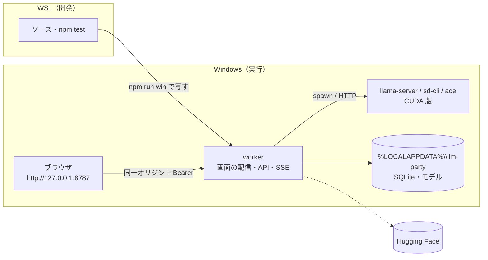
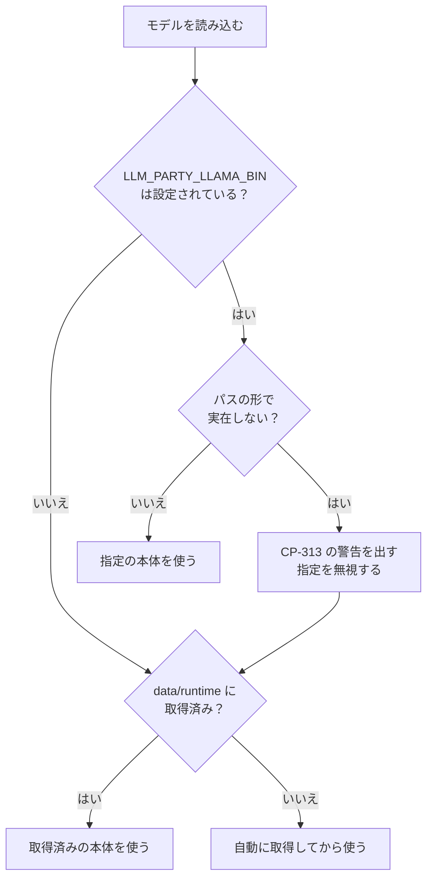

# 12. localhost 段階の仕様
- プロジェクト：LLM-PARTY ／ 版数：v0.3（2026-11-07） ／ インプット：[ADR-008](adr/ADR-008-localhost-first.md)、[07](07_architecture.md)、[09](09_api/README.md)

> **3行で**
> 1. 最初は Electron なしで作り、Windows の worker が `http://127.0.0.1:8787` で画面と API を出す。ブラウザで色々試す。開発は WSL（D-86）。
> 2. 利用者がこの段階で「OK」と言ってから、Electron に包んで exe にする（exe 段階）。exe の設計はそのまま残す。
> 3. worker と画面は両段階で同じものを使い、違いは「画面の接続層」と「worker の起動の入口」に閉じ込める。

## 🧭 判断してほしいこと
| # | 種類 | 論点 | 選択肢 | おすすめ（理由） | 決まらないと止まるもの |
|---|---|---|---|---|---|
| R-19 | リスク | `LLM_PARTY_LLAMA_BIN` の打ち間違いでも読み込みは止まらないので、自分でビルドした本体を試すつもりで別の本体が動くことがある。何も取得していなければ約 780MB の自動取得も始まる | — | 警告を画面とターミナルに出して気づけるようにする（CP-313、[ADR-012](adr/ADR-012-invalid-llama-override.md)） | — |
| R-16 | リスク | エージェントがコマンドを動かす API をブラウザから呼ぶので、他のサイトから叩かれないようにする必要がある | — | トークンに加えて Host と Origin を確かめる（[接続と認証](#接続と認証)） | — |

## 全体図

見てほしいところ：Electron の main と preload がなく、画面は worker から直接配られる。GitHub への通信もこの段階にはない。

## 要点
- 段階の分け方は [段階の定義](#段階の定義)、REQ・FR の振り分けは [01](01_requirements.md#5-要件一覧) と [04](04_functional_spec/README.md#機能一覧) の「段階」列。
- 動かし方は [起動のしかた](#起動のしかた)。
- `window.llmParty` の代わりは [IPC の代わり](#ipc-の代わり)。
- 次へ進む条件は [exe 段階へ進む条件](#exe-段階へ進む条件)。

---

## 詳細
以下は詳細層。

## 段階の定義
| 段階 | 目的 | 使う人 | 動く場所 | 終わり |
|---|---|---|---|---|
| localhost 段階 | 機能と使い勝手を試して固める | 開発者本人（P-1）だけ | Windows（開発は WSL） | [exe 段階へ進む条件](#exe-段階へ進む条件)を満たす |
| exe 段階 | Electron に包んで知人に配る | P-1・P-2 | Windows（NSIS でインストール） | 設計書の最終形 |

WSL はソースの編集とテストだけに使う。アプリは WSL では動かさない（[ADR-016](adr/ADR-016-windows-runtime.md)）。

## 起動のしかた
| コマンド | 実行する場所 | 使う場面 |
|---|---|---|
| `npm run win` | WSL | ソースを `%LOCALAPPDATA%\llm-party\app` へ写し、依存が変わっていれば入れ直し、Windows でビルドして起動する |
| `npm test` / `npm run typecheck` | WSL | テストと型の確認 |
| `scripts\win-start.ps1` | Windows | 写し済みの `app` をそのまま起動する |
| `scripts\win-stop.ps1` | Windows | worker を子プロセスごと止める。`npm run win` は起動の前と終わるときに呼ぶ |

URL は `http://127.0.0.1:8787` の1つだけ。8787 が使用中なら起動エラーにして、自動で別の番号へ移らない。

| 環境変数 | 既定 | 説明 |
|---|---|---|
| `LLM_PARTY_LLAMA_BIN` | なし（任意） | 使う llama-server のパスを上書きする。未設定なら worker が `data/runtime/` を見て、無ければ自動に取得する（[ADR-011](adr/ADR-011-runtime-resolver.md)）。パスが実在しなければ、警告を出して未設定と同じに動く（[ADR-012](adr/ADR-012-invalid-llama-override.md)） |
| `LLM_PARTY_SD_BIN` | `npm run win` では `<データ>\runtime\sd\sd-cli.exe` | 使う sd-cli / sd-server のパス（ADR-009、D-85） |
| `LLM_PARTY_ACE_DIR` | `<LLM_PARTY_DATA_DIR>/runtime/ace`（無ければ音楽生成だけ使えない） | ace-lm と ace-synth のあるフォルダ（ADR-013） |
| `LLM_PARTY_BACKEND` | `cuda` | `LLM_PARTY_LLAMA_BIN` の本体を使うときのバックエンド名（`cuda` / `vulkan` / `cpu`）。自動で決めた本体には効かない |
| `LLM_PARTY_PORT` | `8787` | 待ち受けポート |
| `LLM_PARTY_DATA_DIR` | `npm run win` では `%LOCALAPPDATA%\llm-party` | データの置き場 |

## llama-server の用意
初回のモデル読み込みで、worker が自動に取得する（[ADR-011](adr/ADR-011-runtime-resolver.md)）。取得先は `<LLM_PARTY_DATA_DIR>/runtime/llama/b12125-<種類>/`。NVIDIA の GPU があれば CUDA 12.4 版（約 680MB：本体＋cudart）、無ければ CPU 版（約 25MB）。

自分で用意した llama-server を使うときだけ、`LLM_PARTY_LLAMA_BIN` にそのパスを書く（上書き）。

見てほしいところ：指定が間違っていても読み込みは止まらない。止まるのは、実在する本体が動かなかったときと、取得に失敗したとき。

## 接続と認証
- 待ち受けは `127.0.0.1` だけ（NFR-011）。LAN から見えるアドレスでは待ち受けない
- **トークン**：初回起動時に乱数で作り、`data/local-token`（権限 600）に保存して以後も使う。起動ごとに変えると、ブックマークした URL で開けなくなるため
- **画面への渡し方**：起動時にターミナルへ `http://127.0.0.1:8787/#token=<トークン>` を出す。画面はルーターが動く前に読み取って `localStorage` に入れ、URL から消す。次からは `http://127.0.0.1:8787/` だけで開ける。トークンがなければ入力を求める
- **他のサイトからの防御**（R-16）：`Host` が `127.0.0.1:<ポート>` か `localhost:<ポート>` でなければ拒否する（DNS リバインディング対策）。`Origin` があるなら同じ2つだけ許す。CORS のヘッダーは返さない
- **SSE**：`EventSource` はヘッダーを付けられないので、画面は `fetch` のストリームで読む（[API-099](09_api/worker.md#api-099get-apievents)。exe 段階も同じ）
- **CSP**：`npm start` では `default-src 'self'` を基本にかける。生成した画像・音声は認証付きの fetch で取って `blob:` の URL で見せるので、`img-src` と `media-src` だけ `blob:` を許す。`npm run dev` は Vite の都合で緩める

## IPC の代わり
画面は `src/platform` の接続層（`window.llmParty` と同じ関数の形）だけを呼ぶ。localhost 段階の実装と Electron の実装を差し替える。

| ID | 関数 | localhost 段階 |
|---|---|---|
| API-001 | `getInfo()` | API-093 |
| API-002 / 003 | `pickFolder()` / `pickFile()` | パスの入力ダイアログ（Windows のパスを貼り付ける）。正しいかは今の登録 API が確かめる |
| API-004〜006, 010 | 更新 | なし。更新の UI を出さない |
| API-007 | `setHfToken()` / `hasHfToken()` | API-094 |
| API-008 | `getConnection()` | 同じオリジン＋`localStorage` のトークン |
| API-009 | `openLogsFolder()` | ログのパスを表示してコピーできるようにする |

| ID | メソッド | パス | 概要 |
|---|---|---|---|
| API-093 | GET | `/api/local/info` | `{ version, llamaBuild, isPackaged: false, dataDir, logsDir }`。localhost 段階の `llamaBuild` は `null`（動いている本体の版を返す方法は未設計） |
| API-094 | GET / PUT | `/api/local/hf-token` | GET は `{ has }` だけ返す。PUT は `{ token \| null }`。`data/secrets/hf-token`（権限 600）に平文で保存し、画面には返さない |

API-093 と API-094 は localhost 段階の起動の入口でだけ有効にする。exe 段階の worker には載せない。

この段階だけの画面の文言は [ui/08_copy](ui/08_copy.md#localhost-段階だけの文言)（CP-200〜CP-206）。

## 実行環境での違い
| 項目 | localhost 段階 | exe 段階 |
|---|---|---|
| ワークスペースにできない場所（FR-007） | [FR-007](04_functional_spec/app.md#fr-007ワークスペース選択) の Windows の表 | 同じ |
| `run_command` のシェル | Windows PowerShell 5.1。時間切れは `taskkill /T /F` で子孫ごと終了 | 同じ |
| GPU | `nvidia-smi` が動けば CUDA、無ければ CPU（ADR-011 の D3）。`LLM_PARTY_LLAMA_BIN` の本体を使うときだけ `LLM_PARTY_BACKEND` に従う | FR-001 |
| CUDA パック | なし（`GET /api/system` のパックの状態は空、画面に出さない） | FR-002 |
| 初回セットアップ（UC-001） | GPU の手順を飛ばし、モデルの準備から始める | UC-001 全部 |
| 更新（FR-019） | なし | FR-019 |
| HF トークン | API-094 | safeStorage |
| worker の復旧（D-40） | 自動では起動し直さない。ターミナルからやり直す | main が1回起動し直す |
| 終了 | Ctrl+C で生成・評価・DL を止めて DB を閉じ、llama-server も止める（`prepareShutdown` と同じ処理） | main が `prepareShutdown` を送る |

## exe 段階へ進む条件
次を全部満たし、**利用者が「OK」と言ったら** exe 段階に進む。

1. 手元の GGUF と LoRA を登録し、プリセットを切り替えて対話できる（R-04 の確認を含む）
2. HF の検索・DL が途中再開まで動く
3. エージェントの承認・却下・取り消しが動く
4. 評価ランを流して、別のランと比較できる
5. 再起動しても会話と評価結果が残り、続きを送れる
6. 11 §11 の単体テストと結合テストが通る

## exe 段階でやること
- Electron の main・preload、`app://llm-party`、worker の utilityProcess 起動、`src/platform` の Electron 実装
- FR-001・FR-002、FR-019、safeStorage、NSIS、GitHub Actions のリリース（[07 デプロイ構成](07_architecture.md#デプロイ構成リリース)）
- better-sqlite3 の Electron 用ビルド（R-08）
- 11 §11 の E2E（CUDA あり / なし、更新の適用）を実機で行う

localhost 段階のデータは exe 版と同じ場所・同じパスの形なので、引き継ぎの要否は exe 段階で決める。

## このドキュメントで決まったこと
- D-49〜D-54、D-59、D-86（[00 決定事項ログ](00_overview.md#決定事項ログ)）
- [ADR-008](adr/ADR-008-localhost-first.md)
