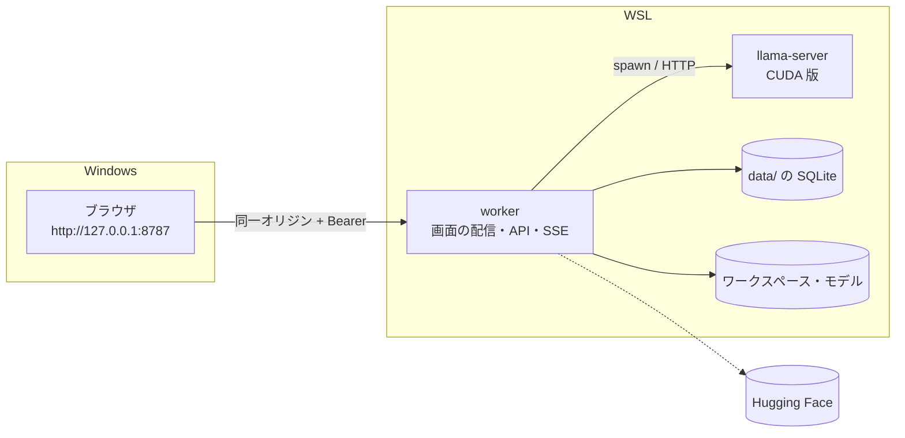

# 12. localhost 段階の仕様
- プロジェクト：LLM-PARTY ／ 版数：v0.1（2026-11-06） ／ インプット：[ADR-008](adr/ADR-008-localhost-first.md)、[07](07_architecture.md)、[09](09_api/README.md)

> **3行で**
> 1. 最初は Electron なしで作り、WSL の worker が `http://127.0.0.1:8787` で画面と API を出す。ブラウザで色々試す。
> 2. 利用者がこの段階で「OK」と言ってから、Electron に包んで exe にする（exe 段階）。exe の設計はそのまま残す。
> 3. worker と画面は両段階で同じものを使い、違いは「画面の接続層」と「worker の起動の入口」に閉じ込める。

## 🧭 判断してほしいこと
| # | 種類 | 論点 | 選択肢 | おすすめ（理由） | 決まらないと止まるもの |
|---|---|---|---|---|---|
| R-14 | リスク | WSL 用の CUDA 版 llama-server は同梱の仕組みがなく、自分で用意する | — | 公式の `llama-b12125-bin-ubuntu-cuda-12.8-x64` を取り、`LLM_PARTY_LLAMA_BIN` で指す（D-59）。動くかは実装の最初に確かめ、手順を README に書く | 全機能の動作確認 |
| R-15 | リスク | PowerShell・ジャンクション・Windows のパスなどの動きは、exe 段階まで確かめられない | — | [exe 段階でやること](#exe-段階でやること)に Windows での確認を入れる。パスとシェルは差し替えられる形で作る | exe 段階 |
| R-16 | リスク | エージェントがコマンドを動かす API をブラウザから呼ぶので、他のサイトから叩かれないようにする必要がある | — | トークンに加えて Host と Origin を確かめる（[接続と認証](#接続と認証)） | — |

## 全体図

見てほしいところ：Electron の main と preload がなく、画面は worker から直接配られる。GitHub への通信もこの段階にはない。

## 要点
- 段階の分け方は [段階の定義](#段階の定義)、REQ・FR の振り分けは [01](01_requirements.md#5-要件一覧) と [04](04_functional_spec/README.md#機能一覧) の「段階」列。
- 動かし方は [起動のしかた](#起動のしかた)。
- `window.llmParty` の代わりは [IPC の代わり](#ipc-の代わり)。
- 次へ進む条件は [exe 段階へ進む条件](#exe-段階へ進む条件)。

---

## 詳細
以下は詳細層。

## 段階の定義
| 段階 | 目的 | 使う人 | 動く場所 | 終わり |
|---|---|---|---|---|
| localhost 段階 | 機能と使い勝手を試して固める | 開発者本人（P-1）だけ | WSL＋Windows のブラウザ | [exe 段階へ進む条件](#exe-段階へ進む条件)を満たす |
| exe 段階 | Electron に包んで知人に配る | P-1・P-2 | Windows（NSIS でインストール） | 設計書の最終形 |

WSL で動かすのは検証のためで、Linux 版の配布ではない。D-19（配布は Windows のみ）は変わらない。

## 起動のしかた
| コマンド | 使う場面 | 画面の出し方 |
|---|---|---|
| `npm run dev` | 開発中 | worker（tsx）が Vite をミドルウェアとして抱える。変更はすぐ反映 |
| `npm start` | ビルドして試す | worker がビルド済みの画面を配る |

どちらも URL は `http://127.0.0.1:8787` の1つだけ。8787 が使用中なら起動エラーにして、自動で別の番号へ移らない。

| 環境変数 | 既定 | 説明 |
|---|---|---|
| `LLM_PARTY_LLAMA_BIN` | なし（必須） | 使う llama-server のパス |
| `LLM_PARTY_BACKEND` | `cuda` | 表示と記録に使うバックエンド名（`cuda` / `vulkan` / `cpu`） |
| `LLM_PARTY_PORT` | `8787` | 待ち受けポート |
| `LLM_PARTY_DATA_DIR` | リポジトリの `data/` | データの置き場。`data/` は Git に入れない |

## 接続と認証
- 待ち受けは `127.0.0.1` だけ（NFR-011）。LAN から見えるアドレスでは待ち受けない
- **トークン**：初回起動時に乱数で作り、`data/local-token`（権限 600）に保存して以後も使う。起動ごとに変えると、ブックマークした URL で開けなくなるため
- **画面への渡し方**：起動時にターミナルへ `http://127.0.0.1:8787/#token=<トークン>` を出す。画面はルーターが動く前に読み取って `localStorage` に入れ、URL から消す。次からは `http://127.0.0.1:8787/` だけで開ける。トークンがなければ入力を求める
- **他のサイトからの防御**（R-16）：`Host` が `127.0.0.1:<ポート>` か `localhost:<ポート>` でなければ拒否する（DNS リバインディング対策）。`Origin` があるなら同じ2つだけ許す。CORS のヘッダーは返さない
- **SSE**：`EventSource` はヘッダーを付けられないので、画面は `fetch` のストリームで読む（[API-099](09_api/worker.md#api-099get-apievents)。exe 段階も同じ）
- **CSP**：`npm start` では `default-src 'self'` を基本にかける。`npm run dev` は Vite の都合で緩める

## IPC の代わり
画面は `src/platform` の接続層（`window.llmParty` と同じ関数の形）だけを呼ぶ。localhost 段階の実装と Electron の実装を差し替える。

| ID | 関数 | localhost 段階 |
|---|---|---|
| API-001 | `getInfo()` | API-093 |
| API-002 / 003 | `pickFolder()` / `pickFile()` | パスの入力ダイアログ（WSL のパスを貼り付ける）。正しいかは今の登録 API が確かめる |
| API-004〜006, 010 | 更新 | なし。更新の UI を出さない |
| API-007 | `setHfToken()` / `hasHfToken()` | API-094 |
| API-008 | `getConnection()` | 同じオリジン＋`localStorage` のトークン |
| API-009 | `openLogsFolder()` | ログのパスを表示してコピーできるようにする |

| ID | メソッド | パス | 概要 |
|---|---|---|---|
| API-093 | GET | `/api/local/info` | `{ version, llamaBuild, isPackaged: false, dataDir, logsDir }` |
| API-094 | GET / PUT | `/api/local/hf-token` | GET は `{ has }` だけ返す。PUT は `{ token \| null }`。`data/secrets/hf-token`（権限 600）に平文で保存し、画面には返さない |

API-093 と API-094 は localhost 段階の起動の入口でだけ有効にする。exe 段階の worker には載せない。

この段階だけの画面の文言は [ui/08_copy](ui/08_copy.md#localhost-段階だけの文言)（CP-200〜CP-206）。

## WSL での違い
| 項目 | localhost 段階 | exe 段階 |
|---|---|---|
| ワークスペースにできない場所（FR-007） | `/`、`/mnt/<ドライブ>`、`$HOME` 直下、`/etc` `/usr` `/bin` `/sbin` `/lib*` `/boot` `/proc` `/sys` `/dev` `/var`、データフォルダ | [FR-007](04_functional_spec/app.md#fr-007ワークスペース選択) の Windows の表 |
| `run_command` のシェル | `/bin/bash -c`。時間切れはプロセスグループごと終了 | Q-06 |
| GPU | 環境変数で手動指定。`--list-devices` の判定はしない | FR-001 |
| CUDA パック | なし（`GET /api/system` のパックの状態は空、画面に出さない） | FR-002 |
| 初回セットアップ（UC-001） | GPU の手順を飛ばし、モデルの準備から始める | UC-001 全部 |
| 更新（FR-019） | なし | FR-019 |
| HF トークン | API-094 | safeStorage |
| worker の復旧（D-40） | 自動では起動し直さない。ターミナルからやり直す | main が1回起動し直す |
| 終了 | Ctrl+C で生成・評価・DL を止めて DB を閉じ、llama-server も止める（`prepareShutdown` と同じ処理） | main が `prepareShutdown` を送る |

## exe 段階へ進む条件
次を全部満たし、**利用者が「OK」と言ったら** exe 段階に進む。

1. 手元の GGUF と LoRA を登録し、プリセットを切り替えて対話できる（R-04 の確認を含む）
2. HF の検索・DL が途中再開まで動く
3. エージェントの承認・却下・取り消しが動く
4. 評価ランを流して、別のランと比較できる
5. 再起動しても会話と評価結果が残り、続きを送れる
6. 11 §11 の単体テストと結合テストが通る

## exe 段階でやること
- Electron の main・preload、`app://llm-party`、worker の utilityProcess 起動、`src/platform` の Electron 実装
- FR-001・FR-002、FR-019、safeStorage、NSIS、GitHub Actions のリリース（[07 デプロイ構成](07_architecture.md#デプロイ構成リリース)）
- better-sqlite3 の Electron 用ビルド（R-08）
- Windows での確認：Q-06 のシェル、FR-007 の表、パス検査（リンク・ジャンクション）、プロセスツリーの終了（R-15）
- 11 §11 の E2E（CUDA あり / なし、更新の適用）を実機で行う

localhost 段階のデータは exe 版へ引き継がない。パスの形が変わるため。評価セットは JSONL の書き出し（FR-015）で持っていける。

## このドキュメントで決まったこと
- D-49〜D-54、D-59（[00 決定事項ログ](00_overview.md#決定事項ログ)）
- [ADR-008](adr/ADR-008-localhost-first.md)
