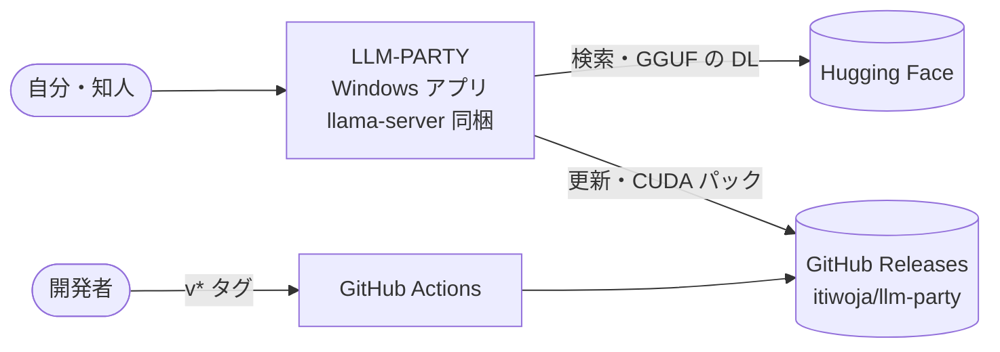

# LLM-PARTY 設計書
> **3行で**：手元の Windows PC で Qwen3.5 9B などの GGUF を動かし、Codex 風の画面で対話・コーディング・評価ができるデスクトップアプリ ／ MVP はローカル対話・ワークスペース内エージェント（承認制）・HF 検索と自作 GGUF / LoRA の登録・プリセット・評価セットの一括実行・GitHub からの自動更新 ／ アプリ内学習・Linux / Mac・クラウド API・MCP・Web 検索・画像入力はやらない ／ まず localhost で作って試し、OK が出てから exe にする（[12](12_localhost_stage.md)）

## 🧭 判断してほしいこと（全ドキュメントから集約）
| # | 種類 | 論点 | おすすめ | 決まらないと止まるもの | 詳細 |
|---|---|---|---|---|---|
| Q-02 | 未決（exe 段階で決める） | CUDA パックの版（12.4 / 13.4） | 12.4（古いドライバでも動く。約 650MB） | FR-002、CI | [models-runtime](04_functional_spec/models-runtime.md#-判断してほしいこと) |
| Q-06 | 未決（exe 段階で決める） | exe 段階でコマンドを動かすシェル | Windows PowerShell 5.1 | FR-009 | [04](04_functional_spec/README.md#-判断してほしいこと) |
| R-01 | リスク | 未署名で SmartScreen の警告 | 手順を案内、SignPath は後で | — | [05](05_non_functional.md#-判断してほしいこと) |
| R-02 | リスク | CUDA パックと同梱 llama.cpp の版ずれ | ビルド番号で照合、ずれたら Vulkan＋再 DL | — | [models-runtime](04_functional_spec/models-runtime.md#-判断してほしいこと) |
| R-03 | リスク | PEFT 形式の LoRA は読めない | 登録時に判定して変換を案内 | — | 同上 |
| R-04 | リスク | リクエストごとの LoRA 倍率・思考 ON/OFF が未確認 | 実装の最初に確認。だめなら読み込み直し | FR-003, FR-005 | [chat-agent](04_functional_spec/chat-agent.md#-判断してほしいこと) |
| R-05 | リスク | 9B のツール誤用・繰り返し | エラーを返す・40 回上限 | — | [04](04_functional_spec/README.md#-判断してほしいこと) |
| R-06 | リスク | 自動要約で指示が落ちる | 最初の指示とシステムは残す | — | 同上 |
| R-07 | リスク | 外への通信がある（HF・GitHub） | 通信先を明示、本文は送らない | — | [05](05_non_functional.md#-判断してほしいこと) |
| R-08 | リスク | ネイティブモジュールのビルド | asarUnpack と検査 | — | [07](07_architecture.md#-判断してほしいこと) |
| R-09 | リスク | cudart の再配布条件 | 公開前に確認、だめなら公式から直接 DL | FR-002 | [models-runtime](04_functional_spec/models-runtime.md#-判断してほしいこと) |
| R-10 | リスク | コマンドはワークスペース外にも影響しうる | 承認制、自動承認は明示 ON のみ | — | [04](04_functional_spec/README.md#-判断してほしいこと) |
| R-14 | リスク | WSL 用の CUDA 版 llama-server は自分で用意する | 公式の Ubuntu 用 CUDA 版を使う（D-59）。動くかは実装の最初に確かめる | 動作確認 | [12](12_localhost_stage.md#-判断してほしいこと) |
| R-15 | リスク | Windows 固有の動きは exe 段階まで確かめられない | exe 段階の確認に入れる | exe 段階 | 同上 |
| R-16 | リスク | 他のサイトから localhost の API を叩かれる | トークン＋Host・Origin の確認 | — | 同上 |

番号の欠け（Q-01, Q-03, Q-04, Q-05, Q-07, Q-08, Q-09）は決着済み → [00 決定事項ログ](00_overview.md#決定事項ログ)（D-55, D-33, D-43, D-46, D-42, D-38, D-56）。Q-02 と Q-06 は exe 段階で決める（D-59）。

## 全体図（C4 レベル1：コンテキスト）
exe 段階の最終形。localhost 段階の図は [12](12_localhost_stage.md#全体図)。

## 読む順番
| 目的 | 読むもの | 所要 |
|---|---|---|
| 画面の見た目と文言を知りたい | [ui/README](ui/README.md) | 5分 |
| 全体像だけ知りたい | この README → [11_tech_spec](11_tech_spec.md) の要約層 | 5分 |
| 何を作るか判断したい | [01](01_requirements.md) → [02](02_user_stories.md) の要約層 | 10分 |
| 振る舞いを知りたい | [04 README](04_functional_spec/README.md) → [chat-agent](04_functional_spec/chat-agent.md) → [eval](04_functional_spec/eval.md) | 20分 |
| 実装する | [12](12_localhost_stage.md) → [07](07_architecture.md) → [08](08_database.md) → [09](09_api/README.md) → [10](10_diagrams.md) | — |

## 主要な設計判断（ADR）
| ADR | 決定 | 状態 |
|---|---|---|
| [ADR-001](adr/ADR-001-electron-worker.md) | Electron＋utilityProcess の worker（DC-Designer 準拠） | 承認 |
| [ADR-002](adr/ADR-002-llama-server-child.md) | 推論は llama-server を子プロセスで | 承認 |
| [ADR-003](adr/ADR-003-gpu-runtime.md) | Vulkan＋CPU 同梱、CUDA は追加パック | 承認 |
| [ADR-004](adr/ADR-004-sqlite.md) | 保存は SQLite | 承認（ドライバは better-sqlite3。D-55） |
| [ADR-005](adr/ADR-005-approval-policy.md) | 読み取り自動・書き込みとコマンドは承認・外は拒否 | 承認 |
| [ADR-006](adr/ADR-006-auto-compaction.md) | 文脈 80% で自動要約（直近 6 メッセージは残す） | 承認 |
| [ADR-007](adr/ADR-007-update-flow.md) | 起動時に確認、DL と適用は利用者の操作 | 承認 |
| [ADR-008](adr/ADR-008-localhost-first.md) | 先に localhost で試し、OK が出てから exe にする | 承認 |

## 最近の変更
- 2026-11-06：Q-01・Q-09 が決着（D-55, D-56）。AI の回答の Markdown 表示（D-57、CMP-022）、日本語検索（D-58）、localhost 段階の開発環境（D-59）を追加
- 2026-11-06：開発を2段階に変更。先に localhost で試し、OK が出てから exe にする（[12](12_localhost_stage.md)、[ADR-008](adr/ADR-008-localhost-first.md)、D-49〜D-54）。API-093〜094 と R-14〜R-16 を追加
- 2026-11-06：[UI 設計書](ui/README.md) v0.1 を追加。Q-05 決着（D-46）、新規作成の形（D-47）、文言の正本（D-48）、`turn.usage` に `tokensPerSecond` を追加
