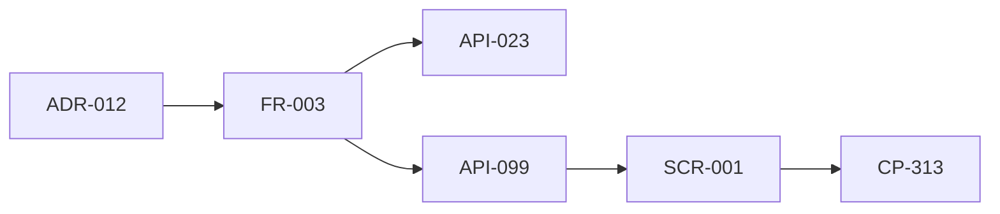

# 変更：`LLM_PARTY_LLAMA_BIN` の無効な指定で読み込みを止めない（v0.1 → v0.2、2026-11-07）
> **3行で**：実在しないパスの指定は、警告して無視するように変える ／ 仮の値が保存済みの起動コマンドに残り、取得済みの本体があるのに読み込みが失敗し続けたため ／ 読み込みは止まらなくなるが、打ち間違いで別の本体が動くことがある

実装済み（2026-11-07）。警告は、ほかの帯が出ていないときだけ出す（設定を直すまで出続けるので、ページの帯を隠さないため）。

## 原因
| 項目 | 確かめた内容 |
|---|---|
| 値の出どころ | 利用者が使う保存済みの起動コマンド（利用者の回答）。`.bashrc` と Git の履歴には無い |
| 本体 | `data/runtime/llama/b12125-cuda12.8/llama-server` に実在する。自動取得は壊れていない |
| 設計の穴 | ADR-011 の1段目が、実在しない指定で読み込みを `failed` にしていた。起動時は警告だけで通るので、失敗に気づくのが読み込みのときになる |

## 🧭 判断してほしいこと
| # | 種類 | 論点 | 選択肢 | おすすめ（理由） | 決まらないと止まるもの |
|---|---|---|---|---|---|
| R-19 | リスク | 打ち間違いでも読み込みが止まらず、別の本体が動くことがある。未取得なら約 780MB の自動取得も始まる | — | 警告で気づけるようにする（CP-313） | — |

## 差分
| ドキュメント | 節 / ID | 種別 | 変更前 → 変更後（1行） |
|---|---|---|---|
| adr | ADR-012 | 追加 | 無効な指定は警告して無視する |
| adr | ADR-011 | 注記 | 状態欄に ADR-012 での改訂を追記 |
| 12_localhost_stage | 環境変数の表・llama-server の用意 | 変更 | 無効な指定は `failed` → 警告して未設定と同じに動く。判断の流れ図を追加 |
| 12_localhost_stage | `LLM_PARTY_BACKEND` | 修正 | 上書きの本体を使うときだけ効く、と実態に合わせた |
| 04_functional_spec/chat-agent | FR-003 | 変更 | 無効な指定の扱いを追記。状態 `installing` と警告を出力に追加 |
| 09_api/worker | API-023, API-099 | 変更 | `warning?` を追加。`engine` の `installPercent?` の書き漏れも追加 |
| ui/08_copy | CP-313 | 追加 | 無効な指定の警告の文言 |
| 00_overview | D-74 | 追加 | この決定 |
| 12・README・11 | R-14 | 削除 | ADR-011 で決着済みのため閉じ、R-19 に置き換えた |
| 12_localhost_stage | WSL での違い（GPU） | 修正 | 手動指定 → ADR-011 の D3 に合わせた |
| 12_localhost_stage | API-093 | 修正 | `llamaBuild` が `null` の理由を「返す方法が未設計」に直した |
| 11_tech_spec | 環境の表 | 修正 | 環境変数で指定 → 自動取得＋上書き用 |
| 01・04 README・models-runtime | REQ-007, FR-001 | 修正 | localhost は手動指定 → ADR-011 の D3 で自動 |
| 00_overview | D-52, D-59 | 注記 | D-52 に ADR-011 での改訂を追記。D-59 の関連を R-14 → ADR-011 に変更 |
| README・00_overview | Q-16 → D-75 | 移動 | 決着済みの Q-16 を判断の表から決定事項ログへ移した |
| 10_diagrams | エンジンの状態遷移 | 修正 | `installing` を追加 |
| README | ADR 一覧・最近の変更 | 修正 | ADR-009〜012 と今回の変更を追加 |

## 影響範囲

- 影響を受けるが今回は変更していないもの：なし
- 保存済みの起動コマンド：指定を外すまで警告が出続ける

## 実装と確かめ
- 変更：`server/binary.ts`、`server/runtime/resolver.ts`、`server/engine.ts`、`server/routes/engine.ts`、`server/local.ts`、`src/types.ts`、`src/app-data.tsx`、`tests/runtime.test.ts`、`tests/engine.test.ts`
- `npx tsc --noEmit` が通る／`npx vitest run` 全件 346 件が通る／`npx vite build` が通る
- 実物の確認：`LLM_PARTY_LLAMA_BIN=/path/to/llama-server` を付けて起動し、起動時の警告（CP-313）、API-023 の `warning`、画面の帯を確かめた。この状態で「Qwen3.5 対話」が `ready` になり、取得済みの `b12125-cuda12.8/llama-server` が動いた

## 関連
- ADR：新規 [ADR-012](../adr/ADR-012-invalid-llama-override.md)、改訂 [ADR-011](../adr/ADR-011-runtime-resolver.md)
