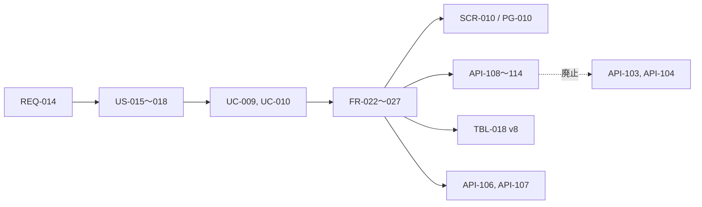

# 変更：音楽専用の画面と XL turbo への置き換え（v0.2 → v0.3、2026-11-07）
> **3行で**：音楽をスレッドから専用の画面へ移し、AI の下書き・歌詞の手直し・作り直しを足す ／ 新しいツールを別に作らず local-chat へ足すとユーザーが決めた ／ いちばん大きい影響は `tracks` の作り直し（DB v8）と API-103・104 の廃止

## 🧭 判断してほしいこと
| # | 種類 | 論点 | 選択肢 | おすすめ（理由） | 決まらないと止まるもの |
|---|---|---|---|---|---|
| R-22 | リスク | XL の VRAM の余裕は約 1.4GB | — | 失敗しても内容を残し、CP-353 で案内する | — |
| R-23 | リスク | 下書きの内容のずれ、長い歌詞を短い曲に渡したときの歌われ方が未確認 | — | 手直しの土台と位置づけ、実装時に耳で確かめる | FR-023 |

## 依頼と決定
| 項目 | 決定 | 根拠 |
|---|---|---|
| 作る場所 | local-chat に足す。新しいツールは作らない | ユーザー回答 |
| モデル | XL turbo Q8 に置き換える（ADR-014） | ユーザー回答。実機の検証の後 |
| 画面 | 音楽専用、一覧＋エディタの2列（ADR-015） | ユーザー回答 |
| スレッド側 | 入口を外して一本化。曲はスレッドから独立 | ユーザー回答 |
| エディタの機能 | AI の下書き→手直し、構成タグのボタン、できた曲から作り直し | ユーザー回答 |
| 作り直しのシード | 毎回新しいシード | ユーザー回答 |
| 曲の削除 | 確認つきで消せる | ユーザー回答 |
| 長さの上限 | 240 秒のまま | ユーザー回答 |
| 利用者 | 自分だけ。今の 127.0.0.1＋トークンのまま | ユーザー回答 |
| 細かい値 | D-83 の一覧 | Claude 判断（見直し可） |

## 差分
| ドキュメント | 節 / ID | 種別 | 変更前 → 変更後（1行） |
|---|---|---|---|
| 00_overview | D-79〜D-83 | 追加 | 今回の決定。D-78 に置き換えの注記 |
| 01_requirements | REQ-014、§7 | 追加 | 音楽の制作。Won't に5項目 |
| 02_user_stories | US-015〜US-018 | 追加 | 下書き・タグ・作り直し・一覧と削除 |
| 03_use_cases | UC-009, UC-010, BR-09, BR-10 | 追加 | 曲を作る・曲を見直す |
| 04_functional_spec | [music.md](../04_functional_spec/music.md)、FR-022〜FR-027 | 追加 | 分野のファイルが5つに |
| 04_functional_spec | 状態の定義 | 追加 | 音楽のジョブ |
| 04_functional_spec/models-runtime | 音楽のレシピ | 変更 | turbo → XL turbo |
| 05_non_functional | NFR-051〜NFR-054 | 追加 | 音楽の時間と VRAM |
| 06_ux_design | SCR-010 | 追加 | 画面が 10 に |
| ui/ | PG-010, CMP-023, CP-338〜CP-357 | 追加 | ナビは6項目に |
| ui/08_copy | CP-327, CP-332〜337 | 変更 | 場所を PG-010 へ。CP-327 は廃止、CP-337 は文言を変更 |
| 08_database | TBL-018 | 変更 | `thread_id` を NULL 可に、`bpm`・`keyscale`・`reasoning` を追加（v8） |
| 09_api/worker | API-103, API-104 | 廃止 | → API-109, API-110 |
| 09_api/worker | API-108〜API-114 | 追加 | 下書き・生成・取消・一覧・詳細・削除・状態 |
| 09_api/worker | `music` イベント | 変更 | `threadId` をなくし `job` を追加 |
| 10_diagrams | ER、UC-009、音楽のジョブ | 追加 | シーケンス 6 本、状態遷移 7 つ |
| 11_tech_spec | §3〜§6, §12, §13 | 変更 | 要約を更新 |
| adr | ADR-014, ADR-015 | 追加 | — |

## 影響範囲

- 影響を受けるが今回は変更していないもの：
  - API-105（曲の MP3）：`/api/music/draft` などと POST / GET で分かれるので、そのまま使える
  - [ADR-013](../adr/ADR-013-acestep-cli.md)：エンジンの決定はそのまま。LM は CPU、合成は Vulkan、`--vae-chunk 384` も変えない
  - [12_localhost_stage](../12_localhost_stage.md)：別の作業の未コミットの変更があるので触っていない。音楽の環境変数に変更はない
  - `server/hf/recipes.ts`：同じく未コミットの変更がある。実装のときに競合に注意

## 確かめたこと
- 実機：XL turbo Q8 で 60 秒・240 秒が完走。数値は [ADR-014](../adr/ADR-014-xl-turbo-q8.md)
- 実機：`lm_mode: "inspire"` で歌詞だけが返る（27 秒、音声コードなし）
- 実機：下書きの歌詞（138 秒ぶん）をそのまま 60 秒の指定で XL に渡すと完走（LM 71 秒、合成 61 秒、出力 59.4 秒）。歌詞は LM の前後で変わらない
- 実機：スペクトログラムに倍音の線と区切りが見え、音量も正常。音質は機械では判定していない（聴き比べ用の音声を渡したうえでユーザーが XL を選択）
- 取得した XL は sha256 が HF の値と一致
- 実機（実装後）：実データのコピーで v7 → v8 の移行が完走し、古い曲が一覧に出る。レシピの DL で XL の登録・古い行と 2B の DiT の削除を確認。下書き 43 秒（NFR-051 は 45 秒以内。request に duration を入れない形）、歌詞あり 30 秒の曲は開始から完了まで 91 秒

## 未確認
- 長い歌詞を短い曲に渡したとき、歌詞のどこまで歌われるか（R-23）

## 関連
- ADR：新規 [ADR-014](../adr/ADR-014-xl-turbo-q8.md)、[ADR-015](../adr/ADR-015-music-page.md)
- 検証の残り：`~/llm-party-runtime/ace-xl-test/`（XL の重み 5.31GB と出力。他の部品はハードリンク）
