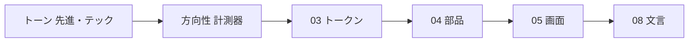

# 00. 体験方針と決定事項
> 版：v0.1（2026-11-06）｜ 関連：[仕様の設計書](../README.md)・[02 方向性](02_visual_direction.md)

> **3行で**
> - LLM-PARTY は、手元の GGUF を動かして対話・コーディング・評価をする Windows アプリ。起動画面は対話とエージェントのメイン。
> - 見た目は「計測器」。ほぼ無彩色に差し色1色で、数字を主役にする。
> - トーンは先進・テック。文章は体言止め中心、テーマは OS の設定に合わせる。

## 🧭 判断してほしいこと
なし（全体の論点は [README](README.md) に集約）

## 全体図

見てほしいところ：下流は上流のトークン名と ID を参照する。値は 03 だけに書く。

## 要点
- 主役の作業は対話とエージェント。評価は左のアイコン列から1クリック。
- Codex から残すのは4点（[D-07](#決定事項ログ)）。
- ダイヤルは個性 5・動き 5・密度 5。
- 言語は日本語のみ。仕様側の Q-05 はこれで決着。

---

## 詳細

### 目的と一番してほしい行動
| 項目 | 内容 | 根拠 |
|---|---|---|
| 種類 | Windows デスクトップアプリ（Electron＋React 19）。先に同じ画面をブラウザの localhost で試す | ../12_localhost_stage.md |
| 一番してほしい行動 | 指示を送る（対話・エージェント） | R1 回答 |
| 主な利用者 | P-1 チューナー（本人）、P-2 知人。PC のみ | ../01_requirements.md §4 |
| 成功の目安 | GGUF 登録から前の版との比較までアプリ内で済む | ../01_requirements.md §2 |

### トーンと言い換え
| 形容詞 | UI ではこう表す | こうはしない |
|---|---|---|
| 先進・テック | 幅ぞろえの数字、等幅の値、細い線、差し色1色 | 光る効果、グラデーション、宇宙や回路の飾り |

### ダイヤル
| ダイヤル | 値 | 意味 |
|---|---|---|
| 個性（variance） | 5 | 骨組みは共通で、評価の画面だけ表を広く使い数字を大きく出す |
| 動き（motion） | 5 | パネルの開閉・画面の切り替えに軽い動き |
| 密度（density） | 5 | 標準 |

### 前提
- テーマ：ライト／ダーク両対応、初期値は OS の設定に従う
- アクセシビリティ目標：WCAG 2.2 AA（仕様 NFR-032）
- 技術：Electron 45（exe 段階）/ React 19 / Vite / TypeScript（CSS の方式は仕様に指定なし）
- 外への通信は Hugging Face と GitHub だけ（仕様 R-07）

### 決定事項ログ
| # | 決定 | 決め方 | 理由 | 日付 |
|---|---|---|---|---|
| D-01 | 画面の言語は日本語のみ（仕様 Q-05 の決着） | ユーザー回答（R1） | 文言の二重管理を避ける | 2026-11-06 |
| D-02 | 起動画面はメイン。主役は対話とエージェント | ユーザー回答（R1） | 毎日触る場所 | 2026-11-06 |
| D-03 | ブランド素材なし。ゼロから決める | ユーザー回答（R1） | — | 2026-11-06 |
| D-04 | 参考アプリは Codex のアプリ | ユーザー回答（R1） | 仕様の「Codex 風」の元 | 2026-11-06 |
| D-05 | トーンは先進・テックの1つ | ユーザー回答（R2） | — | 2026-11-06 |
| D-06 | 密度 5・個性 5・動き 5、表現レベルは標準 | ユーザー回答（R2） | — | 2026-11-06 |
| D-07 | Codex から残す：ほぼ無彩色＋差し色1色／会話は中央の1列／操作は小さな折りたたみ／差分を横で見て判断 | ユーザー回答（参考） | — | 2026-11-06 |
| D-08 | テーマの初期値は OS の設定に合わせる | ユーザー回答（R2） | 知人の環境で違和感が少ない | 2026-11-06 |
| D-09 | 文章の声は体言止め中心 | ユーザー回答（R2） | 開発者の道具らしい短さ | 2026-11-06 |
| D-10 | 方向性は案A「計測器」 | ユーザー回答（R3） | 評価が主目的のアプリだと分かる | 2026-11-06 |
| D-11 | スレッドがない画面は入力欄が主役 | ユーザー回答（R6） | すぐ打てる | 2026-11-06 |
| D-12 | 右パネルは承認待ちで自動で開く | ユーザー回答（R6） | 判断の瞬間に差分が見える | 2026-11-06 |
| D-13 | メインの数字は入力欄の下に1行 | ユーザー回答（R6） | 送る前に目に入る | 2026-11-06 |
| D-14 | ライトの主ボタンは #4F6000＋白文字（6.99:1） | ユーザー回答（R4） | ライムは明るい背景と 1.23:1 | 2026-11-06 |
| D-15 | 本文 16px | ユーザー回答（R4） | — | 2026-11-06 |
| D-16 | Noto Sans JP と JetBrains Mono を同梱 | ユーザー回答（R4） | 通信先を増やさず、知人の PC でも同じ見た目 | 2026-11-06 |
| D-17 | 比較・推移は左に折れ線、右に表 | ユーザー回答（R6） | 推移と差を同時に見る | 2026-11-06 |
| D-18 | 体言止めの例外なし（エラーと確認も） | ユーザー回答（R2） | — | 2026-11-06 |
| D-19 | 部品の土台は Radix Primitives＋自作 CSS | ユーザー回答（R5） | キーボード操作を任せ、見た目はトークンで作る | 2026-11-06 |
| D-20 | アイコンは Lucide | ユーザー回答（R5） | 細い線が計測器に合う | 2026-11-06 |
| D-21 | 左の列はアイコンのみ（幅 48px） | ユーザー回答（R5） | 画面を広く使う | 2026-11-06 |
| D-22 | 演出は右パネルのスライド・数字の切り替わり・生成中の脈打つ印の3つ | ユーザー回答（R7） | — | 2026-11-06 |
| D-23 | 状態色と差分の色、グレーの段 | ユーザー確認（Claude 提案） | ライムから離し、全組で AA | 2026-11-06 |
| D-24 | 作る物は .ico と GitHub 共有画像 | ユーザー回答（R8） | — | 2026-11-06 |
| D-25 | アイコンのモチーフは C「並んだ三人」 | ユーザー回答（R8） | — | 2026-11-06 |
| D-26 | 新規作成は「新規」1つ、仕様も更新（仕様 D-47） | ユーザー回答（Q-11） | 入力欄が主役 | 2026-11-06 |
| D-27 | 文言の正本は 08_copy.md（仕様 D-48） | ユーザー回答（Q-12） | 体言止めでそろえる | 2026-11-06 |
| D-28 | アイコンの頭は足さない | ユーザー回答（Q-13） | 選んだ形のまま | 2026-11-06 |
| D-29 | 入力欄の文言は「指示」「手元のモデルに指示」「送信」 | ユーザー回答（R6） | 会話でも作業でも使える | 2026-11-06 |
| D-30 | 細かい数値（幅・高さ・文字の段・余白・角丸・動き・窓の最小 960×600・入力欄 10 行・トースト 4 秒） | ユーザー確認（Claude 提案の一覧） | 密度と案A に合わせた | 2026-11-06 |
| D-31 | 文言の全 CP を了承 | ユーザー回答 | textlint 0件 | 2026-11-06 |
| D-32 | 状態の帯の出し方、PG-002 の3手順の中身、部品の細かい見た目 | Claude 判断（見直し可） | 帯は実行中と異常のときだけ。手順3は仕様 R-07 の通信先の明示 | 2026-11-06 |
| D-33 | タイトルバーは OS 標準、最小幅以下は作らない、当たり判定は 24px 以上 | 定石 | PC アプリの定石 | 2026-11-06 |

### ID 体系と対応表
ID の種類は PG / SEC / CMP / MOT / CP / ICN / Q / R。Q と R は仕様の番号の続きから使う（Q-11〜、R-11〜）。

| PG | SEC | 使う CMP | 主なトークン |
|---|---|---|---|
| PG-001 | SEC-001-01〜05 | CMP-001, 003〜011, 013, 015, 019, 020 | `--color-primary`, `--thread-max`, `--panel-width` |
| PG-002 | SEC-002-01〜03 | CMP-001, 012 | `--form-max` |
| PG-003 | SEC-003-01〜02 | CMP-001〜003, 012〜014, 019 | `--row-height` |
| PG-004 | SEC-004-01〜02 | CMP-001, 002, 004, 005, 015, 019, 020 | `--form-max` |
| PG-005 | SEC-005-01〜03 | CMP-001, 002, 004, 005, 014, 015, 019, 020 | `--row-height` |
| PG-006 | SEC-006-01〜03 | CMP-001, 002, 006, 010, 012, 014〜016, 019 | `--text-metric` |
| PG-007 | SEC-007-01〜03 | CMP-002, 013〜018 | `--text-metric`, `--chart-focus` |
| PG-008 | SEC-008-01〜04 | CMP-001, 002, 005, 015 | `--space-7` |
| PG-009 | SEC-009-01 | CMP-001, 012, 019 | `--radius-lg` |

| MOT | 対象 CMP |
|---|---|
| MOT-001, MOT-002 | CMP-001, CMP-004, CMP-014 |
| MOT-003 | PG-001 の右パネル |
| MOT-004 | CMP-016 |
| MOT-005 | CMP-008 |
| MOT-006 | CMP-001, CMP-006 |
| MOT-007 | CMP-019 |
| MOT-008 | CMP-002, CMP-020 |
| MOT-009 | CMP-021 |
| MOT-010 | CMP-006 |

## このドキュメントで決まったこと
- [決定事項ログ](#決定事項ログ) の全項目
