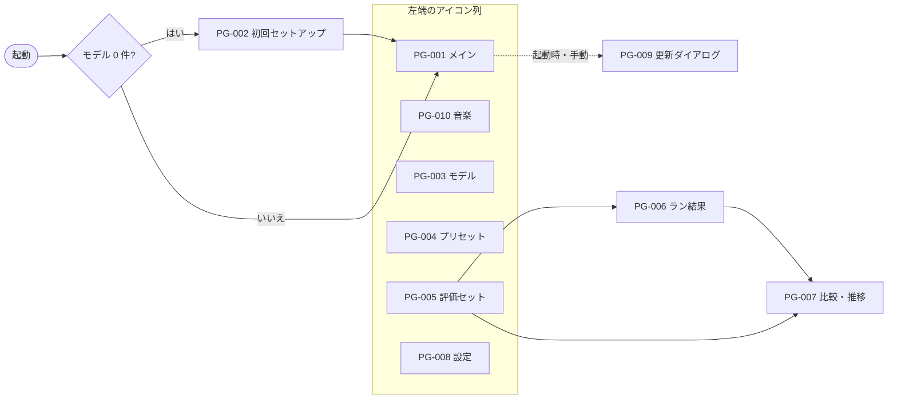

# 01. 情報設計
> 版：v0.3（2026-11-07）｜ 関連：[00_brief](00_brief.md)・[仕様 06](../06_ux_design.md)

> **3行で**
> - ページは仕様の SCR-001〜010 と1対1の10。起動画面はメイン（PG-001）。
> - ナビは左端のアイコン列の6項目だけで、全ページへ1クリックで行ける。
> - 骨組みは「アイコン列＋一覧＋本体＋右パネル」で共通。評価の結果だけ本体を広く使う。

## 🧭 判断してほしいこと
なし

## 全体図

見てほしいところ：PG-006 と PG-007 はアイコン列に出さず、評価セットから入る。

## 要点
- ページの一覧は[ページ一覧](#ページ一覧)。
- アイコン列はアイコンのみ。名前はツールチップと読み上げで補う（[ナビゲーション](#ナビゲーション)）。
- 右パネルはメインだけに置き、承認待ちになると自動で開く。
- 状態の帯は実行中と異常のときだけ出す。
- 骨組みの型は3つ（[ページの型](#ページの型)）。

---

## 詳細

### ページ一覧
| ID | ページ名 | ルート | 目的 | 主CTA | 対応 SCR | 型 |
|---|---|---|---|---|---|---|
| PG-001 | メイン | `#/threads/:id?` | 対話とエージェント作業 | 送信 | SCR-001 | 作業 |
| PG-002 | 初回セットアップ | `#/setup` | GPU 判定とモデルの用意 | DL する | SCR-002 | 手順 |
| PG-003 | モデル | `#/models` | モデル・LoRA の一覧と入手 | ファイルを登録 | SCR-003 | 管理 |
| PG-004 | プリセット | `#/presets/:id?` | プリセットの作成・編集 | 保存 | SCR-004 | 管理 |
| PG-005 | 評価セット | `#/evals/:id?` | 評価セットの編集と実行 | 実行 | SCR-005 | 管理 |
| PG-006 | ラン結果 | `#/runs/:id` | 進捗・結果・人手採点 | 比較を開く | SCR-006 | 計測 |
| PG-007 | 比較・推移 | `#/evals/:id/compare` | ランどうしの比較と推移 | なし（見る画面） | SCR-007 | 計測 |
| PG-008 | 設定 | `#/settings` | 置き場・GPU・更新・診断 | なし（項目ごとの操作） | SCR-008 | 管理 |
| PG-009 | 更新ダイアログ（exe 段階） | ダイアログ | 更新の案内 | 更新する | SCR-009 | ダイアログ |
| PG-010 | 音楽 | `#/music/:id?` | 曲を作り、聴いて、作り直す | 生成する | SCR-010 | 管理 |

### ナビゲーション
| 場所 | 型 | 項目 | 備考 |
|---|---|---|---|
| 左端 | アイコン列（[CMP-002](04_components.md#cmp-002-アイコン列)） | スレッド / 音楽 / モデル / プリセット / 評価 / 設定 | 6項目。現在地は左端の主色の線とアイコンの色。更新があると設定に印 |
| 本体の上 | 戻る（PG-006, PG-007 のみ） | 評価セット名へ戻る | 階層は2段まで |

### ページの型
| 型 | 骨組み | 使うページ | 理由 |
|---|---|---|---|
| 作業 | アイコン列＋一覧＋会話（中央1列）＋右パネル | PG-001 | Codex から残す4点（D-07） |
| 管理 | アイコン列＋一覧＋本体（表やフォーム） | PG-003, PG-004, PG-005, PG-008, PG-010 | 選んで編集する作業 |
| 計測 | アイコン列＋本体（全幅） | PG-006, PG-007 | 個性 5：数字と表を広く出す |
| 手順 | 中央1列・ナビなし | PG-002 | 3段の手順に集中させる |

### セクション構成
### PG-001 メイン
| SEC | 役割 | 中身 | 主な CMP |
|---|---|---|---|
| SEC-001-01 | 状態の帯 | 読み込み・承認待ち・評価中・エラー | CMP-009 |
| SEC-001-02 | スレッド一覧 | 新規・検索・プロジェクト欄（配下にスレッド）・チャット欄 | CMP-001, CMP-003, CMP-004, CMP-020 |
| SEC-001-03 | 会話 | メッセージ・思考・ツール呼び出し・承認 | CMP-006, CMP-007 |
| SEC-001-04 | 入力 | 入力欄・プリセット・フォルダ・数字の1行 | CMP-005, CMP-008 |
| SEC-001-05 | 右パネル | 差分・端末 | CMP-010, CMP-011 |

### PG-002 初回セットアップ
| SEC | 役割 | 中身 | 主な CMP |
|---|---|---|---|
| SEC-002-01 | 手順 1/3 GPU | 判定結果・CUDA パック | CMP-001, CMP-012 |
| SEC-002-02 | 手順 2/3 モデル | おすすめ・置き場・空き容量 | CMP-001, CMP-012 |
| SEC-002-03 | 手順 3/3 外への通信 | 通信先の明示・開始 | CMP-001 |

### PG-003 モデル
| SEC | 役割 | 中身 | 主な CMP |
|---|---|---|---|
| SEC-003-01 | タブ | 手元のモデル / LoRA / HF を探す / DL | CMP-013 |
| SEC-003-02 | 一覧 | 表（タブごと） | CMP-014, CMP-012 |

### PG-004 プリセット
| SEC | 役割 | 中身 | 主な CMP |
|---|---|---|---|
| SEC-004-01 | 一覧 | プリセット・新規 | CMP-001, CMP-004, CMP-020 |
| SEC-004-02 | 編集 | モデル・LoRA・生成設定・プロンプト・思考・文脈長 | CMP-001, CMP-005, CMP-015 |

### PG-005 評価セット
| SEC | 役割 | 中身 | 主な CMP |
|---|---|---|---|
| SEC-005-01 | 一覧 | 評価セット・新規 | CMP-001, CMP-004, CMP-020 |
| SEC-005-02 | ケース | 表・追加・取込・書出・実行 | CMP-001, CMP-014 |
| SEC-005-03 | 最近のラン | ランの表・比較への入口 | CMP-014 |

### PG-006 ラン結果
| SEC | 役割 | 中身 | 主な CMP |
|---|---|---|---|
| SEC-006-01 | 計測値 | 正解率・平均点・速度・時間 | CMP-016 |
| SEC-006-02 | ケースの表 | 状態・時間・採点 | CMP-014, CMP-015 |
| SEC-006-03 | ケースの詳細 | 入力・応答・ツール・テストの出力 | CMP-006, CMP-010 |

### PG-007 比較・推移
| SEC | 役割 | 中身 | 主な CMP |
|---|---|---|---|
| SEC-007-01 | 左：計測値と推移 | ラン A・B の選択、差、折れ線 | CMP-015, CMP-016, CMP-017 |
| SEC-007-02 | 右：ケースの表 | 悪化が先頭の表 | CMP-014 |
| SEC-007-03 | ケースの詳細 | A・B の応答を横に並べる | CMP-018 |

### PG-008 設定
| SEC | 役割 | 中身 | 主な CMP |
|---|---|---|---|
| SEC-008-01 | モデルと実行 | 置き場・バックエンド・CUDA パック・文脈長 | CMP-001, CMP-005, CMP-015 |
| SEC-008-02 | 接続と更新 | HF トークン・更新の確認 | CMP-001, CMP-005 |
| SEC-008-03 | 表示と安全 | テーマ・自動承認 | CMP-015 |
| SEC-008-04 | 診断と情報 | 診断情報・ログ・版とライセンス | CMP-001 |

### PG-009 更新ダイアログ
| SEC | 役割 | 中身 | 主な CMP |
|---|---|---|---|
| SEC-009-01 | 案内と進捗 | 版・リリースノート・進捗 | CMP-001, CMP-012, CMP-019 |

### PG-010 音楽
| SEC | 役割 | 中身 | 主な CMP |
|---|---|---|---|
| SEC-010-01 | 曲の一覧 | 新しい曲・曲の行 | CMP-001, CMP-004 |
| SEC-010-02 | エディタ | 説明・長さ・歌なし・歌詞 | CMP-005, CMP-015, CMP-023 |
| SEC-010-03 | 実行と再生 | 生成する・止める・進み具合・プレーヤー | CMP-001, CMP-012 |

### PG と SCR の対応
名前は仕様のまま（SCR-001〜010 → PG-001〜010）。

## このドキュメントで決まったこと
- [D-02, D-11, D-13, D-17, D-26](00_brief.md#決定事項ログ)
