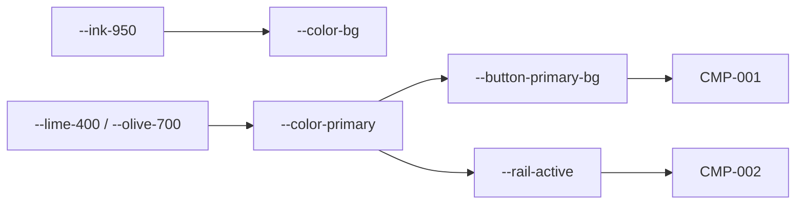

# 03. デザイントークン
> 版：v0.1（2026-11-06）｜ 関連：[02 方向性](02_visual_direction.md)

> **3行で**
> - 実装者の正本。色・文字・余白・形・動きの値はここだけに書く。
> - ライトとダークは別に色を決め、全組み合わせのコントラスト比を `contrast.py` で計算した。
> - 本文 16px、数字とコードは等幅・幅ぞろえ。影は使わない。

## 🧭 判断してほしいこと
| # | 種類 | 論点 | 選択肢 | おすすめ（理由） | 決まらないと止まるもの |
|---|---|---|---|---|---|
| R-11 | リスク | ダークの差し色のライムと成功の緑は近い色相 | — | 成功は必ずアイコンと文字を伴い、ライムを状態表示に使わない | CMP-006, CMP-009 |

## 全体図

見てほしいところ：主色はライトで濃いオリーブ、ダークでライムに切り替わる。

## 要点
- 色の役割はベース・メイン＋状態色。差し色はメインと兼ねる（アクセントの色は持たない）。
- 文字は1画面4段まで、太さは 400 と 700 の2種類。
- 影はなし。重なりは線と背景の明暗で示す。
- 色相だけに頼らず、差分は `+` と `−`、状態はアイコンと文字を付ける。
- フォントは同梱する（Web フォントの読み込みはしない）。

---

## 詳細

### 色
<details>
<summary>primitive（原色の段）</summary>

```css
:root {
  --ink-0:   #FFFFFF;
  --ink-50:  #F7F7F8;
  --ink-100: #ECEDEE;
  --ink-200: #DEDFE2;
  --ink-400: #9B9EA3;
  --ink-500: #74777C;
  --ink-600: #5F6368;
  --ink-700: #2C2D30;
  --ink-900: #1A1B1D;
  --ink-950: #141516;

  --lime-300: #D8F76A;
  --lime-400: #C8F031;
  --lime-ink: #15180B;
  --olive-700: #4F6000;
  --olive-800: #3F4D00;

  --red-300: #FF7B72;  --red-600: #C4291F;  --red-ink: #14100F;
  --amber-400: #F0B429;  --amber-700: #8A5A00;
  --green-300: #6FD08C;  --green-700: #1F7A3D;

  --diff-add-light: #E3F3E7;  --diff-del-light: #FBE6E4;
  --diff-add-dark:  #16301F;  --diff-del-dark:  #3A1B19;
}
```

</details>

| semantic トークン | ライト | ダーク | 用途 |
|---|---|---|---|
| `--color-bg` | `--ink-50` | `--ink-950` | ベース：ページの背景 |
| `--color-surface` | `--ink-0` | `--ink-900` | ベース：入力欄・カード・メニュー・ダイアログ |
| `--color-hover` | `--ink-100` | `--ink-700` | ベース：押せる行の hover と選択中 |
| `--color-fg` | `--ink-900` | `--ink-100` | ベース：本文 |
| `--color-muted-fg` | `--ink-600` | `--ink-400` | ベース：補足・数字の1行のラベル |
| `--color-line` | `--ink-200` | `--ink-700` | ベース：ペインの境の細線 |
| `--color-control` | `--ink-500` | `--ink-500` | ベース：入力欄の枠（UI 部品 3:1 以上） |
| `--color-primary` | `--olive-700` | `--lime-400` | メイン：主ボタン・リンク・現在地 |
| `--color-primary-hover` | `--olive-800` | `--lime-300` | メイン：主ボタンの hover |
| `--color-on-primary` | `--ink-0` | `--lime-ink` | メイン：主ボタンの文字 |
| `--color-danger` | `--red-600` | `--red-300` | 状態：却下・停止・失敗 |
| `--color-on-danger` | `--ink-0` | `--red-ink` | 状態：危険ボタンの文字 |
| `--color-warning` | `--amber-700` | `--amber-400` | 状態：承認待ち・時間切れ |
| `--color-success` | `--green-700` | `--green-300` | 状態：成功・合格・改善 |
| `--color-diff-add` | `--diff-add-light` | `--diff-add-dark` | 状態：差分の追加行の背景 |
| `--color-diff-del` | `--diff-del-light` | `--diff-del-dark` | 状態：差分の削除行の背景 |
| `--color-focus-ring` | `--olive-700` | `--lime-400` | メイン：フォーカスのリング |
| `--color-scrim` | `rgb(20 21 22 / 0.5)` | `rgb(0 0 0 / 0.6)` | ベース：ダイアログの背面 |
| `--chart-focus` | `--olive-700` | `--lime-400` | メイン：折れ線で選んだプリセット |
| `--chart-other` | `--ink-600` | `--ink-400` | ベース：その他のプリセット（線種と直接の名前で区別） |

### コントラスト表
`contrast.py` の計算値（2026-11-06）。

<details>
<summary>ライト</summary>

| 前景 | 背景 | 比 | 通常文字 AA | 大きい文字 AA | UI部品 |
|---|---|---|---|---|---|
| `--color-fg` #1A1B1D | `--color-bg` #F7F7F8 | 16.10:1 | OK | OK | OK |
| `--color-fg` | `--color-surface` #FFFFFF | 17.24:1 | OK | OK | OK |
| `--color-fg` | `--color-hover` #ECEDEE | 14.70:1 | OK | OK | OK |
| `--color-muted-fg` #5F6368 | `--color-bg` | 5.65:1 | OK | OK | OK |
| `--color-muted-fg` | `--color-surface` | 6.05:1 | OK | OK | OK |
| `--color-muted-fg` | `--color-hover` | 5.16:1 | OK | OK | OK |
| `--color-primary` #4F6000 | `--color-bg` | 6.53:1 | OK | OK | OK |
| `--color-primary` | `--color-surface` | 6.99:1 | OK | OK | OK |
| `--color-primary` | `--color-hover` | 5.96:1 | OK | OK | OK |
| `--color-on-primary` #FFFFFF | `--color-primary` | 6.99:1 | OK | OK | OK |
| `--color-on-primary` | `--color-primary-hover` #3F4D00 | 9.24:1 | OK | OK | OK |
| `--color-control` #74777C | `--color-bg` | 4.20:1 | 使わない | OK | OK |
| `--color-control` | `--color-surface` | 4.49:1 | 使わない | OK | OK |
| `--color-danger` #C4291F | `--color-bg` | 5.32:1 | OK | OK | OK |
| `--color-danger` | `--color-surface` | 5.70:1 | OK | OK | OK |
| `--color-on-danger` #FFFFFF | `--color-danger` | 5.70:1 | OK | OK | OK |
| `--color-warning` #8A5A00 | `--color-bg` | 5.54:1 | OK | OK | OK |
| `--color-warning` | `--color-surface` | 5.93:1 | OK | OK | OK |
| `--color-success` #1F7A3D | `--color-bg` | 5.02:1 | OK | OK | OK |
| `--color-success` | `--color-surface` | 5.37:1 | OK | OK | OK |
| `--color-success` | `--color-diff-add` #E3F3E7 | 4.67:1 | OK | OK | OK |
| `--color-danger` | `--color-diff-del` #FBE6E4 | 4.76:1 | OK | OK | OK |
| `--color-fg` | `--color-diff-add` | 14.97:1 | OK | OK | OK |
| `--color-fg` | `--color-diff-del` | 14.40:1 | OK | OK | OK |

</details>

<details>
<summary>ダーク</summary>

| 前景 | 背景 | 比 | 通常文字 AA | 大きい文字 AA | UI部品 |
|---|---|---|---|---|---|
| `--color-fg` #ECEDEE | `--color-bg` #141516 | 15.60:1 | OK | OK | OK |
| `--color-fg` | `--color-surface` #1A1B1D | 14.70:1 | OK | OK | OK |
| `--color-fg` | `--color-hover` #2C2D30 | 11.75:1 | OK | OK | OK |
| `--color-muted-fg` #9B9EA3 | `--color-bg` | 6.80:1 | OK | OK | OK |
| `--color-muted-fg` | `--color-surface` | 6.41:1 | OK | OK | OK |
| `--color-muted-fg` | `--color-hover` | 5.12:1 | OK | OK | OK |
| `--color-primary` #C8F031 | `--color-bg` | 13.90:1 | OK | OK | OK |
| `--color-primary` | `--color-surface` | 13.10:1 | OK | OK | OK |
| `--color-primary` | `--color-hover` | 10.47:1 | OK | OK | OK |
| `--color-on-primary` #15180B | `--color-primary` | 13.68:1 | OK | OK | OK |
| `--color-on-primary` | `--color-primary-hover` #D8F76A | 14.93:1 | OK | OK | OK |
| `--color-control` #74777C | `--color-bg` | 4.07:1 | 使わない | OK | OK |
| `--color-control` | `--color-surface` | 3.83:1 | 使わない | OK | OK |
| `--color-danger` #FF7B72 | `--color-bg` | 7.25:1 | OK | OK | OK |
| `--color-danger` | `--color-surface` | 6.84:1 | OK | OK | OK |
| `--color-on-danger` #14100F | `--color-danger` | 7.50:1 | OK | OK | OK |
| `--color-warning` #F0B429 | `--color-bg` | 9.81:1 | OK | OK | OK |
| `--color-warning` | `--color-surface` | 9.25:1 | OK | OK | OK |
| `--color-success` #6FD08C | `--color-bg` | 9.64:1 | OK | OK | OK |
| `--color-success` | `--color-surface` | 9.09:1 | OK | OK | OK |
| `--color-success` | `--color-diff-add` #16301F | 7.50:1 | OK | OK | OK |
| `--color-danger` | `--color-diff-del` #3A1B19 | 6.17:1 | OK | OK | OK |
| `--color-fg` | `--color-diff-add` | 12.13:1 | OK | OK | OK |
| `--color-fg` | `--color-diff-del` | 13.26:1 | OK | OK | OK |

</details>

使わない組：`--color-control` は枠線専用で、文字に使わない。ライム #C8F031 をライトの背景に置かない（#F7F7F8 に 1.23:1）。

### 文字
| トークン | 大きさ | 太さ | 行間 | 字間 | フォント | 用途 |
|---|---|---|---|---|---|---|
| `--text-metric` | 40px | 400 | 1.1 | 0 | 等幅 | 正解率など一番大きな数字 |
| `--text-title` | 20px | 700 | 1.4 | 0 | 和文 | ページの見出し |
| `--text-body` | 16px | 400 | 1.7 | 0.02em | 和文 | 本文・会話 |
| `--text-small` | 14px | 400 | 1.5 | 0.01em | 和文 | ラベル・補足・表 |
| `--text-code` | 14px | 400 | 1.6 | 0 | 等幅 | コード・差分・端末・数字の1行 |

- `--font-sans`：`"Noto Sans JP", "Yu Gothic UI", "Meiryo", sans-serif`。
- `--font-mono`：`"JetBrains Mono", "Noto Sans JP", "Consolas", monospace`。
- `--numeric`：`font-variant-numeric: tabular-nums`。数字を出す所すべて。
- フォントはアプリに同梱し、`app://` から読む。太さは 400 と 700 だけ。`font-display: block`。ライセンス表示は CP-184。

### 余白・レイアウト
| トークン | 値 | 用途 |
|---|---|---|
| `--space-1` | 4px | グループ内 |
| `--space-2` | 8px | グループ内 |
| `--space-3` | 12px | グループ内 |
| `--space-4` | 16px | 部品の内側 |
| `--space-5` | 24px | グループ間 |
| `--space-6` | 32px | グループ間 |
| `--space-7` | 48px | グループ間 |
| `--rail-width` | 48px | アイコン列 |
| `--list-width` | 280px | 一覧 |
| `--panel-width` | 440px | 右パネル |
| `--thread-max` | 760px | 会話の1列の最大幅（和文 45 字前後） |
| `--form-max` | 640px | フォームの最大幅 |
| `--row-height` | 36px | 一覧・表の行 |
| `--control-height` | 36px | ボタン・入力欄 |
| `--control-height-sm` | 28px | 小さなボタン |
| `--icon-size` | 18px | Lucide の大きさ（線幅 1.75） |

### 形・奥行き
| トークン | 値 | 用途 |
|---|---|---|
| `--radius` | 4px | ボタン・入力欄・カード |
| `--radius-lg` | 6px | ダイアログ・メニュー |
| `--radius-full` | 999px | 状態の点 |
| `--line-width` | 1px | 細線 |
| `--focus-width` | 2px | フォーカスのリング（外側に 2px 離す） |
| `--z-sticky` / `--z-panel` / `--z-menu` / `--z-dialog` / `--z-toast` | 10 / 20 / 30 / 40 / 50 | 重なり |

影のトークンは持たない。

### 動き
| トークン | 値 |
|---|---|
| `--duration-fast` | 120ms |
| `--duration-normal` | 200ms |
| `--duration-slow` | 280ms |
| `--duration-spin` | 800ms（スピナーの1周） |
| `--duration-pulse` | 1200ms（脈打つ点の1周） |
| `--ease-out` | `cubic-bezier(0.23, 1, 0.32, 1)` |
| `--ease-in-out` | `cubic-bezier(0.77, 0, 0.175, 1)` |

### component トークン
| トークン | 参照先 | 使う CMP |
|---|---|---|
| `--button-primary-bg` | `--color-primary` | CMP-001 |
| `--button-primary-fg` | `--color-on-primary` | CMP-001 |
| `--rail-active` | `--color-primary` | CMP-002 |

## このドキュメントで決まったこと
- [D-14〜D-16, D-23](00_brief.md#決定事項ログ)
