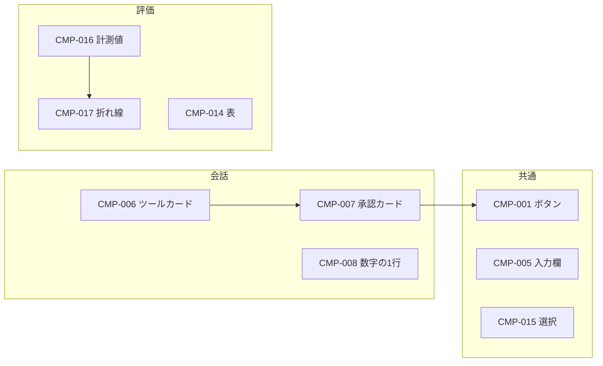

# 04. コンポーネント
> 版：v0.5（2026-11-08）｜ 関連：[03 トークン](03_tokens.md)・[05 画面](05_screens.md)

> **3行で**
> - 部品は22個。操作の土台は Radix Primitives、見た目は自作 CSS、アイコンは Lucide。
> - 押せる物だけに主色と hover を使い、表示だけの箱は反応させない。
> - 主役は状態の違いを見せる部品（承認カード・数字の1行・計測値）。

## 🧭 判断してほしいこと
なし

## 全体図

見てほしいところ：承認カードはツールカードの状態の1つとして作る。

## 要点
- 全部品の共通の状態は[共通の状態](#共通の状態)に1つにまとめた。
- 高さは `--control-height`、角丸は `--radius` で統一する。
- 1画面の主ボタンは1つ。承認待ちの間はメインの主ボタンは「承認」になる。
- アイコンだけのボタンには必ず `aria-label` とツールチップを付ける。
- 絵文字は使わない。

---

## 詳細

### 部品一覧
| ID | 名前 | 使う PG | 土台 |
|---|---|---|---|
| CMP-001 | ボタン | 全 PG | 自作 |
| CMP-002 | アイコン列 | PG-001, 003〜008, 010 | Radix Tooltip |
| CMP-003 | 検索欄 | PG-001, PG-003 | 自作 |
| CMP-004 | 一覧の行 | PG-001, 004, 005, 010 | Radix Context Menu |
| CMP-005 | 入力欄 | PG-001, 004, 005, 008, 010 | 自作 |
| CMP-006 | ツール呼び出しカード | PG-001, PG-006 | Radix Collapsible |
| CMP-007 | 承認カード | PG-001 | 自作 |
| CMP-008 | 数字の1行 | PG-001 | 自作 |
| CMP-009 | 状態の帯 | PG-001, 003〜008 | 自作 |
| CMP-010 | 差分ビュー | PG-001, PG-006 | 自作 |
| CMP-011 | 端末ビュー | PG-001 | 自作 |
| CMP-012 | 進捗バー | PG-001, 002, 003, 006, 009 | Radix Progress |
| CMP-013 | タブ | PG-001, 003, 007 | Radix Tabs |
| CMP-014 | 表 | PG-003, 005, 006, 007 | 自作 |
| CMP-015 | 選択部品 | PG-001, 004, 005, 006, 007, 008 | Radix Select / Switch / Radio |
| CMP-016 | 計測値 | PG-006, PG-007 | 自作 |
| CMP-017 | 折れ線 | PG-007 | 自作（SVG） |
| CMP-018 | 横並び比較 | PG-007 | 自作 |
| CMP-019 | ダイアログ | PG-001, 003, 004, 005, 006, 009 | Radix Dialog |
| CMP-020 | メニュー | PG-001, 004, 005 | Radix Dropdown Menu |
| CMP-021 | トースト | 全 PG | Radix Toast |
| CMP-022 | Markdown 本文 | PG-001 | 自作 |
| CMP-023 | 歌詞エディタ | PG-010 | 自作 |
| CMP-024 | エフォートのバー | PG-001 | Radix Popover＋range |

### 共通の状態
| 状態 | 見た目 | 動き |
|---|---|---|
| hover（マウスのみ） | 押せる物だけ `--color-hover` の背景か `--color-primary-hover` | MOT-002 |
| active | 押した反応 | MOT-001 |
| focus-visible | `--focus-width` のリング `--color-focus-ring`（文字を打つ欄は付けない。CMP-005） | 動かさない |
| disabled | 文字を `--color-muted-fg`、カーソル変更、hover なし | — |
| loading | 文言はそのまま、左に小さなスピナー、二重送信不可 | MOT-006 |
| error | 枠と文を `--color-danger`、アイコンと文言を添える | — |

### CMP-001 ボタン
- 役割：操作を実行する。
- バリエーション：primary / secondary / ghost / danger。
- サイズ：`--control-height` / `--control-height-sm`。マウス前提なので当たり判定は `--control-height-sm` 以上（WCAG 2.2 の 24px を満たす）。
- 使うトークン：`--button-primary-bg`、`--button-primary-fg`（`--color-on-primary`）、`--color-danger`、`--color-on-danger`、`--color-line`。文字は `--color-fg`。
- 押せることの見せ方：primary は塗り、secondary は枠線、ghost は hover で背景、danger は塗り（承認カードの却下は secondary＋`--color-danger` の文字）。

### CMP-002 アイコン列
- 役割：5つのページへ移動する（CP-001〜CP-005）。
- 幅は `--rail-width`。アイコンのみで文字は出さない。名前はツールチップ（遅延あり、続けて指すと遅延なし）と `aria-label` で示す。
- 現在地：左端に `--rail-active` の線＋アイコンを主色に。色だけに頼らないよう `aria-current` も付ける。
- 更新ありのとき：設定に `--color-warning` の点。読み上げ用の名前を足す。

### CMP-003 検索欄
- 役割：一覧を絞る。ラベルは CP-029 / CP-091 を `aria-label` とプレースホルダーの両方に使う。
- 虫眼鏡のアイコン。入力中は消去ボタン。

### CMP-004 一覧の行
- 役割：スレッド・プリセット・評価セットを選ぶ。行全体が1つのリンク。
- 高さ `--row-height`。選択中は `--color-hover`＋左の主色の線。
- 右クリックと `…` ボタンで CMP-020。実行中のスレッドは行の右に状態の点。`…` は hover とフォーカスの間だけ右端に重ねて出し、その間は行の右の印を隠す（普段はタイトルの幅を取らない）。
- 長いタイトルは列の幅で省略する（列を広げない）。
- プロジェクトの見出し行（SEC-001-02、2026-11-06 変更）は CMP-004 の行の見た目を使わない。文字の大きさ・色・太さだけで区切り、hover と選択で面を塗らない。名前の右の `…` と ＋ は hover かフォーカスのときだけ出す（現状どおり）。

### CMP-005 入力欄
- 役割：文字を入れる。単一行 / 複数行 / 数値。
- 枠 `--color-control`、背景 `--color-surface`、`--radius`。ラベルは常に欄の上に出す（CP を参照）。
- 指示の入力欄だけは例外で、ラベルを読み上げ専用にし、案内の文（CP-021）で用途を示す。枠は入力欄を囲む1つの箱（`--radius-lg`）が持ち、下の段にフォルダ・数字の1行・プリセット選択・送信（アイコン）を入れる。
- 箱の内側の余白は四辺とも `--space-3`。入力欄自体は左右の余白を持たず、案内の文と下の段の左端、入力欄の右端と送信の右端をそろえる。下の段は入力欄から `--space-2` 離す。
- 指示の入力欄は最大 10 行まで伸び、それ以上は内部でスクロール（スクロールバーは出さない）。Enter で送信、Shift+Enter で改行（NFR-031）。
- エラーは欄の下に赤い文字＋アイコン。
- フォーカスのリングは付けない（検索欄も同じ）。キャレットで打てる場所を示す。

### CMP-006 ツール呼び出しカード
- 役割：エージェントの1回の操作を見せる。折りたたみ。
- 閉じた形は1行：状態アイコン＋ツール名＋対象パス（等幅）。押せるのは行全体。
- 状態（CP-036〜CP-042）：

  | 状態 | アイコン | 色 |
  |---|---|---|
  | 承認待ち | `circle-pause` | `--color-warning` |
  | 実行中 | `loader` | `--color-muted-fg` |
  | 成功 | `check` | `--color-success` |
  | 失敗 / 時間切れ | `x` / `timer-off` | `--color-danger` |
  | 却下 / 拒否 | `ban` | `--color-muted-fg` |

### CMP-007 承認カード
- 役割：書き込みとコマンドの実行を判断する。CMP-006 の承認待ちが開いた形。
- 中身：差分のプレビューかコマンドと cwd、CP-043〜CP-045。
- 「承認」が primary、「却下」が secondary、「以後自動で承認」が ghost。Tab 順もこの順。開いたらフォーカスを「承認」に移さず、`aria-live` で知らせる（誤操作を防ぐ）。
- 「却下」を押すと理由欄（CP-046）が出る。

### CMP-008 数字の1行
- 役割：入力欄の下（CMP-005 の箱の中）に計測値を1行で出す。押せない。
- 左から：状態の点＋プリセットの状態、Context の円と文脈長（例：32K。円の右に `--space-2` で並べ、1つの項目として扱う。使用率は弧の長さで見せ、ラベルと % の数字はホバーと読み上げだけ）、t/s（数字があるときと生成中だけ）、ツール n/40。項目の間は `--space-3`。`--text-code`、`--color-muted-fg`、`--numeric`。
- 文脈が 80% を超えたら円の弧を `--color-warning` にする（自動要約が近い）。使用率が不明なら輪だけ出す。
- チャットのスレッドではツールを出さない。生成中だけ t/s の横に脈打つ点（MOT-005）。
- 画像モデルを選んでいる間は、円と文脈長を出さない（文脈を使わないため）。

### CMP-009 状態の帯
- 役割：実行中と異常を知らせる。ウィンドウ上端の全幅。何もないときは出さない（高さも取らない）。
- 種類：情報（読み込み中・評価中）/ 警告（承認待ち）/ エラー。背景は `--color-surface`＋下の細線、左にアイコン、文字だけ状態色。複数あるときはエラー → 警告 → 情報の順で1本にする。

### CMP-010 差分ビュー
- 役割：ファイルの変更を unified で見せる。`--text-code`。
- 追加行 `--color-diff-add`、削除行 `--color-diff-del`、行頭に `+` と `−` を必ず出す。
- 上にファイル一覧（パス＋ +n −n）。

### CMP-011 端末ビュー
- 役割：コマンドの出力を流す。コマンドごとに区切り線、終了コードを右に等幅で出す。
- 背景 `--color-bg`、`--text-code`。自動スクロールは一番下にいるときだけ。

### CMP-012 進捗バー
- 役割：割合が分かる待ち。高さ `--space-1`、`--radius-full`、主色の塗り。右に数字（%・残り時間）を等幅で出す。割合が不明なときは数字を出さず「読み込み中」の文字だけ。

### CMP-013 タブ
- 役割：同じ画面の中身を切り替える。文字＋下の主色の線。キーボードは矢印で移動。

### CMP-014 表
- 役割：比べる。行の高さ `--row-height`、見出しは `--text-small`＋`--color-muted-fg`、線は行の間だけ `--color-line`、数字は右揃え・等幅。
- 行全体が押せる表だけ hover を付ける（押せない表には付けない）。50 行を超えたら表示中の分だけ描く。

### CMP-015 選択部品
- セレクト（プリセット選択など）、スイッチ（思考モード）、ラジオ（テーマ・○× 採点）。選択中の印に主色を使う。プリセット選択は名前を等幅にしない。メインのプリセット選択は入力欄の右下に枠なしの小さい形で置き、メニューは右端にそろえる。この小さい形は ⌄ を 14px にして文字から `--space-1` の位置に置き（左右に広げない）、余白は左 `--space-2`・右 `--space-1`。プリセットと思考と送信の間は `--space-1`。
- 入力欄の思考は2つに分ける（D-76, D-92）。オンオフは脳のアイコン（Lucide の `Brain`）の切り替えボタンで、オンは `--color-primary`、オフは `--color-muted-fg`。ボタンの読み上げ名とツールチップは CP-315・CP-316 で今の状態を示す。段階（低・中・高）は CMP-024 のバーで、オンの間だけ出す。切れないモデル（段階だけ）はボタンを出さず、段階のバーだけ出す。編集画面（SEC-004-02）は1つのセレクトのまま。

### CMP-016 計測値
- 役割：大きな数字を見せる。押せない。`--text-metric`＋ラベルは `--text-small`。差は `+15.0` を等幅で添え、上がれば `--color-success`＋↗、下がれば `--color-danger`＋↘。

### CMP-017 折れ線
- 役割：正解率の推移。線の色は `--chart-focus` が選んだプリセット、他は `--chart-other` で実線・破線・点線に変える。線の端に名前を直接書き、凡例は置かない。点に hover で値を出す。折れ線の代わりに読める表を `aria` で用意する。

### CMP-018 横並び比較
- 役割：ケースの A・B の応答を左右に並べる。同じ高さでスクロールを連動させる。

### CMP-019 ダイアログ
- 役割：確認と短い手続き。`--radius-lg`、枠線 `--color-line`、背面 `--color-scrim`。Esc で閉じる。消す操作の主ボタンは danger。

### CMP-020 メニュー
- 役割：名前変更・複製・削除。`--radius-lg`、枠線 `--color-line`。削除は `--color-danger` の文字。

### CMP-021 トースト
- 役割：完了の知らせ（CP-019 など）。右下に出て 4 秒で消える。フォーカスは奪わない。エラーはトーストにせず帯か欄の下に出す。

### CMP-022 Markdown 本文
- 役割：AI の回答の表示（D-57）。見出し・リスト・表・コードブロックを整形する。生成中は届いた分を順に整形し、閉じていないコードブロックもコードとして見せる。
- コードブロックは言語ごとに色分けし、コピーボタンを付ける。本文中の生の HTML は実行せず、文字として出す。

### CMP-024 エフォートのバー
- 役割：入力欄で思考の段階を選ぶ（D-92）。今の段階を CMP-015 の小さい形のボタンで見せ、押すと入力欄の上に幅 260px のカードを開く。外を押すか Esc で閉じる。
- カード：上の中央に今の段階（CP-317〜319、`--color-primary`）、右上に既定（中）へ戻す ↺（Lucide の `RotateCcw`。CP-368）、下に丸いつまみのバー。目盛りは選択肢の数だけ（低・中・高の3つ）。
- バーの色（D-38）：高さ 32px、地は `--color-hover`。左端からつまみの中心までを `--color-primary` で塗る。つまみは直径 28px の `--color-fg` で、周りに 2px の `--color-surface` の輪を付けて塗りと分ける。目盛りは塗りの外で `--color-muted-fg`、塗りの中で `--color-on-primary`。段の違いは塗りの長さと上の文字で示し、色は変えない。使えないときは塗りとつまみを `--color-muted-fg` にする。
- 操作：クリック・ドラッグ・矢印キーで動かす。ドラッグの間はつまみと塗りが指についてきて、文字は段の中間を越えた所で切り替わる。離すと一番近い段へ吸い付く（MOT-012）。保存は指かキーを離したときで、途中の段階は保存しない。開くとバーにフォーカスを移す。今が既定なら ↺ は押せない。生成中は開けない。読み上げ名は CP-314、値は今の段階。

### CMP-023 歌詞エディタ
- 役割：歌詞の入力と構成タグの挿入（FR-024）。上にタグのボタン7つ、下に複数行の入力欄（CMP-005 の複数行）。
- タグのボタンは小さな文字のボタンで、折り返して並べる。読み上げには CP-355 を使う。実行中はボタンも入力欄も使えない。

## このドキュメントで決まったこと
- [D-19〜D-21](00_brief.md#決定事項ログ)
