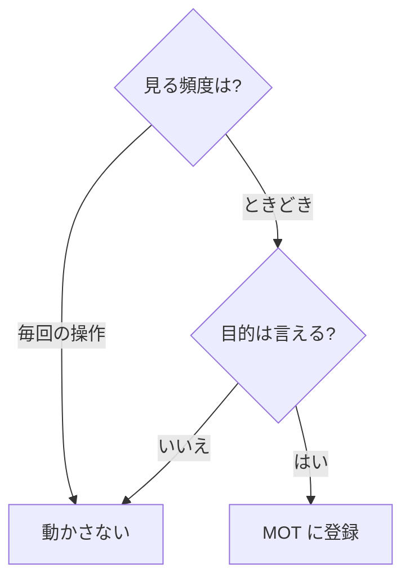

# 06. 動き・操作感
> 版：v0.2（2026-11-08）｜ 関連：[03 トークン](03_tokens.md)・[04 部品](04_components.md)

> **3行で**
> - 動きは標準（ダイヤル 5）で、押した反応と開閉に使う。
> - 選んだ演出は右パネルのスライド、数字の切り替わり、生成中の脈打つ印の3つ。
> - 毎日何十回も見る切り替えとキーボード操作は動かさない。

## 🧭 判断してほしいこと
なし

## 全体図

## 要点
- 動かすのは `transform` と `opacity` だけ。例外は MOT-011 の `background-position`（ユーザーの希望）。
- UI の動きは `--duration-slow` 以内。繰り返す3つ（スピナー・脈打つ印・生成中の文）だけ別の長さ。
- 目立つ動きは1画面に2つまで。
- 全 MOT に reduced-motion の代わりがある。

---

## 詳細

### MOT 一覧
| ID | 対象 | きっかけ | 目的 | 動き | 長さ | イージング | reduced-motion のとき | 頻度 |
|---|---|---|---|---|---|---|---|---|
| MOT-001 | CMP-001, CMP-004 | 押す | 押した反応 | scale 1→0.97 | `--duration-fast` | `--ease-out` | 色の変化のみ | 高 |
| MOT-002 | CMP-001, CMP-004, CMP-014 | hover | 押せると示す | 背景色の変化 | `--duration-fast` | `--ease-out` | そのまま | 高 |
| MOT-003 | PG-001 右パネル | 開く・閉じる | 自動で開いても出どころが分かる | translateX 100%→0 | 開く `--duration-slow` / 閉じる `--duration-normal` | `--ease-out` | opacity のみ | 中 |
| MOT-004 | CMP-016 | 値の確定・ラン切替 | 計測値が変わったと分かる | 数字を前の値から数え上げる | `--duration-slow` | `--ease-out` | 即時に切り替え | 低 |
| MOT-005 | CMP-008 | 生成中 | 動いていると分かる | 点の opacity 1→0.4 の繰り返し | `--duration-pulse` | `--ease-in-out` | 点は止めて t/s の値だけ更新 | 中 |
| MOT-006 | CMP-001, CMP-006 | 処理中 | 待ちの表示 | 回転の繰り返し | `--duration-spin` | linear | 止めて「実行中」の文字を残す | 中 |
| MOT-007 | CMP-019 | 開く・閉じる | 前後関係 | opacity 0→1, scale 0.95→1（中央から） | 開く `--duration-normal` / 閉じる `--duration-fast` | `--ease-out` | opacity のみ | 低 |
| MOT-008 | CMP-002 のツールチップ, CMP-020 | 開く | 急な出現の違和感を消す | opacity 0→1, scale 0.95→1（押した位置から） | `--duration-fast` | `--ease-out` | opacity のみ | 中 |
| MOT-009 | CMP-021 | 出る・消える | 完了を知らせる | translateY 8px→0, opacity | `--duration-normal` | `--ease-out` | opacity のみ | 低 |
| MOT-010 | CMP-006 | 開く・閉じる | 開閉の状態 | 矢印の回転のみ。中身は動かさず即時 | `--duration-fast` | `--ease-out` | 回転なし | 高 |
| MOT-012 | CMP-024 | 押す・指を離す・矢印キー・↺ | 段の間を移ったと目で追える | つまみと塗りの端が今の位置から段まで滑る（`translateX`）。途中で次の操作が来たら、その位置から向きを変える。ドラッグの間は指に直接ついていき、この動きは使わない | `--duration-normal` | `--ease-out` | 即時に切り替え。ドラッグでは指についていく | 中 |
| MOT-011 | PG-001 の生成中の文（画像・曲） | 生成中 | 止まっていないと分かる | 文字の上を明るいグラデーションが左から右へ流れる繰り返し（`background-position`） | `--duration-shimmer` | linear | 文字は止めて `--color-muted-fg` のまま、文言の切り替えだけ残す | 中 |

右パネルが開くとき、会話の幅はスライドの終わりに一度で変える（`width` を動かさない）。

### 動かさないもの
| 対象 | 理由 |
|---|---|
| アイコン列でのページ移動 | 頻度が高い。ユーザーが演出から外した |
| タブの切り替え | 頻度が高い |
| 生成中の文字の流れ | 文字そのものが動きなので足さない |
| 文脈 % と t/s の変化 | 生成中に変わり続けるため数え上げない |
| キーボードで起こした操作 | 待たせない。例外は MOT-012 で、値は押した瞬間に変わり、つまみの位置だけが追いかける（D-38） |
| 一覧・表のスクロール | 目的がない |

### 演出の採否
| 演出 | 採否 | 理由 |
|---|---|---|
| 右パネルのスライド | 採用 | D-22 |
| 数字の切り替わり | 採用 | D-22 |
| 生成中の脈打つ印 | 採用 | D-22 |
| 画面の切り替えフェード | 不採用 | ユーザー回答 |

## このドキュメントで決まったこと
- [D-06, D-22, D-38](00_brief.md#決定事項ログ)
