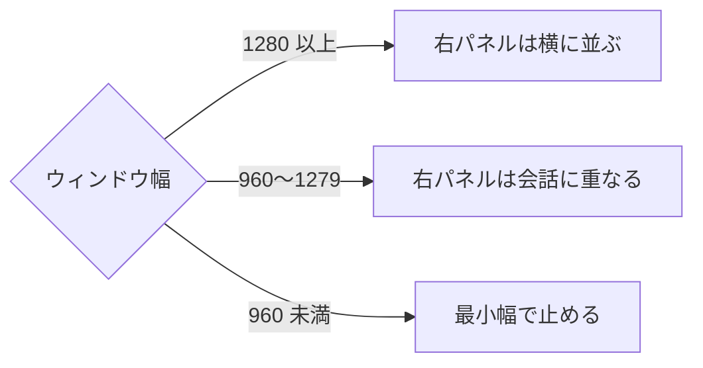

# 07. ウィンドウ幅・アクセシビリティ・表示速度
> 版：v0.1（2026-11-06）｜ 関連：[03 トークン](03_tokens.md)・[05 画面](05_screens.md)

> **3行で**
> - PC 専用なのでスマホ幅は作らず、ウィンドウの幅で右パネルの置き方を変える。
> - 目標は WCAG 2.2 AA。コントラストは全組み合わせを計算済み。
> - フォントは同梱で、外への通信は増やさない。

## 🧭 判断してほしいこと
| # | 種類 | 論点 | 選択肢 | おすすめ（理由） | 決まらないと止まるもの |
|---|---|---|---|---|---|
| R-13 | リスク | Noto Sans JP の同梱でインストーラーが増える。実際の増加量は未計測 | — | 400 と 700 を JIS 第1・第2水準に絞って woff2 にし、実装の最初に測る | NFR、ビルド |

## 全体図

## 要点
- ウィンドウの最小は 960×600。localhost 段階のブラウザでは最小を強制できないので、960px 未満でも崩れない範囲にとどめ、作り込まない。
- フォーカスは文字を打つ欄（CMP-005 と検索欄）を除く全部品で `--color-focus-ring`。文字を打つ欄はキャレットで示す。
- 色だけで状態を伝えない。
- アイコン列はアイコンのみなので、ツールチップと `aria-label` が必須。
- 画像は使わず、外部読み込みもない。

---

## 詳細

### ウィンドウ幅ごとの変化
| 幅 | アイコン列 | 一覧 | 右パネル | 計測の画面 |
|---|---|---|---|---|
| 960〜1279 | あり | `--list-width` | 会話に重ねる（仕様 06 のとおり） | PG-007 は左右の比を保つ |
| 1280〜1439 | あり | `--list-width` | 横に並ぶ | 同上 |
| 1440 以上 | あり | `--list-width` | 横に並ぶ | 同上 |

スキル既定の 375 / 768 は対象外（Electron の PC アプリのため。ウィンドウの最小幅で止まり、横スクロールは出ない）。

### アクセシビリティ
| 項目 | 方針 | 根拠 |
|---|---|---|
| コントラスト | [03 の表](03_tokens.md#コントラスト表) のとおり | ux-rules §1 |
| フォーカス | 文字を打つ欄を除く全操作要素に `--focus-width` のリング（欄はキャレットで示す）。Tab 順は見た目の順 | ux-rules §1、NFR-031 |
| キーボード | Enter 送信、Shift+Enter 改行、承認カードは Tab と Enter で押せる | NFR-031 |
| 当たり判定 | マウス前提で 28px 以上（`--control-height-sm`） | WCAG 2.2 の 24px |
| 見出し | 各ページ h1 は1つ。見出しを見せないページは読み上げ専用で置く | ux-rules §1 |
| 代替テキスト | アイコンだけのボタンは `aria-label`。折れ線は同じ内容の表を読み上げ用に持つ | ux-rules §1 |
| フォーム | ラベルは常に表示、エラーは欄の下 | ux-rules §8 |
| 状態の知らせ | 承認待ちと生成の完了は `aria-live="polite"`、エラーは `assertive` | ux-rules §1 |
| 色 | 差分は `+` `−`、状態はアイコンと文字 | ux-rules §1 |
| 動き | reduced-motion は [06](06_motion.md#mot-一覧) | ux-rules §7 |
| テーマ | 初期は OS に合わせる。設定で固定できる（FR-020） | D-08 |

### 表示速度
| 項目 | 方針 |
|---|---|
| フォント | 同梱・400 と 700 のみ・woff2。`font-display: block` で切り替わりのちらつきを防ぐ |
| 画像 | 画面に画像は使わない。アイコンは Lucide の SVG |
| 長い一覧 | 表とスレッド一覧は 50 行を超えたら表示中の分だけ描く |
| 長い会話 | 長いスレッドも画面外のメッセージは描かない |
| 生成中の描画 | 文字の更新はフレームごとにまとめる |
| レイアウトのずれ | 帯は出るときに本体を押し下げる。数字は幅ぞろえで揺らさない |

## このドキュメントで決まったこと
- [D-08, D-16](00_brief.md#決定事項ログ)
