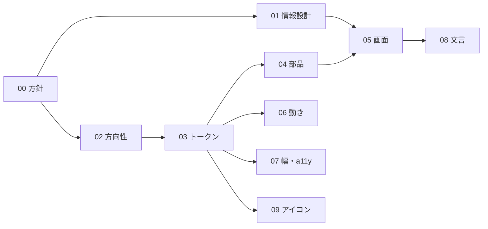

# LLM-PARTY UI 設計書
> **3行で**：手元の GGUF を動かす Windows アプリの画面を、計測器のように作る設計一式 ／ 起動画面は入力欄が主役で、文脈率や速度の数字を入力欄の下に常に出す ／ 色は無彩色に差し色のライム1色、評価の画面では数字を一番大きく見せる

## ひと目で分かる方向性
| 項目 | 決定 |
|---|---|
| トーン | 先進・テック |
| スタイル | 計測器（数字が主役・細線・影なし・角丸 4px） |
| 配色（ダーク） | ■ #141516 背景 ■ #ECEDEE 文字 ■ #9B9EA3 補足 ■ #C8F031 主色 |
| 配色（ライト） | □ #F7F7F8 背景 ■ #1A1B1D 文字 ■ #5F6368 補足 ■ #4F6000 主色 |
| 文字 | Noto Sans JP（本文 16px・行間 1.7）、JetBrains Mono（数字・コード）。どちらも同梱 |
| ダイヤル | 個性 5 / 動き 5 / 密度 5 |
| 動き | 標準＋右パネルのスライド・数字の切り替わり・生成中の脈打つ印 |
| 文章の声 | 体言止め、例外なし |

## 🧭 判断してほしいこと（全ドキュメントから集約）
| # | 種類 | 論点 | おすすめ | 決まらないと止まるもの | 詳細 |
|---|---|---|---|---|---|
| R-11 | リスク | ライムと成功の緑が近い | 成功は必ずアイコンと文字を伴う | CMP-006, CMP-009 | [03](03_tokens.md#-判断してほしいこと) |
| R-12 | リスク | アイコンが棒グラフに見えやすい | タスクバーで実物を見て判断 | ICN-001 | [09](09_icon.md#-判断してほしいこと) |
| R-13 | リスク | Noto Sans JP の同梱でインストーラーが増える（未計測） | 2太さ・JIS 第2水準までに絞り、実装の最初に測る | ビルド | [07](07_responsive_a11y.md#-判断してほしいこと) |

仕様側の未決（Q-02, Q-06）は [設計書 README](../README.md)。UI の Q-11〜Q-13 は決着済み（[D-26〜D-28](00_brief.md#決定事項ログ)）。

## 全体図

## 読む順番
1. [00_brief](00_brief.md) → [02_visual_direction](02_visual_direction.md)（雰囲気をつかむ）
2. [03_tokens](03_tokens.md)（実装者の正本）
3. [01_ia](01_ia.md) → [05_screens](05_screens.md)（画面の中身）
4. [08_copy](08_copy.md)（文言の正本。そのまま使う）
5. [04_components](04_components.md) → [06_motion](06_motion.md) → [07_responsive_a11y](07_responsive_a11y.md) → [09_icon](09_icon.md)

## 最近の変更
- 2026-11-06：サイドバーを「整理された一覧」に変更（D-30〜D-32、[変更レポート](changes/2026-11-06-sidebar-list.md)）
- 2026-11-07：入力欄の下の段の並びと余白を整える（D-36、[変更レポート](changes/2026-11-07-composer-foot.md)）
- 2026-11-08：エフォートのバーを滑らかに動かし、主色の塗りを付ける（D-38、[変更レポート](changes/2026-11-08-effort-bar.md)）
- 2026-11-08：入力欄の思考のオンオフをボタンに分ける（D-37）
- v0.1 初版（2026-11-06）
